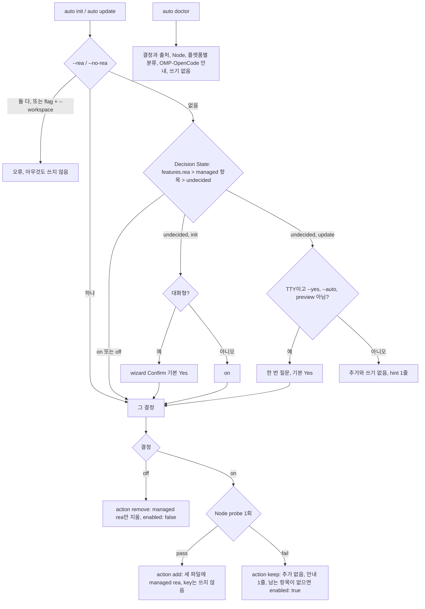
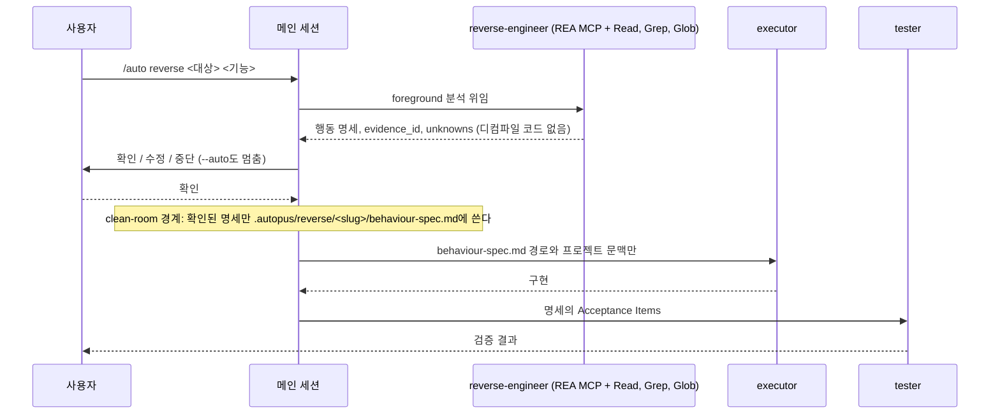

# SPEC-REA-001 구현 계획

## Tasks

기준은 origin/main `4d73aa91`이고 branch는 `feat/rea-001`이다. 순서: T1 → T2 → (T3, T4, T8) → T5·T6·T7(T3, T4 뒤) → T9(T4, T8 뒤) → T10 → T11·T12·T13(T9 뒤) → T15 → T14·T16(T15 뒤) → T17 → T18 → T19 → T20 → T21. `update.go`(292줄), `update_workspace.go`(300), `doctor_json_checks.go`(293), `wizard_steps.go`(268)에는 호출 몇 줄만 더하거나 손대지 않는다.

- [ ] T1: risk-first probe. A1(실제 터미널, dispatch는 동의 뒤)과 A2(scratch, 동의 뒤)를 T5–T7·T14 전에 돌려 아래 표와 `evidence/`에 남긴다. 돌리지 못하면 not-run 그대로 두고 문서 기본값으로 진행하며 CD-1이 남는다. 소스 변경 없음 (REQ-REA-03, 10).
- [ ] T2: 기존 test 분류. 수 고정(16·17), frozen route 목록, compose golden, literal 16개 fixture, MCP inventory, CLI init 출력 비교를 spec.md Existing Test Changes 규칙으로 파일마다 정해 `[NEW] evidence/test-classification.md`에 남긴다. 소스 변경 없음 (REQ-REA-20).
- [ ] T3: 결정 key. 소유 `pkg/config/schema.go`(+1줄), `pkg/config/runtime.go`(+1줄), `[NEW] pkg/config/rea_feature.go`(+test). `ReaFeaturesConf{Enabled *bool}`(`yaml:"rea,omitempty"`), `ReaMCPAction`(zero `keep`, `add`, `remove`), `RuntimeConf.ReaMCP`(yaml `-`). 거부는 기존 strict loader가 한다 (REQ-REA-01, 16).
- [ ] T4: REA 모양과 분류. 소유 `[NEW] pkg/reamcp/shape.go`(+test): `Pin = "6.5.0"`, `ManagedPins`, Claude·Antigravity JSON 모양, Codex 세 줄, JSON·Codex 분류(absent, managed, other_pin, user_owned) (REQ-REA-03, 04, 08).
- [ ] T5: Claude. 소유 `[NEW] pkg/adapter/claude/claude_rea_mcp.go`(+test), `claude_files.go`(managed 삭제 loop에서 rea 제외, action 적용 호출), `claude_clean.go`(clean = remove) (REQ-REA-03, 04, 16).
- [ ] T6: Codex. 소유 `[NEW] pkg/adapter/codex/codex_rea_mcp.go`(+test), `codex_settings.go`(merge 뒤 section 적용), `codex_clean_merge.go`(generic clean 전에 managed section과 앞 빈 줄 제거). `codexManagedConfigKeys`에는 넣지 않는다 (REQ-REA-03, 04, 16).
- [ ] T7: Antigravity. 소유 `[NEW] pkg/adapter/antigravity/antigravity_rea_mcp.go`(+test), `antigravity_settings.go`(merge 뒤 적용, key 삭제 가능), `antigravity_lifecycle_clean.go`(현재 렌더와 무관하게 managed 제거) (REQ-REA-03, 04, 16).
- [ ] T8: Node gate. 소유 `[NEW] pkg/reamcp/node.go`(+test: `NodeVersionStatus`), `[NEW] internal/cli/rea_node_probe.go`(+test: seam `reaNodeProbe`, POSIX login shell·Windows PATH, 5초, 실행당 1회 memo), `internal/cli/pipeline_backend_omp_rpc_test.go`의 `TestMain`이 seam을 `v24.11.0`으로 고정 (REQ-REA-05, 20).
- [ ] T9: 결정 판정. 소유 `[NEW] internal/cli/rea_decision.go`(+test): `resolveReaDecision`(key > managed 항목 > undecided, 선택된 대상 플랫폼 파일만), action, M, 쓰기 표, 등록 줄, 옛 바이너리 줄, Node 안내, OMP·OpenCode 안내, Form Text ko/en (REQ-REA-01, 03, 05, 09, 17).
- [ ] T10: wizard. 소유 `[NEW] internal/cli/tui/wizard_rea_step.go`(+test), `wizard_steps.go`(`InitWizardOpts`·`InitWizardResult` 1줄씩, reviewgate 뒤 entry, `defaultResult` 기본 Yes). flag가 있거나 대상 플랫폼이 없으면 단계를 건너뛴다 (REQ-REA-02).
- [ ] T11: init. 소유 `[NEW] internal/cli/init_rea.go`(+test), `init.go`(flag 2줄, wizard 결과·비대화형 기본 자리에 호출). 두 flag는 Step 1 전에 거부한다 (REQ-REA-02, 17).
- [ ] T12: update. 소유 `[NEW] internal/cli/update_rea.go`(+test), `update.go`(flag 등록 helper 1줄, workspace 분기 전 거부, `promptLanguageSettings` 뒤 적용 호출, 300줄 이하). Update Prompt Contract 전부. preview는 cfg에만 action을 둔다 (REQ-REA-06, 07, 17).
- [ ] T13: doctor. 소유 `[NEW] internal/cli/doctor_rea.go`(+test), `doctor_json.go`(+1 호출), `doctor_text.go`(+1 호출). Doctor Contract의 check, payload, text (REQ-REA-08, 09).
- [ ] T14: 에이전트 본문과 도구 변환. 소유 `[NEW] content/agents/reverse-engineer.md`, `pkg/content/agent_transformer.go`(Gemini 허용 목록: `mcp__rea` → `mcp_rea_*`), `agent_transformer_omp_render.go`·`agent_transformer_opencode.go`(`mcp__rea` 제외), `make generate-templates` 산출물. Reverse Engineer Agent Contract (REQ-REA-10).
- [ ] T15: config 파급. 소유 `pkg/config/quality_tier.go`, `role_model_policy_balanced.go`, `native_balanced.go`, `defaults.go`, `quality_preset_history.go`, `role_model_policy_matrix.go`, `omp_native_agents.go`, `omp_agent_source.go`(주석). Agent Set·Preset Contract (REQ-REA-11).
- [ ] T16: CLI·문장 파급. 소유 `internal/cli/quality_compose_groups.go`, `quality_help.go`, `init_help.go`, `update_help.go`, `platform_omp_agent_migration.go`, `quality_compose_form_edit.go`(주석), `templates/shared/omp-agent-pipeline.md.tmpl`, `content/skills/adaptive-quality.md`, compose golden 재생성(T2 규칙) (REQ-REA-11).
- [ ] T17: MCP 참조 예외. 소유 `pkg/content/skill_transformer_replace_mcp.go`(+test). generic 치환이 첫 segment가 `rea`인 참조를 건너뛰고 context7 치환은 그대로다 (REQ-REA-12).
- [ ] T18: `/auto reverse`. 소유 `[NEW] templates/shared/auto-reverse-contract.md.tmpl`, `[NEW] pkg/adapter/claude/claude_reverse_route.go`, `claude_workflow_skills.go`(route 1행), `templates/claude/commands/auto-router.md.tmpl`(1행), Antigravity root router 템플릿(1행), `[NEW] templates/gemini/skills/auto-reverse/SKILL.md.tmpl`, `pkg/adapter/codex/codex_workflow_specs.go`(spec, router 설명), `codex_workflow_custom.go`, `pkg/adapter/omp/omp_specs.go`, `omp_workflow_render.go`, `pkg/adapter/opencode/opencode_specs.go`, `opencode_workflow_custom.go`. Reverse Route Contract (REQ-REA-13, 14).
- [ ] T19: 사전 승인 없음. 소유 `[NEW] pkg/content/hooks_rea_test.go`와 S14 생성 test. `hooks.go`는 바꾸지 않는다 (REQ-REA-15).
- [ ] T20: Should. Form Text ko/en, init·update·doctor help, README, CHANGELOG v0.50.126(기본 on, flag, Node 범위, lazy key와 옛 바이너리, clean-room, runtime capture 주의). 생성 표면은 `content/`·`templates/` 수정 뒤 `make generate-templates` (REQ-REA-18, 19).
- [ ] T21: 회귀와 smoke. `go test ./...` 필터 없이, test diff와 T2 분류 대조, `auto eval harness run`, `GOOS=windows GOARCH=amd64 go build ./...`, 300줄, golangci-lint, generate 무 diff. S18 실제 터미널과 S19 동의 뒤 live를 `evidence/manual-smoke-rea.txt`에 치환해 남긴다. 빠지면 CD-1·CD-2가 남는다 (REQ-REA-20).

## Implementation Strategy

- 판단은 한 곳씩이다. 결정 판정과 action은 CLI `rea_decision.go`, 모양과 분류는 `pkg/reamcp`, adapter는 `RuntimeConf.ReaMCP`만 받는다. zero 값이 keep이라 CLI를 거치지 않는 생성은 아무것도 넣거나 지우지 않는다.
- 기존 merge 경로를 넓힌다. Claude는 managed 삭제 loop에서 rea를 빼고 action을 적용하고, Codex는 merge 뒤 section 단위로, Antigravity는 merge 뒤 map에서 적용한다. clean은 remove와 같은 함수다. context7·sequential-thinking 템플릿은 바꾸지 않아 REQ-REA-16이 구조로 성립한다.
- 결정 key는 managed 항목이 결정을 담지 못할 때만 쓴다(Decision State Contract). 이유는 A3 실행 증거다.
- 17번째 에이전트는 정규 목록에서 파생되는 소비처를 그대로 두고, 고정된 곳(rung, ultra, history, capability, native 접힘, 그룹, 문장)만 고친다.
- 새 Go 의존성은 없다. Node 범위는 `strconv`로 직접 비교한다. rea-agents는 사용자의 AI 도구가 띄울 때 npx가 받는 runtime 의존성이다.

## Visual Planning Brief

init·update·doctor command-flow. CLI 작업이라 흐름도로 그린다.



`/auto reverse` sequence와 clean-room 경계.



Low-fi wireframe(`wireframe intent: assumed`, 이번 세션에서 사용자가 확인하지 않았다). 요구사항으로 묶는 것은 Update Prompt Contract의 순서·기본값과 Form Text뿐이다.

```text
auto init (wizard)                                auto update (대화형, 미결정)
┃ [5/6] REA 역공학 MCP                              REA 역공학 MCP(rea-agents@6.5.0)를 이 프로젝트의
┃ Claude Code·Codex·Antigravity에 rea-agents@6.5.0을  Claude Code·Codex·Antigravity에 등록할까요? [Y/n]
┃ 프로젝트 범위로 등록합니다 (Node ...)
┃ > Yes   No
```

## Feature Completion Scope

- 이 SPEC 하나가 Outcome Lock을 닫는다. T3–T13은 결정·등록·제거·doctor, T14–T16은 에이전트와 파급, T17–T18은 변환과 라우트, T19는 권한, T20은 Should, T1·T2·T21은 probe·회귀·smoke다.
- 승인된 sibling 의존성은 없다. task 21개(25개 이하), 소스 파일은 test 포함 약 50개다. Completion Debt CD-1·CD-2는 T21의 S18·S19 기록으로만 닫힌다.

## Risk-First Integration Probe

| assumption_id | class | risk | boundary | input | oracle | isolation | status | reason | evidence |
|---------------|-------|------|----------|-------|--------|-----------|--------|--------|----------|
| A1 | implementation_assumption | high | Claude Code subagent와 project `.mcp.json` 서버. frontmatter `tools: Read, Grep, Glob, mcp__rea`, `permissionMode: default` | 새 init project, 현재 Claude Code, project 서버 승인 1회 뒤 메시지 없이 `/mcp`와 `/agents`만 본다. 이어 동의 뒤 foreground dispatch 1회 | `/agents`의 reverse-engineer 도구에 REA 도구와 Read, Grep, Glob이 있고 Write, Edit, Bash가 없다. dispatch에서 REA 도구 호출이 권한 질문을 낸다 | 실제 터미널, scratch HOME, 모델 호출은 dispatch에만 | not-run | 실제 터미널과 dispatch의 모델 호출이 필요하다. 문서(2026-10-15)는 server-level 이름과 background 제약을 확인했지만 project 서버 승인과 subagent 도구 해석의 상호작용은 실행 전이다. 다르면 T14 frontmatter를 고치고 S18과 CD-1로 닫는다 | - |
| A2 | implementation_assumption | medium | Codex CLI, npx 첫 실행, REA stdio 서버. `startup_timeout_sec = 30`, `tool_timeout_sec` 없음(기본 60) | trusted scratch project, 빈 `npm_config_cache`, scratch `CODEX_HOME`, 메시지 없이 세션 시작. 이어 동의 뒤 작은 정적 JS 대상 도구 호출 1회 | 차가운 cache에서 rea가 30초 안에 시작해 도구가 보이고 도구 호출이 60초 안에 끝난다. 아니면 측정 시간을 적는다 | scratch HOME, CODEX_HOME, npm cache. 시작에는 모델 호출 없음 | not-run | 제3자 npm 코드를 받아 실행하므로 maintainer 동의가 필요하다. Codex 문서 기본값은 10초와 60초이고 30초는 REA `rea setup` 값(계획 문맥, 재확인 전)이다. 넘으면 `tool_timeout_sec`를 scope expansion으로 올린다 | - |
| A3 | verified_fact | high | auto v0.50.113–v0.50.125 strict loader와 MCP merge가 이 SPEC이 쓰는 파일을 읽는가 | auto 0.50.123(c447badc), scratch HOME과 project: autopus.yaml + `features.rea.enabled: true`, autopus.yaml + `future_extension.rea`, 세 파일의 managed rea 모양 | features.rea는 doctor ERROR와 update 종료 1, future_extension은 읽히지만 update가 block을 지움, rea 항목은 update 뒤에도 같은 값 | scratch HOME과 project, 네트워크 없음 | PASS | 세 입력 모두 예측대로 관측했다. 그래서 결정은 managed 항목이 담고 key는 항목이 결정을 담지 못할 때만 쓴다(Decision State Contract) | `evidence/probe-rea-forward-compat.md` |

## Plan Statement Classification

| Statement | Class | Evidence |
|-----------|-------|----------|
| 결정 판정은 key > managed 항목 > undecided이고 질문은 undecided 대화형 update에서만 한 번이다 | requirement_invariant | REQ-REA-01, 06, S2, S7 |
| 비대화형 undecided 실행은 아무것도 더하거나 쓰지 않고 stdin을 읽지 않는다 | requirement_invariant | REQ-REA-06, S7 |
| 결정이 없거나 꺼져 있으면 세 MCP 파일 bytes가 기준 commit과 같다 | requirement_invariant | REQ-REA-16, S15 |
| `features.rea`가 든 파일에서 auto 0.50.123의 update가 종료 1로 끝난다 | verified_fact | A3 V1 |
| `future_extension` block은 옛 update의 typed Save가 지운다 | verified_fact | A3 V2, `loader.go:130-153` Read |
| managed 모양의 rea 항목은 옛 update 뒤에도 같은 값으로 남는다 | verified_fact | A3 P3 |
| yaml.v3는 따옴표 없는 `yes`를 true로, `"true"`와 `1`은 오류로 읽는다 | verified_fact | evidence의 yaml.v3 decode |
| Claude `tools`는 `mcp__<server>`를 받고 background subagent는 built-in 대부분을 잃는다 | verified_fact | Claude Code 문서(WebFetch 2026-10-15) |
| project 서버를 승인하면 foreground reverse-engineer가 REA 도구를 받는다 | implementation_assumption | A1, S18, CD-1 |
| Antigravity CLI가 Gemini CLI의 `mcp_<server>_*` 도구 규칙을 따른다 | implementation_assumption | Gemini CLI 문서, S18 |
| npx 첫 실행이 30초, 도구 호출이 60초 안에 끝난다 | implementation_assumption | A2 |
| 16개 balanced는 v0.50.116–v0.50.125, ultra 16개는 v0.50.115–v0.50.125에 같았다 | verified_fact | `git show` 비교 |
| Antigravity merge는 key를 지우지 못하고 Codex merge는 header를 남긴다 | verified_fact | `antigravity_settings.go:187-198`, `codex_config_structural.go:48-127` Read |
| 명세 안의 대상 유래 문자열이 executor를 오도하지 않는다 | implementation_assumption | 확인 gate, Trust Model, S19 |

## Scope Expansion Rule

- 구현자가 요구사항보다 넓은 제약을 넣으면 scope expansion으로 표시하고 fan-out 전에 이 표에 probe 행을 더해 기존 런타임에서 확인한다. 요구사항으로 올리지 않는다. 예: `tool_timeout_sec`, Codex 에이전트별 sandbox, `enableAllProjectMcpServers`, REA 도구 사전 승인이나 이름 나열, Windows 실행 형식, OpenCode `task` permission 제거, Node 범위 변경, 공유 MCP 목록.

## Gate Applicability

- `{SPEC_DIR}/gate-applicability.json`은 아직 없다. 구현 handoff는 `auto spec gates`가 쓴 값만 쓴다. 사용자 MCP 파일과 autopus.yaml 쓰기, subprocess(`node`), 공급망 pin을 다루므로 classifier가 `security_or_data`로 볼 것으로 예상한다. 예상일 뿐 판정이 아니다.
- security, validation, data_loss, deterministic_oracle gate는 `not_applicable`이 될 수 없다. TUI wizard 경로가 있어 accessibility와 ux_verification은 classifier가 정한다.
