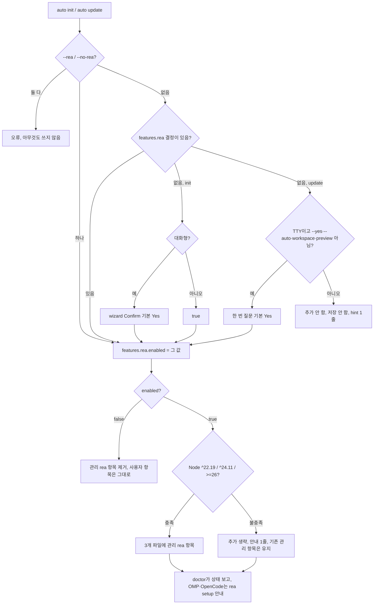
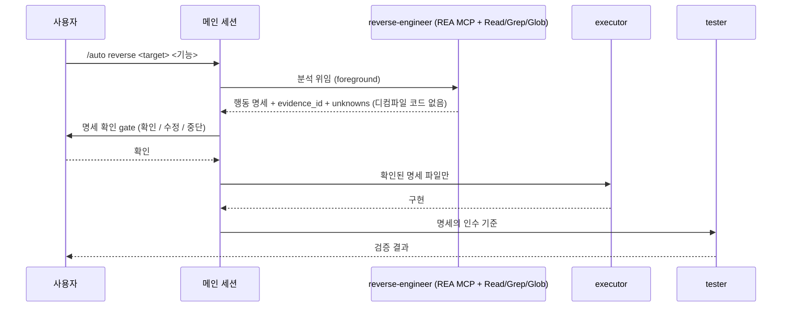

# PRD: REA 역공학 MCP 통합 — 프로젝트 범위 등록, reverse-engineer 에이전트, `/auto reverse`

- **SPEC-ID**: SPEC-REA-001
- **Author**: planner (Autopus-ADK)
- **Mode**: Standard
- **Status**: Draft
- **Date**: 2026-10-15
- **Target module**: `autopus-adk`
- **Release**: v0.50.126(SPEC-MODELUX-003과 같은 릴리스). branch `feat/rea-001`, 기준 origin/main `4d73aa91`(PR #197 merge 뒤)
- **Source**: Plan Intent Ledger(2026-10-15), plan 전 사용자 결정 5건, REA 6.5.0 문서·npm 확인(2026-10-15), worktree 코드 확인(아래 `## Codebase Map 정정`)

---

## Discovery Q&A Checklist

Ledger가 답한 항목은 다시 묻지 않고 근거로 쓴다. 막는 질문은 없다. 남은 불확실성은 9장 Open Questions에 `assumed`로 둔다.

- [x] **Problem**: answered(user, high). 앱·바이너리 기능을 분석하고 증거를 보여 준 뒤 사용자 프로젝트에 다시 구현하는 경로가 없다.
- [x] **Target Users**: answered(user). 실제 터미널에서 `auto init`·`auto update`를 쓰는 사용자, 기존 프로젝트 사용자, CI·비대화형 사용자.
- [x] **Success Metrics**: `done_evidence`는 assumed(planner, medium). 2장 지표로 고정하고 live 실행은 Completion Debt로 둔다.
- [x] **Constraints**: answered(user + repo, high). 새 init 기본 on, `rea-agents@6.5.0` 정확한 pin, Node 범위 gate, 새 secret·승인·유료 CI 없음, 파일 300줄 이하, 생성 root는 `make generate-templates`로만 만든다.
- [x] **Prior Art**: REA 자체 `rea setup`(사용자 범위 파일을 쓴다, 우리는 쓰지 않는다), 기존 MCP 템플릿(context7, sequential-thinking)과 merge·clean 경로, SPEC-MODELUX-003의 옛 바이너리 경고 줄.
- [x] **Scope Boundary**: answered(user, high). MCP는 Claude Code·Codex·Antigravity만 쓴다. OMP·OpenCode는 `rea setup` 안내만 한다. PR은 #197 뒤 별도로 낸다.

---

## Outcome Lock

> Node 조건을 충족한 새 `auto init` 프로젝트에서 Claude Code·Codex·Antigravity가 프로젝트 범위 REA MCP(`npx -y rea-agents@6.5.0 mcp`)를 띄운다. 사용자는 `/auto reverse`로 대상의 기능을 분석시킨다. `reverse-engineer` 에이전트는 evidence_id가 붙은 행동 명세와 unknowns 목록을 낸다. 사용자가 그 명세를 확인하면 executor가 명세만 보고 사용자 프로젝트에 구현하고 tester가 검증한다. 기존 프로젝트는 대화형 `auto update`에서 한 번만 묻는다. 비대화형 실행은 REA를 추가하지 않는다. 사용자 범위 파일은 건드리지 않는다.

- Mandatory: 5장 P0 전부(FR-01 ~ FR-17).
- Completion evidence: P0 결정적 test PASS, `auto eval harness run`, `GOOS=windows GOARCH=amd64 go build ./...`, 신규·변경 소스 300줄 이하, `evidence/manual-smoke-rea.txt`(CD-1, CD-2), `auto spec validate --strict`.

---

## Visual Brief

등록 판단(init·update). CLI 작업이라 command-flow로 그린다.



`/auto reverse` 흐름(clean-room 경계).



Low-fi wireframe(wireframe intent: assumed, 이번 세션에서 사용자가 확인하지 않음).

```text
auto init                                   auto update (대화형, 결정 없음)
[5/6] REA reverse-engineering MCP           REA 역공학 MCP(rea-agents@6.5.0)를 이 프로젝트의
Claude Code·Codex·Antigravity에 프로젝트     Claude Code·Codex·Antigravity에 등록할까요? [Y/n]
범위로 등록합니다 (Node ^22.19|^24.11|>=26)   (답은 autopus.yaml features.rea에 저장되고 다시 묻지 않습니다)
  > Yes   No
```

---

## 1. Problem & Context

**Current Situation**
- 하네스는 MCP 서버를 템플릿에 고정해 쓴다: context7(세 도구 모두), sequential-thinking(Claude·Antigravity만). 공유 목록이나 opt-in 장치는 없다(`templates/claude/mcp.json.tmpl:4-13`, `templates/codex/config.toml.tmpl:30-32`, `templates/gemini/settings/settings.json.tmpl:2-11`).
- 16개 에이전트 중 MCP 도구를 가진 것은 없다. Claude subagent는 frontmatter `tools:`에 적힌 도구만 받는다. 그래서 역공학 분석은 메인 세션에서 돌고, 최대 약 10 MiB인 REA 결과가 메인 문맥을 채운다.
- REA 자체 `rea setup`은 `~/.claude.json`·`~/.codex`·`~/.omp/agent/mcp.json` 같은 사용자 범위 파일을 쓰고 자기 skill을 개인 디렉터리에 설치한다. 프로젝트 단위로 재현되거나 관리되지 않는다.

**Problem Statement**
Autopus 사용자는 기존 앱·바이너리의 기능을 증거와 함께 분석해 자기 프로젝트에 다시 구현할 수 없다. 도구 등록, 분석 격리, 디컴파일 결과와 구현 사이의 clean-room 경계가 모두 없다.

**Impact**
- 분석이 메인 세션에서 돌면 문맥이 넘치고, 디컴파일된 의사코드가 구현 단계로 그대로 흘러 라이선스 위험이 생긴다.
- 사용자마다 손으로 `rea setup`을 돌리면 팀 안에서 버전 pin과 등록 상태가 갈린다.

**Change Motivation**
사용자 요청(2026-10-15)이다. REA 6.5.0이 MCP stdio 서버, evidence_id, unknowns, 큰 결과용 `inspect_analysis_view`를 갖춰 하네스 통합이 가능해졌다.

---

## 2. Goals & Success Metrics

| Goal | Success Metric | Target | Timeline |
|------|---------------|--------|----------|
| 새 프로젝트에 REA 자동 등록 | Node 충족 + 기본 답 `auto init` 뒤 3개 파일의 관리 `rea` 항목 수, 사용자 범위 파일 쓰기 수 | 파일마다 정확히 1개(`rea-agents@6.5.0`), 0건 | v0.50.126 |
| 기존 프로젝트 무단 추가 0 | 비대화형 `auto update`(non-TTY, `--yes`, `--auto`, workspace) 뒤 추가된 rea 항목, MCP 파일 bytes 변화 | 0건, bytes 동일, hint 1줄 | v0.50.126 |
| 질문은 한 번 | 같은 프로젝트에서 대화형 `auto update`를 두 번 돌릴 때 질문 횟수 | 1회 → 0회 | v0.50.126 |
| 17번째 에이전트 | 플랫폼마다 생성 에이전트 수, `CanonicalAgentNames()`와 집합 일치 | 17, 일치(OMP는 17 + task) | v0.50.126 |
| clean-room | live 실행(CD-2)에서 executor 입력에 든 REA 원결과·디컴파일 텍스트 | 0건(확인된 명세 파일만) | 릴리스 전 |
| 실제 터미널 확인 | Claude Code `/mcp`의 rea 상태, `/agents`의 reverse-engineer | connected + 도구 목록, 표시됨(CD-1) | 릴리스 전 |

**Anti-Goals**
- REA 분석 품질 자체를 높이는 것(REA의 몫이다).
- OMP·OpenCode 사용자 범위 MCP 설정을 대신 써 주는 것.
- 역공학을 자동 승인으로 끝까지 돌리는 것. 확인 gate와 권한 질문은 남긴다.

---

## 3. Target Users

| User Group | Role | Usage Frequency | Key Expectation |
|------------|------|-----------------|-----------------|
| 기능 재구현 사용자 | 개발자 | 가끔(기능 단위) | 증거가 붙은 명세를 보고 확인한 뒤 자기 코드로 구현된다 |
| 새 프로젝트 사용자 | 개발자 | 프로젝트마다 1회 | `auto init`만으로 REA가 준비된다 |
| 기존 프로젝트 사용자 | 개발자·유지보수자 | 릴리스마다 | 업그레이드가 네트워크 MCP를 몰래 더하지 않는다 |
| CI·비대화형 사용자 | 자동화 | 매 실행 | 출력 bytes가 안정적이고 질문이 없다 |
| OMP·OpenCode 사용자 | 개발자 | 가끔 | 무엇을 직접 해야 하는지(`rea setup`) 안다 |

**Primary User**: 기능 재구현 사용자.

---

## 4. User Stories / Job Stories

### Story 1: 새 프로젝트에서 바로 역공학 (Job Story)
**When** 새 프로젝트에서 `auto init`을 끝냈을 때, **I want to** 따로 설정하지 않고 REA 도구를 쓰고 싶다, **so I can** 곧바로 `/auto reverse`를 실행한다.
- Given Node 24.11, when wizard의 REA 질문을 기본값으로 넘기면, then `.mcp.json`·`.codex/config.toml`·`.gemini/settings.json`에 관리 `rea` 항목이 1개씩 생기고 `features.rea.enabled: true`가 저장된다.
- Given `--no-rea`, when init이 끝나면, then rea 항목이 없고 `enabled: false`가 저장된다.
- Given `--rea --no-rea`, when init을 실행하면, then 어떤 파일도 쓰기 전에 오류로 끝난다.
- Given Node 20, when init이 끝나면, then rea 항목 없이 감지된 버전과 요구 범위를 적은 안내 1줄이 나온다.
- Given `features.rea`를 처음 쓰는 실행이면, then 옛 바이너리 줄 1줄이 나온다.

### Story 2: 기존 프로젝트 업그레이드 (User Story)
**As a** 기존 프로젝트 유지보수자, **I want** 업그레이드할 때 한 번만 질문받기를, **so that** 원하지 않으면 네트워크 MCP가 생기지 않는다.
- Given 결정 없음 + 대화형 TTY, when `auto update`를 실행하면, then 기본 Yes 질문 1회가 나오고 답이 저장된다. 다음 실행에서는 묻지 않는다.
- Given 결정 없음 + `--yes`·`--auto`·non-TTY·workspace·`--plan`, when update를 실행하면, then rea를 추가하지 않고 저장하지 않으며 `auto update --rea` hint 1줄을 낸다.
- Given 어느 경우든, when update가 끝나면, then 17번째 에이전트와 `/auto reverse` 라우트가 생긴다(하네스 콘텐츠).
- Given 사용자가 직접 만든 `rea` 항목, when update·`--no-rea`·`auto clean`을 실행하면, then 그 항목의 bytes가 그대로다.

### Story 3: 증거 기반 재구현 (Job Story)
**When** 다른 앱 기능을 내 프로젝트로 옮기려 할 때, **I want to** 증거와 모르는 점이 표시된 행동 명세를 먼저 확인하고 싶다, **so I can** 디컴파일 코드를 베끼지 않고 내 코드로 구현한다.
- Given rea 등록, when `/auto reverse <target> <기능>`을 실행하면, then reverse-engineer가 foreground에서 분석하고 행동·입출력·evidence_id·unknowns로 된 명세를 돌려준다.
- Given 명세, when 사용자가 확인하지 않으면(수정·중단), then executor는 시작하지 않는다. `--auto`도 이 gate를 건너뛰지 않는다(assumed, Q6).
- Given 확인, when executor가 시작하면, then executor 입력은 확인된 명세 파일과 사용자 프로젝트 문맥뿐이다.
- Given rea 미등록, when `/auto reverse`를 실행하면, then 에이전트가 그 사실과 `auto update --rea`·`rea setup` 안내를 내고 끝난다.

### Story 4: 상태 확인 (User Story)
**As a** 사용자, **I want** `auto doctor`가 REA 상태를 알려 주기를, **so that** 등록이 안 된 이유를 안다.
- Given 각 상태, when `auto doctor`(text·`--json`)를 실행하면, then 결정(on·off·미결정), Node 버전과 범위 충족 여부, 플랫폼별 항목 상태(관리·없음·사용자 소유·다른 pin), OMP·OpenCode 안내가 나온다.

---

## 5. Functional Requirements

### P0 — Must Have

| ID | Requirement (EARS) | Notes |
|----|-------------|-------|
| FR-01 | THE SYSTEM SHALL accept an optional `features.rea.enabled` boolean whose absence means "not decided", round-trip it through every config save path, and reject a non-boolean value at load. | `[NEW]` `FeaturesConf.Rea`(`pkg/config/schema.go:98`). 저장된 `false`가 사라지면 안 되므로 pointer 또는 omitempty 없는 struct로 만든다(Q1) |
| FR-02 | WHEN `auto init` runs, THE SYSTEM SHALL decide `features.rea.enabled` from `--rea`/`--no-rea` if given, else from a wizard Confirm (default Yes) on an interactive run, else true, and SHALL fail before any write when both flags are given. | wizard 모델은 `buildReviewGateStep`(`internal/cli/tui/wizard_steps.go:194`), flag 자리 `internal/cli/init.go:241-246` |
| FR-03 | WHERE `features.rea.enabled` is true and the Node gate passes, THE SYSTEM SHALL write exactly one Autopus-managed `rea` stdio server running `npx -y rea-agents@6.5.0 mcp` into `.mcp.json`, `.codex/config.toml` (`[mcp_servers.rea]`), and `.gemini/settings.json` through each adapter's existing merge path, with no `env` and no write outside the project root. | 실행 형식은 그 파일의 기존 서버와 같게 한다(Claude·Antigravity `/bin/bash -l -c "exec npx …"`, Codex `npx`). Codex는 `startup_timeout_sec` 등 timeout key를 관리 key로 둔다(Q3) |
| FR-04 | WHEN `features.rea.enabled` becomes false or `auto clean` runs, THE SYSTEM SHALL remove only the Autopus-managed `rea` entry from the three files, including the Codex section header when no user key remains in it, and SHALL leave a user-owned `rea` entry byte-identical. | 지금 Antigravity merge는 key를 지우지 못하고(`antigravity_settings.go:187-198`), Codex merge는 header를 남긴다(`codex_config_structural.go:78-95`). 관리 판정은 Autopus가 낸 모양과 정확히 같을 때만이다(Q7) |
| FR-05 | IF `node` is absent or its version is outside `^22.19.0 \|\| ^24.11.0 \|\| >=26.0.0`, THEN THE SYSTEM SHALL skip adding the `rea` entry, print one notice naming the detected version and the range, keep the stored decision, and never remove an existing managed entry because of the gate. | 버전 검사는 지금 없다(`detect.IsInstalled`는 존재만 본다). semver 라이브러리 없이 세 범위를 직접 비교한다. probe는 실행당 1회, 시간 제한이 있다 |
| FR-06 | WHEN `auto update` runs on a project without a `features.rea` decision on an interactive TTY without `--yes` or `--auto`, THE SYSTEM SHALL ask once (default Yes), persist the answer, and apply it in the same run, and WHEN it runs non-interactively (non-TTY, `--yes`, `--auto`, workspace, preview), THE SYSTEM SHALL add nothing, persist nothing, and print one hint naming `auto update --rea`. | 기존 패턴은 `promptLanguageSettings`(`internal/cli/prompts.go:66-93`, `update.go:186-188`). workspace update는 `--yes`가 필요해 질문하지 않는다(`update_workspace.go:28-29`) |
| FR-07 | WHEN `auto update` receives `--rea` or `--no-rea`, THE SYSTEM SHALL persist that decision without prompting, apply it in the same run, and reject both together before any write. | 에이전트 안내가 이 flag를 가리킨다 |
| FR-08 | THE SYSTEM SHALL report in `auto doctor` text and JSON the REA decision, the Node version and range match, each of the three platforms' entry state (managed, absent, user-owned, other pin), and the `rea setup` guidance for OMP and OpenCode. | 네트워크·모델 호출 없음 |
| FR-09 | WHERE REA is enabled and the project includes OMP or OpenCode, THE SYSTEM SHALL write no MCP configuration for them and print one `rea setup` guidance line in init, update, and doctor. | scope_boundary |
| FR-10 | THE SYSTEM SHALL ship `content/agents/reverse-engineer.md` whose tools are the REA MCP tools plus Read, Grep, and Glob only, without Write, Edit, or Bash, whose output is a behaviour specification with evidence_id references and an unknowns list and never decompiled pseudocode or assembly, and which reports when REA tools are unavailable and points to `auto update --rea` and `rea setup`. | 기본 model `opus`. Claude `tools:`에 MCP wildcard가 되는지는 probe로 정한다(Q4). Bash 제외 이유: REA CLI(`npx rea …`)로 MCP 권한 질문을 우회할 수 있다 |
| FR-11 | THE SYSTEM SHALL add `reverse-engineer` to the canonical agent list and every consumer of it — balanced and ultra presets at `opus`, Historical rows for the 16-agent layouts, role matrix capability, native OMP folding to `task`, OMP Autopus agent files and override keys, and the compose group 탐색·보조 — so that every platform generates 17 agents and every set check against `CanonicalAgentNames()` holds. | balanced 표준 배치에 opus 칸이 없다(Q2). 정규 목록 `pkg/config/quality_tier.go:17-21`, 그룹 `internal/cli/quality_compose_groups.go:34-36` |
| FR-12 | WHEN a skill or agent body that names `mcp__rea__*` is rendered for a non-Claude platform, THE SYSTEM SHALL render it as a REA MCP tool reference and never as the Context7 fallback text. | `pkg/content/skill_transformer_replace_mcp.go:22,50`은 모든 `mcp__*`를 Context7 문구로 바꾼다. 같은 함수가 agent 본문에도 쓰인다(`agent_transformer_mapping.go:75`) |
| FR-13 | THE SYSTEM SHALL add the `reverse` route to every platform's router and route registry with a detail that runs reverse-engineer analysis in the foreground, a behaviour-spec confirmation gate, executor implementation from the confirmed specification only, and tester verification against its acceptance items. | Claude `claude_workflow_skills.go:22-42`·router 표 `auto-router.md.tmpl:55-75`, Codex `codex_workflow_specs.go:14-`, Gemini `templates/gemini/skills/auto-*`, OMP `omp_specs.go`, OpenCode `opencode_specs.go` |
| FR-14 | WHEN the confirmation gate is passed, THE SYSTEM SHALL hand the executor only the confirmed behaviour-spec file and the user's project context, never REA tool results, evidence bundles, or decompiled text, and SHALL keep those out of the product source tree. | 명세 파일 위치는 Q9 |
| FR-15 | THE SYSTEM SHALL NOT pre-approve any `mcp__rea__*` permission in generated settings. | 결정 3. 지금 사전 승인 MCP는 `mcp__sequential-thinking__sequentialthinking`뿐이다(`pkg/content/hooks.go` DetectPermissions) |
| FR-16 | WHILE REA is not enabled, THE SYSTEM SHALL generate the three MCP files byte-identical to the pre-change output, and `DefaultFullConfig` SHALL leave the REA decision absent. | 기존 MCP inventory test가 그대로 통과해야 한다 |
| FR-17 | WHEN a write introduces `features.rea` into an autopus.yaml for the first time, THE SYSTEM SHALL print one line stating that auto older than v0.50.126 cannot read it. | strict loader(`pkg/config/loader_strict.go:107-125`)가 모르는 key를 거부한다 |

### P1 — Should Have

| ID | Requirement (EARS) | Notes |
|----|-------------|-------|
| FR-21 | THE SYSTEM SHALL render every new prompt, notice, hint, and doctor line in Korean when `tui.DetectSystemLang` returns ko and in English otherwise, while stored values stay locale-independent. | MODELUX-003 REQ-MUX3-18과 같다 |
| FR-22 | THE SYSTEM SHALL document the REA default, `--rea`/`--no-rea`, the Node range, the old-binary limit, the clean-room flow, and the runtime-capture caution in init·update·doctor help, README, and the v0.50.126 CHANGELOG. | 기존 test가 검사하는 문장은 지우지 않는다 |

### P2 — Could Have

| ID | Requirement (EARS) | Notes |
|----|-------------|-------|
| FR-31 | WHEN a workspace update covers several undecided repositories, THE SYSTEM SHALL print one aggregated hint instead of one per repository. | 지금은 repo마다 1줄 |
| FR-32 | WHERE the operator passes an explicit opt-in flag, THE SYSTEM SHALL let `auto doctor` start the REA server once and list its tools. | 네트워크가 필요해 기본은 끈다 |

### Feature Coverage Map

| 영역 | 포함 | FR | 완료 증거 |
|---|---|---|---|
| Happy path | 새 init 기본 on → 3개 파일에 rea 1개, 에이전트 17, `/auto reverse` 라우트와 흐름 | 01-03, 10, 11, 13 | 결정적 test, CD-1, CD-2 |
| Error/recovery | Node 없음·구버전, flag 충돌, opt-out 제거, clean, 사용자 소유 항목 보존, REA 미등록 안내, 명세 거절·수정, 쓰기 실패 시 기존 adapter 복원 | 02, 04-07, 10, 13 | 결정적 test |
| Integration boundary | 3개 writer·clean, OMP·OpenCode 안내만, 사용자 범위 파일 무접촉, 5개 플랫폼 route registry, OMP 17 + task, preset·history·matrix, MCP 참조 변환 | 03, 09, 11-13, 16 | test, golden, HOME sandbox test |
| CLI/UX surface | wizard Confirm, init·update flag, update 1회 질문, 비대화형 hint, doctor text·JSON, 옛 바이너리 줄, ko/en | 02, 06-08, 17, 21 | test(기존 form·TTY seam), CD-1 |
| Verification | 결정적 test 전부, 실제 터미널 smoke, 동의한 live 실행, Windows cross-build, eval harness | 전부 | `evidence/manual-smoke-rea.txt` |
| Docs/ops | README, CHANGELOG, help, pin 전략 기록, 사전 승인 없음 | 15, 22 | review |

---

## 6. Non-Functional Requirements

| Category | Requirement | Target |
|----------|-------------|--------|
| Performance | init·update가 더하는 비용 | `node --version` probe 실행당 최대 1회, 시간 제한 있음. auto 자신은 네트워크를 쓰지 않는다(다운로드는 AI 도구가 서버를 띄울 때 npx가 한다) |
| Security | 사용자 범위 파일 | `~/.claude.json`, `~/.codex`, `~/.gemini`, `~/.omp`에 쓰기 0건(HOME sandbox test) |
| Security | 공급망 | 정확한 pin `rea-agents@6.5.0`, `@latest` 금지, env 없음, `mcp__rea__*` 사전 승인 없음 |
| Security | clean-room | reverse-engineer에 Write·Edit·Bash 없음. executor는 확인된 명세만 받는다 |
| Determinism | 생성 결과 | Node probe는 seam으로 주입한다. 같은 cfg와 probe 결과면 같은 bytes가 나온다. REA가 꺼져 있으면 MCP 파일 bytes가 바뀌지 않는다 |
| Compatibility | 옛 바이너리 | `features.rea`를 쓴 파일은 v0.50.113–v0.50.125(strict loader)가 읽지 못한다. 쓰는 순간 1줄로 알린다 |
| Maintainability | 크기·생성 | 신규·변경 소스 300줄 이하(`update.go` 292줄, `init.go` 258줄이라 새 파일에 두고 호출만 더한다). 생성 root는 `make generate-templates` |
| Quality | coverage·build | 신규·변경 package coverage는 MODELUX-003과 같은 기준, `GOOS=windows GOARCH=amd64 go build ./...` 통과 |
| OSS ops | CI | 새 secret·승인 단계·유료 키가 필요한 CI 없음 |

---

## 7. Technical Constraints

**Technology Stack Constraints**
- brownfield: Go module `github.com/insajin/autopus-adk`(go 1.26). 새 Go 의존성 없음. Node 범위는 직접 비교한다.
- MCP 등록은 기존 adapter merge 경로(`claude_files.go:25-87`, `codex_config_structural.go:48-127`, `antigravity_settings.go:18-60`)를 확장한다. 공유 MCP 목록을 새로 만들지는 Q8에서 정한다.
- `content/agents`, `content/skills`가 원천이고 Codex·Gemini 산출물은 `make generate-templates`로 만든다.

**Technology Stack Decision**

| Mode | Selected stack | Resolved versions | Source refs | Checked at | Rejected alternatives |
|------|----------------|-------------------|-------------|------------|-----------------------|
| brownfield | REA MCP stdio via npx | `rea-agents@6.5.0` (latest-stable를 정확히 pin), Node `^22.19.0 \|\| ^24.11.0 \|\| >=26.0.0` | npm `rea-agents`, github.com/morluto/rea 문서 | 2026-10-15 | `@latest`(움직이는 참조, `content/rules/techstack-freshness.md:50` 위반), `rea setup` 호출(사용자 범위 파일을 쓴다), 전역 설치(재현 불가) |

**External Dependencies**

| Dependency | Version / SLA | Risk if Unavailable |
|------------|---------------|---------------------|
| npm registry + npx | 첫 실행 때 다운로드 | 서버가 시작되지 않는다. doctor와 문서로 안내 |
| Node.js | 위 범위 | gate가 등록을 건너뛴다 |
| Hopper·Ghidra·IDA | 선택(native 분석만) | 정적 JS·Electron·.NET 분석은 필요 없다 |
| Claude Code·Codex·Antigravity MCP 로더 | 현재 설치판 | 형식 변화는 smoke(CD-1)와 probe로 확인 |

**Compatibility Requirements**
- REA 결정이 없거나 꺼진 프로젝트의 MCP 파일은 바뀌지 않는다(FR-16).
- MODELUX-003 계약(OMP Agent File, Agent Set, Route, Claim Set, Pins-only)은 16을 17로 넓히는 것 말고는 그대로다. native 모드에서 reverse-engineer는 `task`로 접힌다(`omp_native_agents.go:22`).
- Windows: 기존 서버처럼 `/bin/bash -l -c` 형식을 쓴다(지금도 POSIX 전용이다). Windows 전용 형식은 범위 밖이다.

**Infrastructure Constraints**
- 새 CI job·secret·승인 없음. live 실행은 maintainer가 동의하고 로컬에서 한 번 돈다.

---

## 8. Out of Scope

- OMP·OpenCode용 프로젝트 MCP writer(안내만 한다)
- 사용자 범위 설정 쓰기, `rea setup` 호출, REA 자체 skill(`reverse-engineer-anything`) 설치
- `REA_MCP_*` env 조정, REA 버전 자동 갱신
- `mcp__rea__*` 권한 사전 승인, background 분석
- Windows `cmd.exe /d /c` 실행 형식(기존 서버도 POSIX 형식이다), context7 `@latest` pin 정리
- 디컴파일 결과의 저장·배포, 법률 판단 자동화

**Deferred to Future Iterations**
- Evolution Ideas 참조. Completion Debt는 미루지 않는다.

### Completion Debt

| ID | 남은 일 | 닫는 증거 |
|---|---|---|
| CD-1 | 실제 터미널 smoke: 새 init 프로젝트에서 Claude Code `/mcp`가 rea connected와 도구 목록을 보이고 `/agents`에 reverse-engineer가 있다. Codex·Antigravity의 MCP 목록에도 rea가 있다(모델 호출 없음) | `evidence/manual-smoke-rea.txt` |
| CD-2 | 사용자 동의 뒤 live `/auto reverse` 1회: 작은 로컬 정적 대상(JS·Electron, 외부 디컴파일러 불필요)으로 명세 → 확인 → 구현 → 검증, executor 입력에 명세 파일만 있음 | 같은 파일 |

### Evolution Ideas (선택, 후속 SPEC 근거 아님)

- OMP·OpenCode 프로젝트 MCP writer, 모든 MCP 서버의 Windows 실행 형식
- doctor의 REA 새 버전 안내와 pin 갱신 도우미
- REA 도구 감사 뒤 읽기 전용 도구 일부 사전 승인
- `export_evidence_bundle` 결과를 SPEC evidence로 묶기
- workspace 단일 질문(지금은 비대화형이라 묻지 않는다)

### Sibling SPEC Decision

없다. Primary SPEC 하나다.
- 후보 A "MCP 등록만": 혼자서도 쓸모 있지만 Outcome Lock은 끝에서 끝까지의 재구현 흐름이다. 에이전트 안내가 FR-07 flag에 기대고, 같은 module·같은 릴리스라 나누면 순서 의존만 생긴다.
- 후보 B "에이전트 16→17 파급": 넓지만 배포·migration 순서 경계가 없다(#197은 merge됐다). 보안·데이터 경계도 아니다.
- 크기: 예상 태스크 약 16-18개, 소스 파일 40개 안팎이다. 25개 초과 태스크와 40개 초과 파일을 동시에 넘지 않는다.

---

## 9. Risks & Open Questions

### Risks

| Risk | Severity | Probability | Mitigation Strategy |
|------|----------|-------------|---------------------|
| R1 옛 바이너리 단절이 MODELUX-003보다 넓다. 새 init마다, 업데이트 답마다 `features.rea`를 쓴다 | Medium | Medium | 사용자 결정으로 받아들인다. FR-17 줄, CHANGELOG, doctor |
| R2 Node 판정이 실제 실행과 다르다. auto의 PATH와 login shell·Codex 프로세스 PATH가 다르다(nvm·volta) | Medium | Medium | 서버와 같은 실행 경로로 확인(Q5), doctor가 경로·버전을 보인다, gate는 기존 항목을 지우지 않는다 |
| R3 runtime capture 도구가 사용자 권한으로 대상을 실행한다 | High | Medium | 사전 승인 없음, foreground만, 에이전트가 runtime 도구 전에 사용자 확인을 받는다, 문서 경고 |
| R4 clean-room 누수. 디컴파일 텍스트가 executor나 repo로 간다 | High | Medium | 쓰기 도구 없음, 명세 형식 고정, 확인 gate, executor 입력 제한, CD-2 |
| R5 opt-out 뒤 항목이 남는다(Antigravity merge는 key를 못 지우고 Codex는 header를 남긴다) | Medium | High(대응 없으면) | FR-04 제거 경로와 test |
| R6 관리 판정이 넓으면 사용자 `rea` 항목을 덮거나 지운다(Claude merge는 관리 서버를 지우고 다시 넣는다, `claude_files.go:60-68`) | Medium | Low | 정확한 모양만 관리로 본다(Q7) |
| R7 16→17 파급. 많은 test·계약이 16을 고정하고, 기존 16개 프리셋이 `customized`로 분류된다 | Medium | High | Historical row 추가, 기존 test 변경 규칙(Q10) |
| R8 MCP 참조 변환이 `mcp__rea__*`를 Context7 문구로 바꾼다 | High | High(대응 없으면 확실) | FR-12와 golden |
| R9 공급망. npx가 transitive 의존성을 고정하지 않고 첫 실행 때 내려받는다 | Medium | Low | 정확한 pin, 사전 승인 없음, 문서 |
| R10 Codex 기본 startup timeout 안에 npx 첫 실행이 끝나지 않는다 | Medium | Medium | REA `rea setup`처럼 `startup_timeout_sec = 120`(Q3, probe) |
| R11 OMP가 frontmatter의 모르는 도구 이름(`mcp__rea__*`)에 오류를 낸다 | Medium | Unknown | omp 18.6.1 probe, OMP·OpenCode 본문은 중립 이름(Q11) |

### Open Questions (모두 assumed 또는 deferred, Outcome Lock을 막지 않는다)

| # | Question | Owner | Due Date | Status |
|---|----------|-------|----------|--------|
| Q1 | `features.rea` 모양 | spec-writer | 2026-10-16 | assumed: `features.rea.enabled`(*bool 또는 omitempty 없는 struct). absent = 미결정, false도 저장된다 |
| Q2 | balanced의 `opus`. 표준 배치는 top=fable, 나머지=sonnet이다(`role_model_policy_balanced.go:21-69`, `native_balanced.go:37-52`) | spec-writer | 2026-10-16 | assumed: 새 balanced rung(anthropic Opus 5.5, openai `gpt-6.1-sol` xhigh, `CodexModelForTier("opus")`와 같다)으로 "모든 정규 에이전트가 matrix에 한 번" 불변식을 지킨다. 아니면 matrix 밖 명시 tier로 둔다. 이 경우 OMP는 deep_reasoning capability route(fable)를 타 도구마다 다르다 |
| Q3 | Codex timeout key 값 | spec-writer | probe | assumed: `startup_timeout_sec = 120`. `tool_timeout_sec`는 REA 6.5.0 `rea setup` 출력으로 정한다(unverified) |
| Q4 | Claude subagent `tools:`가 `mcp__rea` 또는 `mcp__rea__*` wildcard를 받는가, plan mode와 background에서 MCP 호출은 어떻게 되는가 | spec-writer | probe | assumed: 안 되면 pin된 6.5.0의 `tools/list`로 이름을 나열한다. `permissionMode`는 기본(질문함), foreground만 |
| Q5 | Node probe 방법 | spec-writer | 2026-10-16 | assumed: CLI가 실행당 1회 확인해 `cfg.Runtime`(yaml `-`)에 넘긴다. POSIX는 서버와 같은 login shell로, Windows는 PATH로 확인한다. adapter는 순수하게 남는다 |
| Q6 | `--auto`에서 확인 gate | spec-writer | 2026-10-16 | assumed: 건너뛰지 않는다(gate에서 멈춤) |
| Q7 | 관리 항목 판정 | spec-writer | 2026-10-16 | assumed: 이름 `rea` + Autopus가 낸 command·args 모양과 정확히 같음(이전에 낸 pin 목록 포함). 나머지는 사용자 소유 |
| Q8 | 공유 MCP 목록을 만들지, 템플릿 조건 3곳으로 둘지 | spec-writer | 2026-10-16 | deferred: 둘 다 Outcome을 만족한다 |
| Q9 | 확인된 명세 파일 위치 | spec-writer | 2026-10-16 | assumed: `.autopus/reverse/<slug>/behaviour-spec.md`. 에이전트가 쓰기 도구가 없으므로 메인 세션이 확인 뒤 쓴다 |
| Q10 | Historical row 범위 | spec-writer | 2026-10-16 | assumed: v0.50.125까지 낸 16개 balanced(runtimeStandard)와 ultra 배치를 `git log -p -- pkg/config/defaults.go`로 복원해 더한다 |
| Q11 | OMP·OpenCode 에이전트 도구 | spec-writer | probe | assumed: MCP 이름을 쓰지 않고 읽기 도구만 쓴다. 본문은 사용자 범위 `rea setup`을 안내한다 |

---

## 10. Pre-mortem

| # | Failure Scenario | Probability | Impact | Preventive Action |
|---|-----------------|-------------|--------|-------------------|
| 1 | 옛 auto를 고정한 CI가 새 프로젝트를 읽지 못해 사용자가 기능을 끈다 | Medium | Medium | FR-17 줄과 CHANGELOG, `auto update --self` 안내(R1) |
| 2 | REA 서버가 조용히 시작되지 않아 "고장"으로 보인다(PATH·timeout) | Medium | High | Q3·Q5 probe, doctor 상태, CD-1(R2, R10) |
| 3 | 디컴파일 코드가 제품 repo에 들어가 라이선스 문제가 된다 | Medium | High | FR-10, 13, 14, CD-2(R4) |
| 4 | 업그레이드가 비대화형 경로 버그로 네트워크 MCP를 몰래 더한다 | Low | High | non-TTY·`--yes`·`--auto`·workspace·preview를 각각 test(FR-06) |
| 5 | 17번째 에이전트가 기존 프리셋을 `customized`로 만들어 최신 기본값 갱신이 사라진다 | High(대응 없으면) | Medium | Historical row와 분류 test(R7, Q10) |

**Connection to Risks (Section 9)**: 1→R1, 2→R2·R10, 3→R4, 4는 새 위험이다(비대화형 판정 버그, FR-06 test로 막는다). 5→R7.

---

## 11. Practitioner Q&A

**Q1: 결정은 어디에 저장하고 어떻게 읽는가?**
A: `autopus.yaml`의 `features.rea.enabled`다. absent = 미결정이고, update 질문은 absent일 때만 나온다. `DefaultFullConfig`는 absent로 두고 init이 명시적으로 쓴다(FR-16).

**Q2: Node gate는 생성 결과를 기계마다 다르게 만드는가?**
A: gate는 추가만 막고 기존 관리 항목은 지우지 않는다. 그래서 같은 repo를 다른 Node로 update해도 항목이 오락가락하지 않는다. probe 결과는 seam으로 주입해 test가 결정적이다(Q5).

**Q3: 기존 시스템과 어디서 만나는가?**
A: MCP는 세 adapter의 merge·clean, 결정은 init wizard·update prompt, 에이전트는 `CanonicalAgentNames()` 소비처 전부(MODELUX-003 Agent Set Contract 포함), 라우트는 5개 플랫폼 registry, 변환은 `ReplacePlatformReferences`다.

**Q4: rollout과 기능 flag는?**
A: 새 init은 기본 on이다. 기존 프로젝트는 대화형 1회 질문 또는 `--rea`로만 켠다. 에이전트와 라우트는 flag와 무관하게 항상 생긴다(결정 1). 그래서 model-policy 표가 설정마다 달라지지 않는다.

**Q5: 관측은?**
A: 새 로그나 artifact는 없다. doctor text·JSON 줄과 init·update 안내 줄이 전부다. live 증거는 placeholder로 바꾼 뒤 커밋한다(`$HOME`, scratch 경로, 사용자 이름).

**Q6: 사고 때 되돌리기는?**
A: `auto update --no-rea` 또는 `auto clean`이 관리 항목만 지운다. 옛 바이너리로 돌아가려면 `features.rea`를 지운다(FR-17 줄이 알린다).

**Q7: 하위 호환과 migration은?**
A: 16개 프리셋 배치는 Historical row로 인식되어야 한다(Q10). 그래야 reverse-engineer는 YAML을 다시 쓰지 않아도 표준 칸(또는 frontmatter `opus` fallback)을 받는다. OMP는 manifest에 16개가 있으면 17번째를 추가 파일로 쓴다(MODELUX-003 Migration Contract의 첫 생성 경로가 아니다).

**Q8: 무엇부터 해야 하는가(risk-first)?**
A: 넓게 구현하기 전에 probe 넷을 돈다. 모델 호출은 없다. (a) Claude Code subagent `tools:`의 MCP wildcard·plan mode·background 권한(Q4) (b) REA 6.5.0 `tools/list`로 도구 이름 확정 (c) Codex의 npx 첫 실행과 timeout(Q3) (d) omp 18.6.1에서 모르는 도구 이름(Q11).

---

## Codebase Map 정정 (2026-10-15 worktree 확인)

- `mergeCodexConfig`는 `codex_config_structural.go:48`에 있다. `codex_settings.go:24-51`은 그것을 부르는 `prepareConfigFileWithManifest`다.
- route 상세는 `content/skills/auto-*.md`가 아니다(`generate.go`는 `auto-*`를 건너뛴다). 플랫폼마다 따로 있다: Claude `claude_workflow_skills.go:22-42`(`auto-workflows.md.tmpl` 절 추출 또는 customBody), Codex `codex_workflow_specs.go`(router 설명 :17)와 `codex_workflow_custom.go`, Gemini `templates/gemini/skills/auto-*`, OMP `omp_specs.go`, OpenCode `opencode_specs.go`. route 목록 고정 test는 `router_budget_test.go`(claude·antigravity, 8192 bytes)와 `codex_surface_test.go`다.
- `latest_cli_omp_contract_test.go`는 `internal/cli`가 아니라 `pkg/adapter`에 있다. 탐색·보조 그룹은 `quality_compose_groups.go:34-36`이다.
- balanced에는 opus 칸이 없다(Q2). 16개 프리셋 분류(`quality_preset_history.go:116-139`)가 17번째 에이전트 때문에 바뀐다(R7).
- Antigravity merge는 key를 지우지 못하고 clean은 현재 cfg로 렌더한 것과 같은 서버만 지운다. Codex merge는 관리 header를 남긴다(R5).
- Node 버전 검사와 semver 라이브러리는 없다. `update.go`는 292줄이다.

## PRD Quality Checklist

- [x] 11개 절과 Discovery·Outcome Lock·Visual Brief·Coverage Map·Completion Debt·Evolution Ideas·Sibling Decision이 있다
- [x] 정량 지표가 있다(2장: 항목 수, 0건, 1회→0회, 17)
- [x] P0 17개가 EARS 형식이다
- [x] 범위 밖 항목이 있다(8장)
- [x] 기존 SPEC과 충돌하지 않는다. MODELUX-003 계약은 16을 17로만 넓히고 옛 바이너리 경고 방식을 따른다
- [x] 용어가 코드와 같다(`features`, `CanonicalAgentNames`, Historical, 탐색·보조, adapter 이름)
