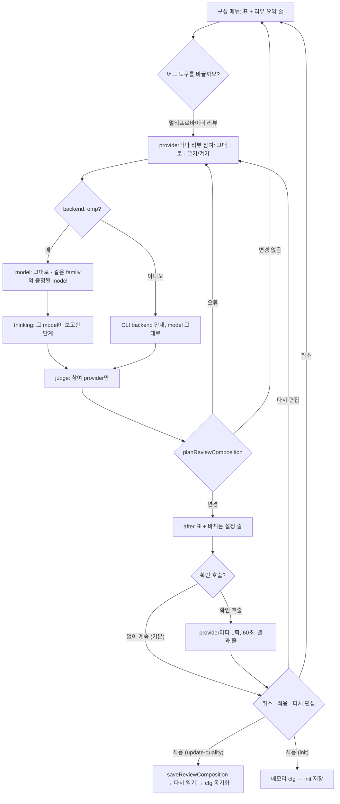

# SPEC-REVMODEL-001 구현 계획

## Tasks

기준은 `feat/rea-001`(ee811e2e)이고 branch는 `feat/revmodel-001`이다. 순서: T1 → T2 → (T3, T4) → T5 → T6 → T7 → T8 → (T9, T10) → T11. 290줄인 `quality_compose_form_driver.go`에는 분기 몇 줄만 더하고 흐름은 새 파일에 둔다.

- [ ] T1: 기존 test 분류. tool tab Select가 선택지 하나라 건너뛰던 폼 test와 init의 `spec.review_gate.providers` 단언 test를 grep으로 모아 Existing Test Changes의 1·2·3 중 하나로 정하고 `research.md`에 붙인다. 소스 변경 없음 (REQ-RVM-19).
- [ ] T2: 구성 planner. 소유: `[NEW] internal/cli/quality_compose_review_plan.go`(+test). cfg에서 시작 값(참여 = `spec.review_gate.providers`에 있음, model, judge), 참여 delta를 목록마다 적용, judge 규칙(`orchestra.judge` 동기 조건, 꺼진 provider의 명령별 judge 삭제), `planReviewComposition` 검증 4종과 오류 문구, 변경 줄 순서, after 표 (REQ-RVM-02, 03, 04, 05, 09).
- [ ] T3: 증명된 선택지. 소유: `[NEW] internal/cli/quality_compose_review_choices.go`(+test). `installedOMPAttestedModelChoices`를 탭 진입당 1회 부르고 `providerModelFamily`와 `orchestra.ModelFamilyForSelector`로 거른다. `(catalog에 없음)`, thinking 단계와 기본값, CLI backend 판정, catalog 못 읽음 안내 (REQ-RVM-06, 07, 08).
- [ ] T4: writer. 소유: `[NEW] internal/cli/quality_compose_review_write.go`(+test). `saveReviewComposition`: raw document(`parseAutopusConfigDocument`) node 편집, 없는 목록·`spec.review_gate.judge` key만 그 mapping에 더함, alias·merge·`${` 거부, `encodeAutopusConfigRewrite`, atomic replace, 다시 읽어 `cfg.Orchestra`·`cfg.Spec.ReviewGate` 동기화, model은 `validOMPModelSelector`를 지나는 값만 (REQ-RVM-03, 07, 12, 15).
- [ ] T5: 탭 흐름. 소유: `[NEW] internal/cli/quality_compose_review.go`(+test), `quality_compose_form_driver.go`(`chooseTab`·`edit` 분기), `quality_compose_form_text.go`. 진입 조건(provider 둘 이상), 참여 → model → thinking → judge → 검증 → 미리보기 → 확인 호출 Select → 확인(`취소`·`적용`·`다시 편집`) (REQ-RVM-01, 02, 04, 08, 09).
- [ ] T6: 확인 호출. 소유: `[NEW] internal/cli/quality_compose_review_check.go`(+test). 후보 cfg 사본을 `assembleSpecReviewProviders`에 넣고 `providerSmokeBackendFactory`·`providerSmokePrompt`·`classifyProviderSmokeResult`, 60초, 결과 줄, 실패 안내와 확인 기본값 (REQ-RVM-10, 11).
- [ ] T7: init·update·quality 연결. 소유: `internal/cli/init.go`(wizard의 Review Gate 대입을 compose 단계 앞으로), `[NEW] quality_compose_review_write.go`의 메모리 적용. update·quality는 파일 writer와 cfg 동기화, init은 메모리 cfg (REQ-RVM-12, 13).
- [ ] T8: 비대화형과 호환 고정. 소유: T5·T6 test 파일. `--yes`·pipe stdin·CI에서 탭 문구 0, catalog 읽기 0, 확인 호출 0, bytes 불변. 이 branch가 쓴 파일을 v0.50.125 바이너리(dd6d6ea2로 만든 `auto`)로 읽는 S7 스크립트 (REQ-RVM-14, 15).
- [ ] T9: Should. 메뉴 요약 1줄(`f.draw()` 뒤) (REQ-RVM-16).
- [ ] T10: Should. Form Text en, help·README·CHANGELOG v0.50.126. 생성 표면을 고치면 `make generate-templates` (REQ-RVM-17, 18).
- [ ] T11: 회귀와 smoke. `go test ./internal/cli/... ./pkg/...` 필터 없이, 300줄, `GOOS=windows GOARCH=amd64 go build ./...`, golangci-lint, `git diff --stat` 의 test 변경이 T1 분류와 같은지. 이 repo의 실제 터미널에서 S15를 하고 `evidence/manual-smoke-revmodel.txt`에 경로를 치환해 남긴다. 빠지면 CD-1이 남는다 (REQ-RVM-19).

## Implementation Strategy

- 판단을 새로 만들지 않는다. 폼은 SPEC-MODELUX-002 `composeSelect`·확인 Select, 증명은 SPEC-MODELUX-003 `installedOMPAttestedModelChoices`, family는 런타임의 두 함수, 확인 호출은 `auto doctor --provider-smoke`의 prompt·backend·판정, 쓰기는 OMP writer의 raw document와 rewrite 검사, cfg 동기화는 `ompApply`의 다시 읽기다.
- 새 것은 순수 planner 하나(`planReviewComposition`), node 편집 writer 하나, 탭 흐름 하나, 확인 호출 연결 하나다. 새 의존성과 새 YAML key는 없다.
- planner는 파일 I/O 없이 cfg 사본만 받는다. 그래서 init 메모리 경로, update·quality 파일 경로, 확인 호출의 후보 cfg가 같은 결과를 쓴다.

## Visual Planning Brief

UI는 SPEC-MODELUX-002 huh Select의 연속이다(`wireframe intent: assumed`). 요구사항으로 묶는 것은 Review Tab Contract의 순서·기본값·선택지와 Form Text뿐이다.



Wireframe A: 이 repo에서 gemini를 끄고 codex model을 바꾼 미리보기

```text
┃ 어느 도구를 바꿀까요?
┃   모든 도구 같게   Claude Code   Codex   OMP
┃ > 멀티프로바이더 리뷰
┃ gemini 리뷰 참여
┃   그대로 — 켜짐
┃ > 끄기
┃ codex model
┃   그대로 — openai-codex/gpt-6-astra:max
┃ > openai-codex/gpt-6-luna
┃ codex thinking (openai-codex/gpt-6-luna)
┃   low   medium   > high
┃ judge
┃ > 그대로 — claude    codex
provider  리뷰   model                                    judge
claude    켜짐   anthropic/claude-fable-5-1:max           judge
codex     켜짐   openai-codex/gpt-6-luna:high *
gemini    꺼짐 * google-antigravity/gemini-3.1-pro:high
바뀌는 설정
  spec.review_gate.providers [claude, codex, gemini] → [claude, codex]
  orchestra.commands.brainstorm.providers [claude, codex, gemini] → [claude, codex]
  …(plan, review, secure 같음)
  orchestra.providers.codex.model openai-codex/gpt-6-astra:max → openai-codex/gpt-6-luna:high
┃ 확인 호출
┃ > 확인 호출 없이 계속
┃   확인 호출 — 참여 provider 2개에 model 호출 1회씩
```

Wireframe B: 확인 호출 실패 뒤

```text
확인 호출 claude (anthropic/claude-fable-5-1:max): 통과
확인 호출 gemini (google-antigravity/gemini-3.1-pro:high): 실패 — HTTP 404 Not Found (Cloud Code Assist)
확인 호출이 실패한 provider가 있습니다. 적용하면 그 provider는 리뷰에서 실패합니다.
┃ 적용할까요?
┃ > 취소   적용   다시 편집
```

## Feature Completion Scope

- 이 SPEC 하나가 Outcome Lock을 닫는다. T2–T7은 탭과 쓰기, T6은 확인 호출, T8은 안전·호환, T1·T11은 회귀와 smoke, T9·T10은 Should다.
- 승인된 sibling 의존성은 없다. 규모는 task 11개, 소스 파일 test 포함 약 15개다. Completion Debt CD-1은 T11의 S15 기록으로만 닫힌다.

## Risk-First Integration Probe

| assumption_id | class | risk | boundary | input | oracle | isolation | status | reason | evidence |
|---------------|-------|------|----------|-------|--------|-----------|--------|--------|----------|
| A1 | verified_fact | high | 런타임 model을 정하는 것이 `orchestra.providers.codex.model`인가 `CodexOrchestraProfile`인가(OMP backend codex) | 이 repo `autopus.yaml` 사본에서 codex model만 `openai-codex/gpt-6-luna:low`로 바꿈, `globalFlags{Effort: "low"}`로 `applyRuntimeHarnessOverrides` | load 뒤와 runtime override 뒤 codex `model`이 쓴 값 그대로이고 `args`가 비어 있음 | `t.TempDir()`, 모델 호출 없음, throwaway test(실행 뒤 삭제) | PASS | load 결과 `backend="omp" model_policy="" model="openai-codex/gpt-6-luna:low" args=[]`, runtime 뒤에도 `model="openai-codex/gpt-6-luna:low" args=[]`. `CodexOrchestraProfile`은 `model_policy: quality`일 때 args만 덮는다(`orchestra_run_runtime.go:27-35`). CLI codex(`model_policy: quality`)는 반대로 profile이 정한다 | 2026-10-15 `go test ./internal/cli -run TestZZRevmodelProbe -count=1 -v` 출력 `LOADED codex …`, `RUNTIME(--effort low) codex model="openai-codex/gpt-6-luna:low" args=[]` (`research.md` `## Probe 기록`) |
| A2 | verified_fact | high | `auto spec review`의 provider 목록 원천이 `spec.review_gate.providers`인가 `orchestra.commands.review.providers`인가 | 같은 사본에서 `review_gate.providers: [claude, codex]`, `commands.review.providers: [claude, codex, gemini]`, `assembleSpecReviewProviders` multi=false·true | multi=false면 claude·codex 둘, multi=true면 gemini가 더해짐 | 같은 throwaway test | PASS | `--multi` 없으면 `spec.review_gate.providers`만 쓴다. `--multi`면 commands.review, `orchestra.providers` key, 기본 provider를 합친다(`spec_review_providers.go:39-51`). 그래서 끄기는 두 목록을 모두 고친다 | 같은 출력 `ASSEMBLE multi=false provider=claude …`, `provider=codex model="openai-codex/gpt-6-luna:low"`, `ASSEMBLE multi=true … provider=gemini model="google-antigravity/gemini-3.1-pro:high"` |
| A3 | verified_fact | high | v0.50.125 strict loader가 이 탭이 쓰는 모든 key와 값 모양을 읽는가 | 세 provider `backend: omp`, `orchestra.judge: codex`, `commands.{brainstorm,review}.providers: [claude, codex]`, `review_gate.providers: [claude, codex]`, `judge: codex`인 `autopus.yaml`. 대조군 둘: `review_gate.reviewers` key, 공백 든 selector | 본 파일 exit 0, 대조군은 모르는 key·selector 오류 | scratch dir, `git archive v0.50.125`로 만든 바이너리, 모델 호출 없음 | PASS | 본 파일 `auto config get usage_profile` exit 0(`developer`). 대조군: `field reviewers not found in type config.ReviewGateConf`, `validate config: provider_model_required: codex`. 그래서 새 key는 거부되고 잘못된 selector는 파일 전체를 막는다 | 2026-10-15 scratch `fc125/autopus.yaml`(sha256 앞 16자 `d27927eeb7fcf1c5`), `fc125neg` 실행 출력 (`research.md` `## Probe 기록`) |

## Plan Statement Classification

| Statement | Class | Evidence |
|-----------|-------|----------|
| judge는 참여 provider여야 한다 | requirement_invariant | REQ-RVM-04, 05, S3 |
| 리뷰 provider는 둘 이상이다 | requirement_invariant | REQ-RVM-05, `init.go:154-157`, S3 |
| model 선택지는 같은 family의 증명된 설치 model뿐이다 | requirement_invariant | REQ-RVM-06, S4 |
| 비대화형 실행은 묻지 않고 쓰지 않으며 호출하지 않는다 | requirement_invariant | REQ-RVM-14, S6 |
| 확인 호출은 사용자가 고를 때만 돈다 | requirement_invariant | REQ-RVM-10, S5 |
| OMP backend codex의 런타임 model은 `orchestra.providers.codex.model`이다 | verified_fact | A1 |
| `auto spec review`(`--multi` 없음)는 `spec.review_gate.providers`만 쓴다 | verified_fact | A2 |
| v0.50.125는 여섯 key를 읽고 모르는 key·잘못된 selector를 거부한다 | verified_fact | A3 |
| init은 compose 단계 뒤에 `spec.review_gate.providers`를 덮는다 | verified_fact | `init.go:122-129` Read |
| quorum이 차면 provider 실패가 `degraded_reasons`에 남지 않는다 | verified_fact | `spec_review_integrity.go:32-43` Read |
| catalog에 있는 `google-antigravity/gemini-3.1-pro:high`가 HTTP 404를 냈다 | verified_fact | planning context의 2026-10-15 one-shot `omp -p` 호출(상위 세션 실행, 이 SPEC에서 재실행 안 함) |
| raw node 편집 + `encodeAutopusConfigRewrite`가 `orchestra`·`spec` 밖 bytes를 그대로 둔다 | implementation_assumption | T4, S1, S12 |
| 60초가 max thinking provider의 한 줄 답에 충분하다 | implementation_assumption | T6, S15. 틀리면 실패 줄이 나고 쓰기는 사용자 선택으로 남는다 |
| huh accessible runner로 새 Select를 모두 몰 수 있다 | implementation_assumption | T5, MODELUX-002 seam |

## Scope Expansion Rule

- 구현 중 요구사항보다 넓은 제약(예: judge를 명령마다 따로 고르게 하기, CLI backend args 편집, 확인 호출 자동 실행, `degraded_reasons` 규칙 변경, `--multi` 의미 변경)이 필요해 보이면 요구사항으로 올리지 않는다. scope expansion으로 표시하고, 위 표에 probe 행을 더해 fan-out 전에 기존 런타임에서 확인한다(행은 셋을 넘기지 않으므로 가장 덜 위험한 행과 바꾼다).
- 새 ACL·호환성 제한·보안 제한도 같다. 이 SPEC은 새 key를 쓰지 않으므로 v0.50.125 호환 제한을 더하는 것은 scope expansion이다.

## Gate Applicability

- `{SPEC_DIR}/gate-applicability.json`은 아직 없다. 구현 handoff에서는 `auto spec gates`가 쓴 값만 쓴다. 사용자 설정 파일 쓰기와 외부 model 호출(비용)을 다루므로 classifier가 `security_or_data`로 볼 것으로 예상한다. 예상일 뿐 판정이 아니다.
- security, validation, data_loss, deterministic_oracle gate는 `not_applicable`이 될 수 없다. 터미널 UI 경로가 있으므로 accessibility와 ux_verification은 classifier가 정한다.
