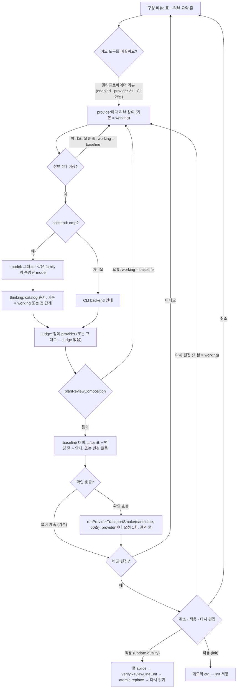

# SPEC-REVMODEL-001 구현 계획

## Tasks

기준은 `feat/rea-001`(ee811e2e)이고 branch는 `feat/revmodel-001`이다. 순서: T1 → T2 → (T3, T4) → T5 → T6 → T7 → T8 → (T9, T10) → T11. 290줄인 `quality_compose_form_driver.go`에는 호출 두 줄만 더하고, 300줄을 넘으면 선택지 조립(`composeReviewTabOption`)과 요약 줄을 새 파일로 옮긴다.

- [ ] T1: 기존 test 분류. tool tab Select의 건너뛰기·선택지 목록을 단언하는 폼 test, init의 `spec.review_gate.providers` 단언, OMP review backend stderr 단언을 grep으로 모아 Existing Test Changes 1–4 중 하나로 정하고 `research.md`에 붙인다. 소스 변경 없음 (REQ-RVM-19).
- [ ] T2: 구성 planner. 소유: `[NEW] internal/cli/quality_compose_review_plan.go`(+test). baseline(cfg와 raw `spec.review_gate.judge` 유무·값)과 working 분리, 참여 목록 계산, 수 검사, judge 규칙(judge 없음 포함), `planReviewComposition`의 오류 4종과 문구, 검증 오류 뒤 working = baseline, 변경 줄 순서와 고정 안내, after 표 (REQ-RVM-02, 03, 04, 05, 09).
- [ ] T3: 증명된 선택지. 소유: `[NEW] internal/cli/quality_compose_review_choices.go`(+test). `installedOMPAttestedModelChoices`를 탭 진입당 1회, thinking 1개 이상, `providerModelFamily`·`ModelFamilyForSelector` family 필터, `(catalog에 없음)`, OMP Autopus 탭과 같은 thinking 순서·기본값, CLI backend 판정, catalog 못 읽음(`catalog_invalid` 포함) 안내 (REQ-RVM-06, 07, 08).
- [ ] T4: 줄 splice writer. 소유: `[NEW] internal/cli/quality_compose_review_write.go`(+test), `[NEW] quality_compose_review_verify.go`(+test). `pruneRetiredConfig`, raw node 위치, scalar·flow·block span, 없는 `judge` 삽입, 거부 7종(anchor·alias·merge·`${`·flow mapping·block scalar·block 목록 주석), `verifyReviewLineEdit`, atomic replace, 다시 읽어 cfg 동기화, `validOMPModelSelector` (REQ-RVM-03, 07, 12, 15).
- [ ] T5: 탭 흐름. 소유: `[NEW] internal/cli/quality_compose_review.go`(+test), `quality_compose_form_driver.go`(호출 두 줄), `quality_compose_form_text.go`. 진입 조건(enabled, provider 둘 이상, CI 아님), 참여 → 수 검사 → model → thinking → CLI 안내 → judge → 검증 → 미리보기 → 확인 요청 Select → 확인(바뀐 편집만) (REQ-RVM-01, 02, 04, 08, 09).
- [ ] T6: 확인 요청과 진단 줄. 소유: `[NEW] internal/cli/quality_compose_review_check.go`(+test), `omp_review_backend.go`(두 줄). 먼저 `pkg/orchestra/command.go`가 CLI provider stderr를 터미널에 넘기는지 확인해 research에 적는다. candidate 사본으로 `runProviderTransportSmoke`(60초), 이름 검사, 결과 줄, 요청 수 라벨(최대 3n), 실패 안내와 확인 기본값, backend 두 줄의 `terminalSafe` (REQ-RVM-10, 11, 20).
- [ ] T7: init·update·quality 연결. 소유: `internal/cli/init.go`(wizard의 Review Gate 대입을 compose 단계 앞으로), T4의 메모리 적용. update·quality는 파일 writer와 cfg 동기화, init은 메모리 cfg (REQ-RVM-12, 13).
- [ ] T8: 비대화형·CI와 호환 고정. 소유: T5·T6 test 파일. entry point별 gate와 CI 탭 규칙에서 탭 선택지 0, 리뷰 title 0, FB 요청 0, bytes 불변. 이 branch가 쓴 파일을 v0.50.125 바이너리(dd6d6ea2로 만든 `auto`)로 읽는 S7 스크립트 (REQ-RVM-14, 15).
- [ ] T9: Should. 메뉴 요약 1줄(`f.draw()` 뒤) (REQ-RVM-16).
- [ ] T10: Should. Form Text en, help·README·CHANGELOG v0.50.126. 생성 표면을 고치면 `make generate-templates` (REQ-RVM-17, 18).
- [ ] T11: 회귀와 smoke. `go test ./internal/cli/... ./pkg/...` 필터 없이, 300줄, `GOOS=windows GOARCH=amd64 go build ./...`, golangci-lint, test 변경이 T1 분류와 같은지. 이 repo의 실제 터미널에서 S15를 하고 `evidence/manual-smoke-revmodel.txt`에 경로를 치환해 남긴다. 빠지면 CD-1이 남는다 (REQ-RVM-19).

## Implementation Strategy

- 판단을 새로 만들지 않는다. 폼은 SPEC-MODELUX-002 `composeSelect`·확인 Select, 증명과 thinking 규칙은 SPEC-MODELUX-003, family는 런타임의 두 함수, 확인 요청은 `runProviderTransportSmoke` 전체, 줄 writer 검사는 `verifyQualityLineEdit` 방식, cfg 동기화는 `ompApply`의 다시 읽기다.
- 새 것은 순수 planner 하나, 줄 splice writer와 그 검사 하나, 탭 흐름 하나, 확인 요청 연결 하나, backend 진단 줄 두 줄 수정이다. 새 의존성과 새 YAML key는 없다.
- 참여는 `spec.review_gate.providers`만 바꾼다. `orchestra.commands`는 Migration 3이 load마다 채우는 값이라 쓰지 않는다(probe A2).
- planner는 파일 I/O 없이 baseline과 working만 받는다. 그래서 init 메모리 경로, update·quality 파일 경로, 확인 요청의 candidate가 같은 결과를 쓴다.

## Visual Planning Brief

UI는 SPEC-MODELUX-002 huh Select의 연속이다(`wireframe intent: assumed`). 요구사항으로 묶는 것은 Review Tab Contract의 순서·기본값·선택지와 Form Text뿐이다.



Wireframe A: 이 repo에서 gemini를 끄고 codex model을 바꾼 미리보기

```text
┃ 어느 도구를 바꿀까요?
┃   모든 도구 같게   Claude Code   Codex   OMP
┃ > 멀티프로바이더 리뷰
┃ gemini 리뷰 참여
┃   그대로 — 켜짐
┃ > 끄기
┃ codex model
┃   그대로 — openai-codex/gpt-6-astra:max
┃   openai-codex/gpt-6-astra
┃ > openai-codex/gpt-6-luna
┃ codex thinking (openai-codex/gpt-6-luna)
┃ > high   low   medium
┃ judge
┃ > 그대로 — claude    codex
provider  리뷰   model                                    judge
claude    켜짐   anthropic/claude-fable-5-1:max           judge
codex     켜짐   openai-codex/gpt-6-luna:high *
gemini    꺼짐 * google-antigravity/gemini-3.1-pro:high
바뀌는 설정
  spec.review_gate.providers [claude, codex, gemini] → [claude, codex]
  orchestra.providers.codex.model openai-codex/gpt-6-astra:max → openai-codex/gpt-6-luna:high
꺼진 provider도 orchestra 명령(brainstorm·plan·review·secure)과 auto spec review --multi에서는 계속 돕니다
바뀐 model은 auto spec review와 orchestra 명령 모두에 쓰입니다
┃ 확인 호출
┃ > 확인 호출 없이 계속
┃   확인 호출 — provider 2개에 요청 1회씩 (재시도 포함 최대 6회 model 호출)
```

Wireframe B: 편집 없이 확인 요청을 한 뒤(바뀐 것이 없으니 확인 Select 없이 메뉴로)

```text
변경 없음
확인 호출 claude (anthropic/claude-fable-5-1:max): 통과
확인 호출 codex (openai-codex/gpt-6-astra:max): 통과
확인 호출 gemini (google-antigravity/gemini-3.1-pro:high): 실패 — HTTP 404 Not Found (Cloud Code Assist)
확인 호출이 실패한 provider가 있습니다. 적용하면 그 provider는 리뷰에서 실패합니다.
```

## Feature Completion Scope

- 이 SPEC 하나가 Outcome Lock을 닫는다. T2–T7은 탭과 쓰기, T6은 확인 요청과 진단 줄, T8은 안전·호환, T1·T11은 회귀와 smoke, T9·T10은 Should다.
- 승인된 sibling 의존성은 없다. 규모는 task 11개, 소스 파일 test 포함 약 17개다. Completion Debt CD-1은 T11의 S15 기록으로만 닫힌다.

## Risk-First Integration Probe

| assumption_id | class | risk | boundary | input | oracle | isolation | status | reason | evidence |
|---------------|-------|------|----------|-------|--------|-----------|--------|--------|----------|
| A1 | verified_fact | high | 실제 loader를 지난 런타임 model이 `orchestra.providers.codex.model`인가 `CodexOrchestraProfile`인가(OMP backend codex) | 이 repo `autopus.yaml` 사본에서 codex model만 `openai-codex/gpt-6-luna:low`, `t.Chdir` 뒤 `loadHarnessConfigForFlags(globalFlags{})`, 그리고 `applyRuntimeHarnessOverrides(…, globalFlags{Effort: "low"})` | loader 뒤와 runtime override 뒤 codex `model`이 쓴 값이고 `args`가 비며 조립된 리뷰 provider의 `Model`도 같음 | `t.TempDir()`, 모델 호출 없음, throwaway test 둘(실행 뒤 삭제) | PASS | `LOADER codex backend="omp" model_policy="" model="openai-codex/gpt-6-luna:low" args=[]`, `RUNTIME(--effort low) codex model="openai-codex/gpt-6-luna:low" args=[]`, `LOADER assemble multi=false provider=codex model="openai-codex/gpt-6-luna:low"`. profile은 `model_policy: quality`일 때 args만 덮는다(`orchestra_run_runtime.go:27-35`) | 2026-10-15 `go test ./internal/cli -run 'TestZZRevmodelProbe2?$' -count=1 -v` 출력(`research.md` `## Probe 기록`) |
| A2 | verified_fact | high | 탭이 쓴 참여가 실제 load 경로(`loadHarnessConfigForFlags` → `loadAndMigrateHarnessConfig` → Migration 3)와 update persist migration을 지나 살아남는가 | 같은 사본에서 `review_gate.providers: [claude, codex]`, `commands.review.providers: [claude, codex]`(gemini 뺌), loader 뒤 `selectSpecReviewProviderNames`·`assembleSpecReviewProviders`, 별도로 `config.Load` + `config.MigrateOrchestraConfig` | review gate 목록은 그대로, 명령 목록은 gemini가 다시 붙음, `--multi`면 gemini가 들어옴 | 같은 throwaway test | PASS | `LOADER review_gate.providers=[claude codex] … commands.review.providers=[claude codex gemini]`, `spec-review names(multi=false)=[claude codex]`, `assemble multi=true … provider=gemini`, `PERSIST migrate changed=true review_gate.providers=[claude codex] commands.review.providers=[claude codex gemini]`. 그래서 참여는 review gate 목록만 쓰고 명령 목록은 쓰지 않는다(J-001) | 같은 출력 |
| A3 | verified_fact | high | v0.50.125 strict loader가 이 탭이 쓰는 key와 값 모양을 읽는가 | 세 provider `backend: omp`, `review_gate.providers: [claude, codex]`, `judge: codex`, codex model `openai-codex/gpt-6-luna:high`인 `autopus.yaml`. 대조군 둘: `review_gate.reviewers` key, 공백 든 selector | 본 파일 exit 0, 대조군은 모르는 key·selector 오류 | scratch dir, `git archive v0.50.125`로 만든 바이너리, 모델 호출 없음 | PASS | 본 파일 `auto config get usage_profile` exit 0(`developer`). 대조군: `field reviewers not found in type config.ReviewGateConf`, `validate config: provider_model_required: codex` | 2026-10-15 scratch `fc125/autopus.yaml`(sha256 앞 16자 `d27927eeb7fcf1c5`)와 `fc125neg` 실행 출력(`research.md` `## Probe 기록`) |

## Plan Statement Classification

| Statement | Class | Evidence |
|-----------|-------|----------|
| judge는 참여 provider이거나 지금의 judge 없음이다 | requirement_invariant | REQ-RVM-04, 05, S3, S9 |
| 리뷰 provider는 둘 이상이고 수 검사는 참여 Select 바로 뒤다 | requirement_invariant | REQ-RVM-05, S3 |
| 바뀐 model만 같은 family의 증명된 설치 model과 대조한다 | requirement_invariant | REQ-RVM-05, 06, S4 |
| 비대화형·CI는 탭을 내지 않고 요청·쓰기가 없다 | requirement_invariant | REQ-RVM-01, 14, S6 |
| 확인 요청은 사용자가 고를 때만 돈다 | requirement_invariant | REQ-RVM-10, S5 |
| OMP backend codex의 런타임 model은 `orchestra.providers.codex.model`이다(실제 loader 경유) | verified_fact | A1 |
| 참여 편집은 `spec.review_gate.providers`로만 살아남고, Migration 3은 명령 목록을 load마다 다시 채운다 | verified_fact | A2, `pkg/config/migrate.go:75-88` Read |
| v0.50.125는 세 key를 읽고 모르는 key·잘못된 selector를 거부한다 | verified_fact | A3 |
| init은 compose 단계 뒤에 `spec.review_gate.providers`를 덮는다 | verified_fact | `init.go:122-129` Read |
| catalog 정규화는 thinking을 정렬하고, thinking 없는 model은 strict 선택지에서 빠진다 | verified_fact | `omp_model_catalog_normalize.go:188-200`, `quality_omp_custom.go:159` Read |
| OMP backend는 일시 오류에 한 요청을 최대 3회 시도한다 | verified_fact | `omp_review_backend_session.go:13, 57-63` Read |
| `terminalSafe("gem\x1b[2Jini\nx")`는 `gem\x1b[2Jini\nx`(역슬래시 글자)다 | verified_fact | 같은 throwaway test의 `TSAFE` 줄 |
| CI는 update gate만 보고 quality·init gate는 보지 않는다 | verified_fact | `quality_compose_driver_gate.go:66-70`, `quality_compose_entry.go:82-84`, `init.go:100` Read |
| quorum이 차면 provider 실패가 `degraded_reasons`에 남지 않는다 | verified_fact | `spec_review_integrity.go:32-43` Read |
| catalog에 있는 `google-antigravity/gemini-3.1-pro:high`가 HTTP 404를 냈다 | verified_fact | planning context의 2026-10-15 one-shot `omp -p` 호출(상위 세션 실행, 이 SPEC에서 재실행 안 함) |
| 줄 splice가 span 밖 bytes를 원본 그대로 둔다(retired key 없는 파일) | implementation_assumption | T4, S12(d) |
| CLI subprocess가 provider stderr를 터미널에 넘기지 않는다 | implementation_assumption | T6 첫 확인. 넘기면 `terminalSafeMultiline` |
| 60초가 max thinking provider의 한 줄 답에 충분하다 | implementation_assumption | T6, S15. 틀리면 실패 줄이 나고 쓰기는 사용자 선택으로 남는다 |

## Scope Expansion Rule

- 구현 중 요구사항보다 넓은 제약이나 동작(예: Migration 3 변경으로 명령 목록에서 provider 빼기, `orchestra.judge` 쓰기, CLI backend args 편집, 확인 요청 자동 실행, `degraded_reasons` 규칙 변경, `--multi` 의미 변경)이 필요해 보이면 요구사항으로 올리지 않는다. scope expansion으로 표시하고 위 표에 probe 행을 더해 fan-out 전에 실제 loader(`loadHarnessConfigForFlags`) 경로에서 확인한다(행은 셋을 넘기지 않으므로 가장 덜 위험한 행과 바꾼다).
- 새 ACL·호환성 제한·보안 제한도 같다. 이 SPEC은 새 key를 쓰지 않으므로 v0.50.125 호환 제한을 더하는 것은 scope expansion이다.

## Gate Applicability

- `{SPEC_DIR}/gate-applicability.json`은 아직 없다. 구현 handoff에서는 `auto spec gates`가 쓴 값만 쓴다. 사용자 설정 파일 쓰기와 외부 model 호출(비용)을 다루므로 classifier가 `security_or_data`로 볼 것으로 예상한다. 예상일 뿐 판정이 아니다.
- security, validation, data_loss, deterministic_oracle gate는 `not_applicable`이 될 수 없다. 터미널 UI 경로가 있으므로 accessibility와 ux_verification은 classifier가 정한다.
