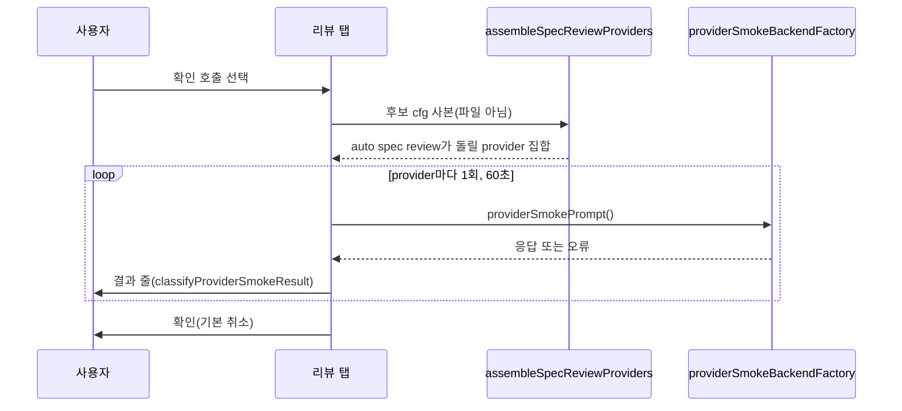

# SPEC-REVMODEL-001 리서치

## 기존 코드 분석

- 설정: `OrchestraConf`(`pkg/config/schema_orchestra.go:4-12`)의 `judge`, `providers`, `commands`. `ProviderEntry`(`:28-37`)의 `backend`·`model`. `CommandEntry`(`:48-53`)의 `providers`(flow)·`judge`. `ReviewGateConf`(`pkg/config/schema_spec.go:11-15`)의 `providers`(flow)·`judge`. 기본값은 CLI backend 셋(`pkg/config/defaults.go:114-120`)과 review gate 셋·judge claude(`:75-81`)다.
- OMP backend 검증: `backend`는 비거나 `omp`만, `omp`면 `validOMPModelSelector`(`schema_provider_backend.go:41-46, 56-75`).
- 런타임 model: `applyRuntimeHarnessOverrides`(`internal/cli/orchestra_run_runtime.go:12-37`)는 codex `model_policy`가 `quality`일 때만 `CodexOrchestraProfile`(`pkg/config/codex_profile.go:93-95`, astra·max 고정)로 args를 덮는다. `providerConfigFromEntry`(`orchestra_helpers.go:221`)는 `Model`을 그대로 옮기고, OMP review backend는 그 값을 selector로 쓴다(`omp_review_backend.go:40-44`).
- 리뷰 provider: `resolveSpecReviewProviderNames`(`spec_review_providers.go:39-51`)는 `--multi`가 없으면 `spec.review_gate.providers`만, 있으면 commands.review, `orchestra.providers` key, 기본 provider를 합친다. `assembleSpecReviewProviders`(`spec_review_readonly.go:53`)가 read-only 정책과 설치 확인을 더한다. judge는 `doctor_provider_readiness.go:36`처럼 목록 밖에서도 합쳐질 수 있다. 그래서 "judge는 참여 provider"는 이 탭이 지킨다.
- 구성 UI: tool tab은 `chooseTab`(`quality_compose_form_driver.go:155`), 분기는 `edit`(`:133`), 확인은 `review`(`:213`)다. OMP 탭의 쓰기 뒤 다시 읽기와 cfg 동기화는 `ompApply`(`quality_compose_omp.go:263`)다. 폼은 `composeFormsTerminal`(`quality_compose_form.go:50-54`)이 참일 때만 열린다.
- 증명 목록: `installedOMPAttestedModelChoices`(`quality_omp_attested_choices.go:17-37`), 항목 `ompCustomModelChoice{Provider, Model, Thinking, Capabilities, Family}`(`quality_omp_custom.go:30-40`). family: `providerModelFamily`(`orchestra_brainstorm_judge.go:67-79`), `ModelFamilyForSelector`(`pkg/orchestra/model_family.go:31-43`).
- 확인 호출 재료: `auto doctor --provider-smoke`(`doctor.go:105-106`, 30초)의 `runProviderTransportSmoke`·`providerSmokePrompt`·`classifyProviderSmokeResult`(`doctor_provider_smoke.go:27, 87-144`).
- writer 재료: `parseAutopusConfigDocument`(`platform_omp_config.go:45`), `replaceAutopusConfigSection`(`:93`), `encodeAutopusConfigRewrite`(`:145`). quality writer `saveQualityBlock`(`quality_config_block.go:29`)은 quality 구역 전용이다.
- init: compose 단계(`init.go:122`) 뒤에 Review Gate 답과 감지 provider를 넣는다(`:126-129`). 비대화형은 provider가 둘보다 적으면 gate를 끈다(`:154-157`).
- receipt: `observationDegradedReasons`(`spec_review_integrity.go:32-43`)는 문서 coverage와 quorum만 본다. 셋 중 하나가 실패해도 quorum(기본 과반)이 차면 사유가 없다. 2026-10-15 receipt의 `degraded_reasons=None`은 이 규칙대로다.

## Probe 기록

- A1·A2(2026-10-15): `internal/cli`에 throwaway `TestZZRevmodelProbe`를 두고 `go test ./internal/cli -run TestZZRevmodelProbe -count=1 -v`로 돌린 뒤 지웠다. 입력은 이 repo `autopus.yaml` 사본(codex model `openai-codex/gpt-6-luna:low`, `review_gate.providers: [claude, codex]`). 출력:
  - `LOADED codex backend="omp" model_policy="" model="openai-codex/gpt-6-luna:low" args=[]`
  - `LOADED review_gate.providers=[claude codex] commands.review.providers=[claude codex gemini]`
  - `RUNTIME(--effort low) codex model="openai-codex/gpt-6-luna:low" args=[]`
  - `ASSEMBLE multi=false` → claude, codex(`openai-codex/gpt-6-luna:low`). `ASSEMBLE multi=true` → claude, codex, gemini(`google-antigravity/gemini-3.1-pro:high`)
- A3(2026-10-15): `git archive v0.50.125`(dd6d6ea2)를 scratch에 풀어 `go build ./cmd/auto`. 본 파일 `config get usage_profile` → exit 0, `developer`. 대조군 → `field reviewers not found in type config.ReviewGateConf`(exit 1), `validate config: provider_model_required: codex`(exit 1). `config get`은 `hints.platform`·`usage_profile`만 받지만 파일 전체를 strict load한다(대조군이 증명).
- 같은 날 상위 세션의 live 증거(재실행 안 함): catalog에 있는 `google-antigravity/gemini-3.1-pro:high` one-shot은 HTTP 404, `gemini-3-pro`는 stream 끊김, `gemini-3.8-flash:high`는 `ok`.

## Plan Intent Ledger

direct `auto plan` 문맥의 ledger다(planning context). 칸은 증거로만 요약한다.

| Field | Status | Source | Confidence | Decision / Assumption | If Wrong | Plan Handoff |
|---|---|---|---|---|---|---|
| goal | answered | user | high | `auto init`·`auto update`(구성 UI를 같이 쓰는 `auto quality` 포함)에서 멀티프로바이더 리뷰 model을 구성한다 | — | requirements (REQ-RVM-01, 13) |
| scope_boundary | answered | user | high | 기존 구성 UI 안의 새 `멀티프로바이더 리뷰` 탭(화살표·Enter, 적용 전 미리보기). 참여 on/off, provider마다 model과 effort·thinking, judge. strategy·timeout·참여에서 나오지 않는 명령별 override는 제외 | creep | non-goals |
| constraints | answered | user + repo | high | 그 provider에 증명된 model만. 비대화형·`--yes`·CI는 묻지 않고 그대로. 새 secret·승인 없음. 옛 바이너리 호환을 위해 기존 key 재사용(확인할 것). 300줄, 생성 표면은 `make generate-templates` | — | constraints (REQ-RVM-06, 14, 15) |
| done_evidence | assumed | planner | medium | 결정적 폼 test, 설정 쓰기 oracle, 미리보기 oracle, init·update 실제 터미널 smoke | weaker | acceptance + CD-1 |
| brownfield_impact | assumed | planner | medium | 기존 설정은 값을 유지하고 update는 지금 리뷰 구성을 보이며 편집할 때만 쓴다 | surprise writes | REQ-RVM-09, 12, 16(Should), S11 |

## Question Audit

- question_transport: AskUserQuestion; question_count: 4 (location=compose tab, scope=providers+model+judge, release=v0.50.126, gemini 404 fix=probe and switch)
- unresolved_fields: done_evidence, brownfield_impact (assumed). 둘은 acceptance 가정과 Reviewer focus로 남겼고 요구사항으로 몰래 올리지 않았다(메뉴 요약은 Should).

## Outcome Lock

- User-visible outcome: `auto init`·`auto update`·`auto quality`의 구성 UI에 `멀티프로바이더 리뷰` 탭이 생긴다. 리뷰 참여 provider, OMP backend provider의 model·thinking(증명된 선택지만), 참여 provider 중 judge를 고르고, 미리보기를 보고, 원하면 provider당 1회 확인 호출로 실제로 답하는지 본 뒤 적용한다. 쓰는 key는 v0.50.125가 읽는 기존 key뿐이다.
- Mandatory requirements: REQ-RVM-01 ~ 15, 19.
- Explicit non-goals: `spec.md` `## Outcome Boundary`의 목록(정책 key, 명령별 편집, CLI backend model, provider 항목 추가·삭제, flag 의미, receipt 규칙, 확인 호출 자동 실행·저장, 새 key).
- Completion evidence: Must S1–S12, S15 PASS, strict validate, 300줄, Windows build, `evidence/manual-smoke-revmodel.txt`.

## Visual Planning Brief

탭 흐름(Mermaid)과 저충실도 wireframe 둘은 `plan.md` `## Visual Planning Brief`에 있다(`wireframe intent: assumed`). 확인 호출의 data-flow:

## Technology Stack Decision

| 항목 | 결정 | 근거 |
|---|---|---|
| mode | brownfield, 변경 없음 | Go module 그대로, 새 의존성 없음. huh·yaml.v3는 기존 의존성 |

## 설계 결정

- D1 탭 위치: 새 명령이나 init wizard 단계가 아니라 기존 tool tab의 마지막 선택지다(사용자 답 location=compose tab). 미리보기·확인·적용 흐름을 그대로 얻는다.
- D2 참여 = `spec.review_gate.providers`에 있음: `auto spec review`의 원천이 그 목록이다(A2). 끄기·켜기는 delta로 모든 목록에 반영해 "참여"가 orchestra 명령에도 같은 뜻이 되게 하고, 손대지 않은 provider의 명령별 차이는 남긴다(사용자: 참여에서 나오지 않는 명령별 override는 제외).
- D3 model은 OMP backend만: 증명 원천인 OMP catalog가 세 family의 model과 thinking을 모두 보고하는 유일한 원천이다. CLI codex model은 `CodexOrchestraProfile`이 정하고(A1의 반대 경우) 기본 gemini에는 model flag가 없다. 대안(CLI args 편집, CLI→OMP 전환)은 `model_policy`·backend라는 정책 변경을 낳아 Evolution Idea로 둔다. 틀린 가정이면(init 사용자가 CLI model 편집을 기대) 새 init 프로젝트는 참여·judge만 고칠 수 있다.
- D4 family 필터: 런타임의 두 함수로 맞춰 provider 이름과 model family가 어긋나지 않게 한다(claude provider에 openai model을 넣으면 family 다양성이 깨진다).
- D5 judge: 참여 provider만. `orchestra.judge`는 편집 전 두 judge가 같았거나 꺼진 provider를 가리킬 때만 따라간다. 사용자가 일부러 다르게 둔 값을 지키면서 "judge는 참여 provider"를 지킨다. 명령별 judge는 꺼진 provider를 가리킬 때만 지운다.
- D6 확인 호출: 새 호출 경로를 만들지 않고 doctor smoke의 prompt·backend·판정을 쓴다. 대상은 후보 cfg로 만든 실제 리뷰 집합이라 통과가 곧 `auto spec review`의 도달 가능성이다. catalog 증명만으로는 404를 못 잡는다(상위 세션 live 증거). 비용 때문에 기본값은 호출 없음이다.
- D7 writer: quality writer는 quality 구역 전용이라 쓰지 못한다. OMP writer의 raw document와 rewrite 검사를 쓰되 구역 통째 재encode 대신 node만 고친다. 그래서 그 구역의 주석과 다른 key가 남는다(가정, S1·S12).
- D8 provider 수 하한 2: init의 기존 규칙과 같다. 하나로 줄이는 것은 Review Gate를 끄는 일이고 이 탭의 범위가 아니다.

## Minimality Decision Matrix

| Ladder step | Evidence | Decision | Receipt item |
|-------------|----------|----------|--------------|
| actual need | Outcome Lock, 2026-10-15 gemini 404와 수동 편집뿐인 지금 상태 | proceed | 탭, 쓰기, 확인 호출 |
| existing code/helper/pattern | `composeSelect`·확인 Select, `installedOMPAttestedModelChoices`, `providerModelFamily`·`ModelFamilyForSelector`, doctor smoke 셋, OMP writer 재료, `ompApply` 다시 읽기, `sortedProviderKeys` | reuse | 판단·호출·검사는 기존 함수 |
| stdlib/native | `slices`(목록 delta), `time`(60초) | use | 목록 편집 |
| existing dependency | huh, yaml.v3 | reuse | 폼, node 편집 |
| new dependency or new abstraction | 의존성 0. 새 abstraction: 순수 planner `planReviewComposition`, node writer `saveReviewComposition` | accepted | REQ-RVM-03–05, 12 |
| minimum sufficient verification | 폼 oracle(accessible runner), 쓰기 diff·SHA, v0.50.125 load, FB 기록, 실제 터미널 smoke 1회 | required checks | security·data-loss·deterministic-oracle gate 유지 |

## Semantic Invariant Inventory

| ID | source clause | invariant type | affected outputs | acceptance IDs |
|----|---------------|----------------|------------------|----------------|
| INV-RVM-01 | "which providers take part (on/off)" | 참여 delta: 끈 provider는 모든 목록에서 빠지고 켠 provider는 없는 목록 끝에 붙으며 나머지 membership은 그대로 | `spec.review_gate.providers`, `orchestra.commands.*.providers` | S1, S8, S9, S10 |
| INV-RVM-02 | "the judge" + 참여 provider | judge ∈ 참여 집합, 하한 2 | judge key 둘, 오류 줄 | S3, S9 |
| INV-RVM-03 | "Only models verified for that provider are offered" | 선택지 = 같은 family ∩ 증명된 설치 model, thinking = 그 model 보고 단계 | Select 목록, 오류 줄 | S2, S4 |
| INV-RVM-04 | "model + effort/thinking" | 쓰는 값 = `<provider>/<model>:<thinking>` | `orchestra.providers.
.model` | S2, S5 |
| INV-RVM-05 | "Non-TTY … no prompt, keep" + 비용 | 확인 호출은 opt-in, 비대화형은 호출·쓰기 0, 실패 뒤 기본 취소 | FB 호출 수, SHA | S5, S6, S11 |
| INV-RVM-06 | "older binaries still load the file" | 쓰는 key 경로 ⊆ 시작 파일 key ∪ v0.50.125 schema | v0.50.125 load 결과 | S7 |
| INV-RVM-07 | "preview before apply" + 쓰기 안전 | 바뀐 node만 쓰고 구역 밖 bytes 불변, 거부면 bytes·cfg 불변 | SHA, diff | S1, S12 |
| INV-RVM-08 | "same flow as the per-tool tabs" | 탭 위치(마지막)와 변경 줄 순서 고정 | 출력 줄 순서 | S1, S9 |

## Feature Coverage Map

| Outcome slice | Covered by | Status |
|---------------|------------|--------|
| 탭 진입·참여·judge·미리보기 | REQ-RVM-01–05, 09 / S1, S3, S9 | covered |
| 증명된 model·thinking·CLI 한계 | REQ-RVM-06–08 / S2, S4, S8 | covered |
| 확인 호출 | REQ-RVM-10, 11 / S5 | covered |
| 쓰기 안전·init·update·비대화형·호환 | REQ-RVM-12–15 / S6, S7, S10–S12 | covered |
| 실제 터미널(gemini 전환) | REQ-RVM-19 / S15 | completion-debt (CD-1) |

## Completion Debt

| Item | Blocks | Required resolution |
|------|--------|---------------------|
| CD-1 실제 터미널 smoke(S15): 확인 호출 결과, gemini 전환, 그 뒤 `auto spec review` provider 상태 | REQ-RVM-19, Outcome Lock의 "실제로 답하는지" | `evidence/manual-smoke-revmodel.txt` 기록(사용자 동의, model 호출 최대 6회). blocker나 생략은 PASS가 아니다 |

## Evolution Ideas
These are optional improvements and do not block sync completion.

| Idea | Why not required now | Promotion trigger |
|------|----------------------|-------------------|
| quorum이 차도 실패한 provider를 receipt에 남기기(`provider_failed:<name>` 같은 정보 사유) | `degraded_reasons`는 승격을 막는다(`evaluateIntegrityGate`). 넣으면 provider 하나만 실패해도 모든 리뷰가 막혀 리뷰 무결성 quorum 규칙을 바꾼다 | 사용자가 승격을 막지 않는 별도 필드를 요청 |
| CLI backend model 편집(claude `--model`·`--effort`, codex `model_policy: pinned`) 또는 CLI→OMP 전환 | 정책 key 변경이고 원천마다 증명 방식이 다르다(D3) | init 사용자 요청 |
| `auto doctor --provider-smoke`에 "catalog에는 있으나 호출 실패" 안내 | 확인 호출이 같은 판정을 이미 보인다 | doctor 개선 요청 |
| 명령별 참여·judge 편집 | 사용자 범위 밖 | 사용자 요청 |

## Sibling SPEC Decision

| Decision | Reason | Sibling SPEC IDs |
|----------|--------|------------------|
| none | 탭·쓰기·확인 호출은 하나의 구성 흐름이다. task 11개, 파일 약 15개라 기준(25개 초과 task이면서 40개 초과 파일)에 못 미친다 | None |

## Reference Discipline

| Reference | Type | Verification |
|-----------|------|--------------|
| 위 `pkg/config`, `pkg/orchestra`, `internal/cli` 경로·함수·줄 번호 | existing | Read, grep(2026-10-15, `feat/revmodel-001` = ee811e2e) |
| v0.50.125 schema·바이너리 | existing (tag) | `git show v0.50.125:pkg/config/schema_orchestra.go`, `schema_spec.go`, `git archive` 빌드(A3) |
| `quality_compose_review*.go`, `planReviewComposition`, `saveReviewComposition`, `composeReviewCheckTimeout`, `evidence/manual-smoke-revmodel.txt` | [NEW] planned addition | 부재 확인(grep) |

## Reviewer Brief

- Intended scope: 구성 UI의 리뷰 탭(참여, OMP model·thinking, judge, 미리보기), 기존 key만 쓰는 writer, opt-in 확인 호출, init 순서 수정.
- Explicit non-goals: 정책 key, 명령별 편집, CLI backend model, receipt 규칙, `--multi`, doctor 변경, 확인 호출 자동화.
- Self-verified: A1·A2(throwaway test), A3(v0.50.125 바이너리와 대조군 둘), Traceability Matrix, oracle 시나리오, existing/[NEW] 구분.
- Reviewer should focus on: 참여 delta와 judge 규칙의 일관성, node writer의 bytes 보존, 확인 호출의 비용·기본값, init 순서, D3 범위 결정, 그리고 Completion Debt only.

## Self-Verify Summary

- Q-CORR-01 | status: PASS | attempt: 1 | files: spec.md, research.md, plan.md | reason: 줄 번호와 함수 이름을 이 branch에서 Read·grep로 확인했다
- Q-CORR-02 | status: PASS | attempt: 1 | files: spec.md, plan.md, research.md | reason: 새 함수·파일·evidence는 [NEW]다
- Q-CORR-04 | status: PASS | attempt: 1 | files: research.md | reason: Reference Discipline이 existing, tag, [NEW]를 나눈다
- Q-COMP-01 | status: PASS | attempt: 1 | files: spec.md, plan.md, acceptance.md, research.md, prd.md | reason: 계약, 계획, oracle, 근거, 요약이 나뉜다
- Q-COMP-02 | status: PASS | attempt: 1 | files: plan.md | reason: 11개 task가 owner 파일과 REQ를 갖는다
- Q-COMP-05 | status: PASS | attempt: 2 | files: research.md, acceptance.md | reason: INV-RVM-01–08이 S1–S12 oracle에 잇고, S7의 key 비교 기준을 시작 파일로 고쳤다
- Q-COMP-06 | status: PASS | attempt: 1 | files: spec.md | reason: Traceability Matrix가 REQ 19개를 잇는다
- Q-COMP-07 | status: PASS | attempt: 1 | files: research.md | reason: live 확인을 CD-1로 남겼다
- Q-COMP-08 | status: PASS | attempt: 1 | files: plan.md | reason: A1–A3 PASS와 실행 증거, 진술 분류, scope expansion 규칙
- Q-SEC-01 | status: PASS | attempt: 1 | files: spec.md | reason: raw node 쓰기, 거부 규칙, terminalSafe, 비용 opt-in이 Trust Model에 있다
