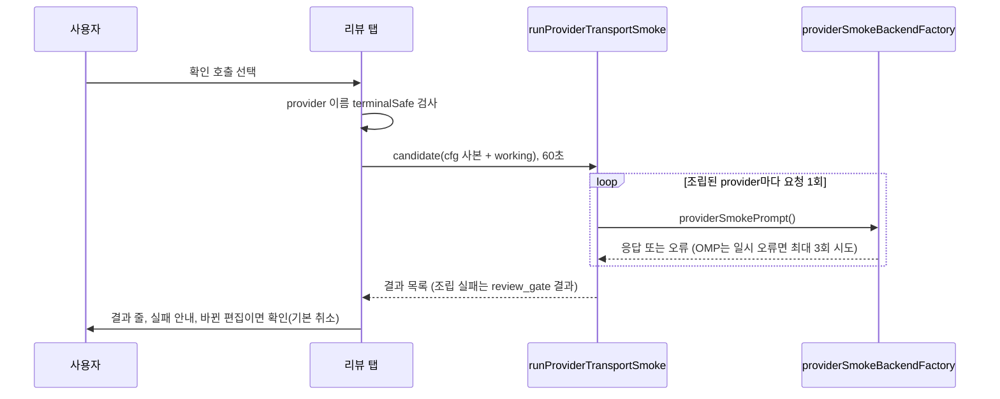

# SPEC-REVMODEL-001 리서치

## 기존 코드 분석

- 설정: `OrchestraConf`(`pkg/config/schema_orchestra.go:4-12`), `ProviderEntry`(`:28-37`)의 `backend`·`model`, `CommandEntry`(`:48-53`). `ReviewGateConf`(`pkg/config/schema_spec.go:11-15`)의 `providers`(flow)·`judge`(omitempty 없음). 기본값은 CLI backend 셋(`pkg/config/defaults.go:114-120`)과 review gate 셋·judge claude(`:75-81`).
- Migration 3(`pkg/config/migrate.go:75-88`)은 `orchestra.providers`의 모든 key를 모든 `orchestra.commands.*.providers`에 없으면 붙인다. 이 migration은 `loadAndMigrateHarnessConfig`(`orchestra_config_fallback.go:39-45`, `auto spec review`·orchestra 명령의 `loadHarnessConfigForFlags`), `init.go:161`(compose 뒤), update의 persist migration에서 돈다. review gate key는 건드리지 않는다(probe A2).
- 런타임 model: `applyRuntimeHarnessOverrides`(`orchestra_run_runtime.go:12-37`)는 codex `model_policy`가 `quality`일 때만 `CodexOrchestraProfile`(`codex_profile.go:93-95`)로 args를 덮는다. `providerConfigFromEntry`(`orchestra_helpers.go:221`)는 `Model`을 옮기고 OMP review backend는 그 값을 selector로 쓴다(`omp_review_backend.go:40-44`).
- CLI argv: `buildSubprocessArgs`(`pkg/orchestra/subprocess_runner.go:111-127`)는 `Config.Args`만 쓴다. claude 기본 args `--print --model claude-fable-5-1 --effort max`(`claude_provider.go:10, 36-47`), 등급 model `ClaudeModelForTier`(`quality_tier.go:8-11, 104-115`), codex 기본은 `model_policy: quality`(`defaults.go:35-37`), gemini는 `agy --print ""`(`defaults.go:119`). `agy --help`는 `--model`과 `models`를 보인다(`evidence/probe-cli-model.md`).
- 리뷰 provider: `resolveSpecReviewProviderNames`(`spec_review_providers.go:39-51`)는 `--multi`가 없으면 `spec.review_gate.providers`만 쓴다. 실제 리뷰는 `planSpecReviewProviders`(`spec_review_readiness.go:59`)의 readiness 필터를 더 거친다. 빈 judge는 judge 없는 리뷰다(`spec_review_loop.go:78`).
- 구성 UI: `chooseTab`(`quality_compose_form_driver.go:155`), `edit`(`:133`), 확인 `review`(`:213`). OMP 탭 쓰기 뒤 다시 읽기는 `ompApply`(`quality_compose_omp.go:263`). 폼 gate는 `composeFormsTerminal`(`quality_compose_form.go:50-54`). CI는 update gate(`quality_compose_driver_gate.go:66-70`)만 본다. quality(`quality_compose_entry.go:82-84`)와 init(`init.go:100`)은 보지 않는다.
- 증명·thinking: `installedOMPAttestedModelChoices`(`quality_omp_attested_choices.go:17-37`). strict 선택지는 thinking 없는 model을 뺀다(`quality_omp_custom.go:159`). 정규화는 thinking을 정렬하고(`pkg/adapter/omp/omp_model_catalog_normalize.go:188-200`) 명시된 빈 배열은 `catalog_invalid`다. OMP Autopus 탭의 thinking 규칙은 `quality_compose_omp_autopus.go:159-171`(기본 첫 단계, working이 있으면 그 값, 하나면 묻지 않음).
- 확인 요청 재료: `runProviderTransportSmoke`·`providerSmokePrompt`·`classifyProviderSmokeResult`(`doctor_provider_smoke.go:27, 87-144`), 30초 기본(`doctor.go:105-106`). OMP backend는 한 요청을 최대 3회 시도하고(`omp_review_backend_session.go:13, 57-63`) stderr에 provider·model·사유를 escape 없이 쓴다(`omp_review_backend.go:52, 72-73`).
- writer 재료: `pruneRetiredConfig`(`config_retired_keys.go:37`), `parseAutopusConfigDocument`(`platform_omp_config.go:45`), 줄 writer 검사 `verifyQualityLineEdit`(`quality_config_verify.go:20`), `atomicWriteQualityConfig`(`quality_config.go:258`). `encodeAutopusConfigRewrite`(`platform_omp_config.go:145`)는 문서 전체를 다시 encode하므로 쓰지 않는다(J-006).
- init: compose 단계(`init.go:122`) 뒤에 Review Gate 답과 감지 provider를 넣는다(`:126-129`). receipt: `observationDegradedReasons`(`spec_review_integrity.go:32-43`)는 coverage와 quorum만 본다.

## Probe 기록

- 1차(2026-10-15, throwaway `TestZZRevmodelProbe`, 실행 뒤 삭제): `config.Load` 경로. `LOADED codex backend="omp" model_policy="" model="openai-codex/gpt-6-luna:low" args=[]`, `RUNTIME(--effort low) codex model="openai-codex/gpt-6-luna:low" args=[]`.
- 2차(review round 1 뒤, throwaway `TestZZRevmodelProbe2`, 삭제): `t.Chdir` 뒤 `loadHarnessConfigForFlags(globalFlags{})`, 입력은 codex `openai-codex/gpt-6-luna:low`와 두 목록 [claude, codex]. 출력 `LOADER review_gate.providers=[claude codex] … commands.review.providers=[claude codex gemini]`, `spec-review names(multi=false)=[claude codex]`, `multi=true`면 gemini 추가, `PERSIST migrate changed=true review_gate.providers=[claude codex]`, `TSAFE "gem\\x1b[2Jini\\nx"`(역슬래시 글자)
- 3차(2026-10-16, throwaway `TestZZRevmodelProbe3`, 실행 뒤 삭제, model 호출 없음): `evidence/probe-cli-model.md`. pinned codex argv에 쓴 `-m gpt-6-luna`와 effort `high`가 남고 quality codex는 `-m gpt-6-astra`로 덮인다. claude `--model`은 남는다. `backend: omp`+`model`로 바꾼 gemini는 OMP backend로 조립된다. v0.50.125는 두 모양을 읽는다(exit 0).
- A3(2026-10-15): `git archive v0.50.125`(dd6d6ea2) 빌드. 본 파일 `config get usage_profile` → exit 0, `developer`. 대조군 → `field reviewers not found in type config.ReviewGateConf`, `validate config: provider_model_required: codex`(둘 다 exit 1). `config get`은 두 key만 받지만 파일 전체를 strict load한다.
- 상위 세션 live 증거(재실행 안 함): catalog의 `google-antigravity/gemini-3.1-pro:high` one-shot은 HTTP 404, `gemini-3-pro`는 stream 끊김, `gemini-3.8-flash:high`는 `ok`.
- 2026-10-16 사용자 결정: 이 repo의 gemini 리뷰 model을 `google-antigravity/gemini-3.8-flash:high`로 바꾼다(위 live 증거). catalog 증명만으로는 404를 못 잡는다는 D6의 근거이고 S15의 목표 값이다. fixture는 이 값에 기대지 않는다(R3는 `gemini-3.1-pro:high` 그대로).

## T1 기존 test 분류

2026-10-16, `feat/revmodel-001`(a15ca6d1). grep(`어느 도구를 바꿀까요`, `Which tool`, `composeFormTabD`, `OMP 리뷰 세션`, `리뷰 세션 재시도`, init test의 `ReviewGate`·`review_gate`)으로 모으고, tool tab 끝에 리뷰 탭 선택지만 임시로 더한 build로 `CI= go test ./internal/cli -count=1`을 돌려 확인했다. 임시 변경은 되돌렸다.

| Existing Test Change | test | 처리 |
|---|---|---|
| 1·2 | `TestComposeForms_ToolTabListsTheInstalledTools`의 `opencode,antigravity-cli` case(`quality_compose_form_driver_test.go:141`) | 유일하게 깨진 test다. D fixture(`DefaultFullConfig`: review gate 켜짐, provider 3개)가 REQ-RVM-01을 만족해 건너뛰던 tool tab이 `모든 도구 같게`·`멀티프로바이더 리뷰`로 열린다. 그 case의 기대값을 두 선택지 목록으로 바꾸고(2), 입력은 이미 넉넉해 Enter를 더하지 않아도 된다(1, 입력 끝은 기본값). 원래 단언(선택지가 하나면 건너뜀)은 바꿀 수 없어, 같은 platform에 `spec.review_gate.enabled: false`인 case(RD 규칙)로 그대로 남긴다 |
| 2, 변경 없음 | `composeFormTabD`나 `…4. OMP\n`까지를 `assert.Contains`로 단언하는 test(`quality_compose_form_driver_test.go:86`, `:139-140`, `quality_compose_form_locale_test.go:21`, `:28`, `quality_compose_omp_test.go:67`, `:160`, `init_compose_omp_test.go:65`, `init_compose_form_test.go:46`, `update_compose_form_test.go:50`) | 목록 앞부분만 단언해 리뷰 탭이 끝에 붙어도 통과한다. 바꾸지 않는다 |
| 3, 해당 없음 | init의 compose 뒤 `spec.review_gate.providers` 단언 | 없다. init test의 wizard stub(`stubInitWizard`)은 Review Gate가 아니오라 T7 뒤에는 탭도 열리지 않는다 |
| 4, 해당 없음 | OMP review backend stderr bytes 단언 | 없다. 두 줄의 문구를 단언하는 test가 없다 |
| 결정성 | 폼 runner `useComposeFormRunner`(`quality_compose_form_helpers_test.go`) | GitHub Actions는 `CI=true`라 REQ-RVM-01이 탭을 숨기고, 위 test 결과가 CI 값에 따라 달라진다. 폼 runner가 `t.Setenv("CI", "")`로 대화형 터미널을 흉내 낸다. `composeCIEnv`를 직접 바꾼 test(`stubDriverProbes`)는 그 값이 이긴다 |

기준 branch에서 이미 실패하는 test 둘은 이 SPEC과 무관하다(변경 없는 base에서 재현): `TestEditGuardCorpus_ProtectedDeniedAndLegitimateAllowed`(`.claude/hooks/README.md` replace를 deny), `TestGeneratePreviewMappings_OMPResolvesToAdapter`(OMP preview 명령 20개 기대, 21개).

## T6 확인 요청의 터미널 경계

2026-10-16 Read. CLI provider의 stderr는 터미널에 가지 않는다. `pkg/orchestra/command.go:50`의 `SetStderr`는 받은 writer를 그대로 쓰고, 확인 요청이 타는 subprocess backend는 그 writer로 buffer를 준다(`pkg/orchestra/subprocess_runner.go:58-60`, `provider_runner.go:46-51`). 그 내용은 `ProviderResponse.Error`와 오류 문자열로만 돌아오고, 탭은 결과 줄에 `terminalSafe`를 거친 첫 줄 200 rune까지만 쓴다. 그래서 `terminalSafeMultiline`을 더할 곳이 없다(implementation_assumption 확인).

같은 경로에서 os.Stderr에 직접 쓰는 줄은 OMP review backend 두 줄(REQ-RVM-20, 이번에 `terminalSafe`) 말고 둘이 더 있다. 둘 다 이 SPEC 전부터 `auto spec review`·`auto doctor --provider-smoke`에도 있는 줄이고 REQ-RVM-20이 이름 짓지 않아 바꾸지 않았다(Scope Expansion Rule). `filterInstalledProviders`(`spec_review_providers.go:23`)의 `경고: <binary> 바이너리를 찾을 수 없습니다 (건너뜀)`은 CLI provider면 `orchestra.providers.
.binary`를 그대로 쓰고, `reportCodexRuntimeFallback`(`codex_catalog_runtime.go:63-80`)은 `model_policy: quality`인 CLI codex의 args model·effort를 쓴다. 고치려면 별도 SPEC이나 이 SPEC의 범위 확장 결정이 필요하다.

## Plan Intent Ledger

direct `auto plan` 문맥의 ledger다(planning context). 칸은 증거로만 요약한다.

| Field | Status | Source | Confidence | Decision / Assumption | If Wrong | Plan Handoff |
|---|---|---|---|---|---|---|
| goal | answered | user | high | `auto init`·`auto update`(구성 UI를 같이 쓰는 `auto quality` 포함)에서 멀티프로바이더 리뷰 model을 구성한다 | — | requirements (REQ-RVM-01, 13) |
| scope_boundary | answered | user | high | 기존 구성 UI 안의 새 탭. 참여 on/off, provider마다 model과 effort·thinking, judge. strategy·timeout·참여에서 나오지 않는 명령별 override는 제외 | creep | non-goals. 참여의 효과 범위는 G1-1 |
| constraints | answered | user + repo | high | 그 provider에 증명된 model만. 비대화형·`--yes`·CI는 묻지 않음. 새 secret·승인 없음. 옛 바이너리 호환(기존 key). 300줄, 생성 표면은 `make generate-templates` | — | constraints (REQ-RVM-01, 06, 14, 15) |
| done_evidence | assumed | planner | medium | 결정적 폼 test, 설정 쓰기 oracle, 미리보기 oracle, init·update 실제 터미널 smoke | weaker | acceptance + CD-1 |
| brownfield_impact | assumed | planner | medium | 기존 설정 유지, update는 지금 구성을 보이고 편집할 때만 쓴다 | surprise writes | REQ-RVM-09, 12, 16(Should), S11(3) |

## Question Audit

- question_transport: AskUserQuestion; question_count: 4 (location=compose tab, scope=providers+model+judge, release=v0.50.126, gemini 404 fix=probe and switch)
- unresolved_fields: done_evidence, brownfield_impact (assumed). acceptance 가정과 Reviewer focus로 남겼고 요구사항으로 몰래 올리지 않았다(메뉴 요약은 Should).

## Outcome Lock

- User-visible outcome: `auto init`·`auto update`·`auto quality`의 구성 UI에 `멀티프로바이더 리뷰` 탭이 생긴다. `auto spec review`에 참여하는 provider, provider마다 model과 effort·thinking(OMP catalog, Claude 탭 model, run의 Codex catalog가 증명한 것만, 증명할 수 없는 CLI는 OMP 전환), 참여 provider 중 judge를 고르고, 미리보기를 보고, 원하면(편집이 없어도) provider당 1회 확인 요청으로 실제로 답하는지 본 뒤 적용한다. 쓰는 key는 v0.50.125가 읽는 기존 key뿐이다.
- Mandatory requirements: REQ-RVM-01 ~ 15, 19 ~ 23.
- Explicit non-goals: `spec.md` `## Outcome Boundary`의 목록. 특히 orchestra 명령 목록과 `--multi`는 바뀌지 않는다(G1-1).
- Completion evidence: Must S1–S12, S15–S22 PASS, strict validate, 300줄, Windows build, `evidence/manual-smoke-revmodel.txt`.

## Visual Planning Brief

탭 흐름(Mermaid)과 저충실도 wireframe 둘은 `plan.md` `## Visual Planning Brief`에 있다(`wireframe intent: assumed`). 확인 요청의 data-flow:

## Technology Stack Decision

| 항목 | 결정 | 근거 |
|---|---|---|
| mode | brownfield, 변경 없음 | Go module 그대로, 새 의존성 없음. huh·yaml.v3는 기존 의존성 |

## 설계 결정

- D1 탭 위치: 기존 tool tab의 마지막 선택지다(사용자 답 location=compose tab). gate는 `spec.review_gate.enabled`, provider 둘 이상, CI 아님(J-015, J-020).
- D2 참여 = `spec.review_gate.providers`만: 명령 목록은 Migration 3이 load마다 다시 채우므로 쓰면 미리보기가 거짓이 되고 다음 update가 되돌린다(J-001, probe A2). planning 예시의 "명령 목록에서도 gemini 제거"는 Migration 3 변경이 필요해 scope expansion이다(G1-1). 미리보기 안내가 명령과 `--multi`는 그대로라고 알린다. 2026-10-16 Gate 1에서 사용자가 이 범위를 확정했다(안내 줄 유지).
- D3 (대체됨 2026-10-16) model은 OMP backend만: 새 `auto init`의 세 CLI provider에서 쓸모가 없어 사용자가 바꿨다. D3'가 대신한다.
- D3' CLI model: claude는 Claude 탭의 등급 model을 args `--model`로, codex는 run의 Codex catalog model을 `model_policy: pinned`와 `ApplyCodexProviderProfile` args로 쓴다. CLI 항목에 `model` key를 쓰는 대안은 v0.50.125가 읽기는 해도 실행에서 무시해 옛 바이너리가 다른 model로 조용히 돈다. args는 옛 바이너리도 그대로 실행한다(A3 3차). 증명할 목록이 없는 CLI(agy)는 OMP catalog로 증명하는 전환만 준다(G1-3).
- D4 family 필터: 런타임의 두 함수로 맞춰 provider 이름과 model family가 어긋나지 않게 한다.
- D5 judge: `spec.review_gate.judge`만 쓴다. `orchestra.judge`는 명령 쪽 값이라 쓰지 않는다(D2와 같은 경계). 빈 judge는 `그대로 — judge 없음`으로 남는다(J-018). raw node로 key 유무를 baseline에 담아 없으면 넣고 `""`면 값만 바꾼다(J-014).
- D6 확인 요청: `runProviderTransportSmoke` 전체를 쓴다. 조립 오류와 0개를 그 함수가 이미 결과로 바꾼다(J-017). 통과는 "답했다"이고 readiness 필터는 별개다(J-016). 요청은 provider당 1회지만 model 호출은 최대 3n회라 라벨이 적는다(J-003). 편집 없이도 돈다(J-004).
- D7 writer: 줄 splice다. `encodeAutopusConfigRewrite`는 문서 전체를 다시 encode해 손으로 쓴 파일의 span 밖 bytes를 바꾼다(J-006). 대상 span만 바꾸고 `verifyQualityLineEdit` 방식의 전체 문서 검사로 anchor 공유(J-007)와 alias를 막는다.
- D8 baseline·working: 비교와 쓰기는 baseline, Select 기본값은 working, 오류 뒤 reset(J-010, J-012). 수 검사는 참여 직후(J-011). baseline 참여가 이미 둘보다 적으면 경고 줄을 쓰고, 오류 뒤 Select의 `나가기`로 언제든 쓰지 않고 나간다(round 2 F-001).
- D9 터미널: backend 진단 줄 두 개에 `terminalSafe`를 더하고(REQ-RVM-20), 이름이 바뀌는 provider가 있으면 확인 요청을 시작하지 않는다(J-002).

## Minimality Decision Matrix

| Ladder step | Evidence | Decision | Receipt item |
|-------------|----------|----------|--------------|
| actual need | Outcome Lock, 2026-10-15 gemini 404와 수동 편집뿐인 지금 상태 | proceed | 탭, 쓰기, 확인 요청 |
| existing code/helper/pattern | `composeSelect`·확인 Select, `installedOMPAttestedModelChoices`와 OMP 탭 thinking 규칙, family 두 함수, `runProviderTransportSmoke`, `verifyQualityLineEdit` 방식, `pruneRetiredConfig`, `atomicWriteQualityConfig`, `ompApply` 다시 읽기, `terminalSafe` | reuse | 판단·호출·검사는 기존 함수 |
| stdlib/native | `slices`(목록), `bytes`(span), `time`(60초) | use | 목록·span 편집 |
| existing dependency | huh, yaml.v3 | reuse | 폼, node 위치 |
| new dependency or new abstraction | 의존성 0. 새 abstraction: 순수 planner `planReviewComposition`, 줄 splice writer `saveReviewComposition`과 `verifyReviewLineEdit` | accepted | REQ-RVM-02–05, 12 |
| minimum sufficient verification | 폼 oracle, loader 값, diff·span 밖 bytes·SHA, v0.50.125 load, FB 기록, stderr pipe, 실제 터미널 smoke 1회 | required checks | security·data-loss·deterministic-oracle gate 유지 |

## Semantic Invariant Inventory

| ID | source clause | invariant type | affected outputs | acceptance IDs |
|----|---------------|----------------|------------------|----------------|
| INV-RVM-01 | "which providers take part (on/off)" | 참여 = 쓴 `spec.review_gate.providers`이고 loader·migration 뒤에도 같다. 명령 목록은 바뀌지 않는다 | review gate 목록, loader 값 | S1, S8, S10, S11 |
| INV-RVM-02 | "the judge" + 참여 provider | judge ∈ 참여 집합 또는 그대로인 judge 없음, 하한 2, baseline이 하한 아래면 경고와 `나가기` | `spec.review_gate.judge`, 오류 줄, 오류 뒤 Select | S3, S9, S18 |
| INV-RVM-03 | "Only models verified for that provider are offered" | 선택지 = 같은 family ∩ 증명된 설치 model, 바뀐 값만 대조(baseline과 같은 값은 catalog에 없어도 통과), thinking = catalog 순서의 보고 단계 | Select 목록, planner 오류(baseline과 다른 값에만) | S2, S4 |
| INV-RVM-04 | "model + effort/thinking" | 쓰는 값 = `<provider>/<model>:<thinking>` | `orchestra.providers.
.model` | S2, S5 |
| INV-RVM-05 | "Non-TTY … no prompt, keep" + 비용 | 확인 요청은 opt-in, 요청 n·호출 최대 3n, 비대화형·CI는 요청·쓰기 0, 실패 뒤 기본 취소 | FB 요청 수, 라벨, SHA | S5, S6, S11 |
| INV-RVM-06 | "older binaries still load the file" | 쓰는 key 경로 ⊆ 시작 파일 key ∪ {`spec.review_gate.judge`} | v0.50.125 load 결과 | S7 |
| INV-RVM-07 | "preview before apply" + 쓰기 안전 | 바뀐 span만 쓰고 span 밖 bytes 불변, 거부면 bytes·cfg 불변 | diff, span 밖 bytes, SHA | S12 |
| INV-RVM-08 | "same flow as the per-tool tabs" | 탭 위치(마지막)와 변경 줄 순서 고정 | 출력 줄 순서 | S1, S2 |
| INV-RVM-09 | 미리보기·다시 편집 | 변경 판정은 baseline, 기본값은 working, 오류 뒤 working = baseline | `변경 없음`, Select 기본값 | S3, S17 |
| INV-RVM-11 | "each provider's model + effort/thinking"(CLI) | CLI 실행 argv의 model = 쓴 값: claude `--model X`, codex `-m X`(pinned, profile 미적용) | 조립된 argv | S19, S20 |
| INV-RVM-12 | "OMP backend로 전환" | 전환은 `backend: omp`와 `model`만 쓰고 조립 backend는 omp, OMP가 없으면 이유 줄 | 조립 config, 이유 줄 | S8, S21 |
| INV-RVM-10 | Trust Model | 확인 요청 중 터미널에 닿는 이름·사유에 제어 문자 0 | stderr bytes, 거부 줄 | S16 |

## Feature Coverage Map

| Outcome slice | Covered by | Status |
|---------------|------------|--------|
| 탭 진입·참여·judge·미리보기 | REQ-RVM-01–05, 09 / S1, S3, S9, S17, S18 | covered |
| 증명된 model·thinking·CLI model·OMP 전환 | REQ-RVM-06–08, 21–23 / S2, S4, S8, S19–S21 | covered |
| 확인 요청·터미널 안전 | REQ-RVM-10, 11, 20 / S5, S16 | covered |
| 쓰기 안전·init·update·비대화형·호환 | REQ-RVM-12–15 / S6, S7, S10–S12, S22 | covered |
| 실제 터미널(gemini 전환) | REQ-RVM-19 / S15 | completion-debt (CD-1) |

## Completion Debt

| Item | Blocks | Required resolution |
|------|--------|---------------------|
| CD-1 실제 터미널 smoke(S15): 두 확인 요청의 결과, gemini 전환, doctor readiness 줄 | REQ-RVM-19, Outcome Lock의 "실제로 답하는지" | `evidence/manual-smoke-revmodel.txt` 기록(사용자 동의, model 호출 보통 6회·최대 18회). blocker나 생략은 PASS가 아니다 |

## Evolution Ideas
These are optional improvements and do not block sync completion.

| Idea | Why not required now | Promotion trigger |
|------|----------------------|-------------------|
| quorum이 차도 실패한 provider를 receipt에 남기기(승격을 막지 않는 정보 필드) | `degraded_reasons`는 승격을 막는다. 사유로 넣으면 provider 하나만 실패해도 모든 리뷰가 막혀 리뷰 무결성 quorum 규칙을 바꾼다 | 사용자가 별도 필드를 요청 |
| Migration 3이 명시적으로 뺀 provider를 다시 붙이지 않게 바꾸기(명령 목록 참여) | load 의미 변경이고 기존 migration test가 바뀐다. Gate 1(2026-10-16)은 리뷰 목록만으로 확정했다 | 사용자가 나중에 명령 목록 참여를 요청 |
| agy model Select(`agy models` 해석으로 증명) | 출력 형식과 증명 규칙이 없다(G1-3) | 사용자가 agy model 편집을 요청 |
| `auto doctor --provider-smoke`에 "catalog에는 있으나 호출 실패" 안내 | 확인 요청이 같은 판정을 이미 보인다 | doctor 개선 요청 |

## Sibling SPEC Decision

| Decision | Reason | Sibling SPEC IDs |
|----------|--------|------------------|
| none | 탭·쓰기·확인 요청은 하나의 구성 흐름이다. task 11개, 파일 약 17개라 기준(25개 초과 task이면서 40개 초과 파일)에 못 미친다 | None |

## Reference Discipline

| Reference | Type | Verification |
|-----------|------|--------------|
| 위 `pkg/config`, `pkg/orchestra`, `pkg/adapter/omp`, `pkg/content`, `internal/cli` 경로·함수·줄 번호 | existing | Read, grep(2026-10-15, `feat/revmodel-001` = ee811e2e), review round 1 교차 확인 |
| v0.50.125 schema·바이너리 | existing (tag) | `git show v0.50.125:pkg/config/schema_orchestra.go`, `schema_spec.go`, `git archive` 빌드(A3) |
| `quality_compose_review*.go`, `composeReviewTabOption`, `planReviewComposition`, `saveReviewComposition`, `verifyReviewLineEdit`, `composeReviewCheckTimeout`, `quality_compose_review_cli.go`, `evidence/manual-smoke-revmodel.txt` | [NEW] planned addition | 부재 확인(grep) |

## Reviewer Brief

- Intended scope: 구성 UI의 리뷰 탭(참여, OMP model·thinking, claude·codex CLI model·effort, OMP 전환, judge, 미리보기), 세 key만 쓰는 줄 splice writer, opt-in 확인 요청, backend 진단 줄 escape, init 순서 수정.
- Explicit non-goals: 명령 목록·`orchestra.judge`·Migration 3, 정책 key, CLI backend model, receipt 규칙, `--multi`, doctor 변경, 확인 요청 자동화.
- Self-verified: A1·A2(실제 loader 경유 throwaway test), A3(v0.50.125 바이너리와 대조군 둘), catalog 정규화·재시도·CI gate 줄 번호, Traceability Matrix, oracle 시나리오, existing/[NEW] 구분.
- Reviewer should focus on: 줄 splice의 span·거부·검사, baseline·working, judge 없음, 확인 요청의 비용·터미널 경계, Gate 1에서 확정된 G1-1·G1-2의 반영, 그리고 Completion Debt only.

## Self-Verify Summary

- Q-CORR-01 | status: PASS | attempt: 2 | files: spec.md, research.md, plan.md | reason: round 1이 짚은 Migration 3·catalog 정규화·재시도·CI gate·NoJudge를 Read로 다시 확인하고 인용을 고쳤다
- Q-CORR-02 | status: PASS | attempt: 2 | files: spec.md, plan.md, research.md | reason: 새 함수·파일·evidence는 [NEW]다
- Q-CORR-03 | status: PASS | attempt: 2 | files: acceptance.md | reason: CATG에서 빈 thinking 배열을 빼고(CATE로 분리) thinking 순서·기본값을 정규화 결과로 고쳤다
- Q-CORR-04 | status: PASS | attempt: 1 | files: research.md | reason: Reference Discipline이 existing, tag, [NEW]를 나눈다
- Q-COMP-02 | status: PASS | attempt: 2 | files: spec.md, acceptance.md | reason: 0명 참여(S3d), CI의 init·quality(S6d), catalog_invalid(S4c), 조립 실패(Live Check 엔진 행), judge 없음(S9)을 닫았다
- Q-COMP-04 | status: PASS | attempt: 2 | files: spec.md, acceptance.md, research.md | reason: 편집 없는 확인 요청을 허용하고 S15 예산을 재시도 포함 18회로, `auto spec review`를 빼 CD-1을 닫을 수 있게 했다
- Q-COMP-05 | status: PASS | attempt: 4 | files: research.md, acceptance.md | reason: round 2에서 S4(b) 음성 사례를 baseline과 다른 비증명 값으로 바꾸고 baseline 대조군을 더했으며 S18(baseline 1개)을 더했다. INV-RVM-01–10이 S1–S18 oracle에 잇는다. loader 값, 손으로 쓴 파일의 span 밖 bytes, 공유 anchor, 최대 호출 수(3n)를 판정한다
- Q-COMP-06 | status: PASS | attempt: 3 | files: spec.md | reason: Traceability Matrix가 REQ 23개를 잇는다(REQ-RVM-21–23 추가)
- Q-COMP-07 | status: PASS | attempt: 1 | files: research.md | reason: live 확인을 CD-1로 남겼다
- Q-COMP-08 | status: PASS | attempt: 2 | files: plan.md | reason: A1·A2를 `loadHarnessConfigForFlags` 경유로 다시 돌렸고 소비처 주장을 진술 분류에 넣었다
- Q-FEAS-01 | status: PASS | attempt: 3 | files: spec.md, plan.md | reason: 참여를 review gate 목록으로 좁혔고 writer를 줄 splice로 바꿨으며, CLI model은 기존 args·`model_policy`로 쓰고 A1·A3 3차가 실행·호환을 확인했다
- Q-FEAS-03 | status: PASS | attempt: 2 | files: acceptance.md | reason: S15는 편집 없는 확인 요청으로 시작하고 CATG는 strict 정규화를 지나는 fixture다
- Q-STYLE-01 | status: PASS | attempt: 2 | files: spec.md | reason: baseline·working을 나눠 비교·기본값·reset 규칙을 따로 적었다
- Q-SEC-01 | status: PASS | attempt: 2 | files: spec.md | reason: backend 진단 줄의 escape(REQ-RVM-20)와 이름 검사로 확인 요청 중 터미널 출력이 경계 안에 있다
- Q-SEC-03 | status: PASS | attempt: 2 | files: spec.md, acceptance.md | reason: backend 직접 출력도 `terminalSafe`를 거치고 S16이 판정한다. 증거 파일은 경로를 치환한다
