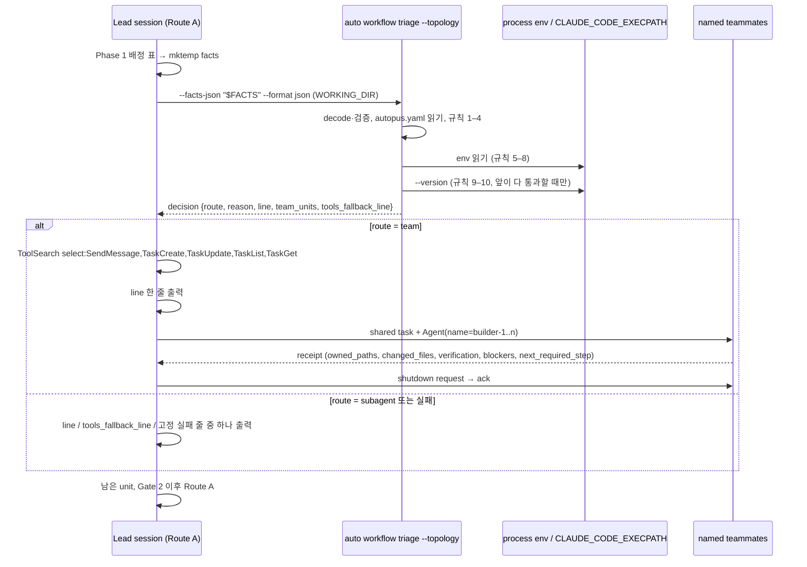

# SPEC-TEAMAUTO-001 구현 계획

## Tasks

기준은 origin/main `33b5bb55`이고 branch는 `feat/teamauto-001`이다. 순서: T1 → T2 → T3(같은 package라 차례로) · T4 · T6(서로 독립) → T5(T1–T4, T6 뒤) → T7 · T8(문구, T5의 출력 모양 확정 뒤) → T9(T7, T8 뒤) → T10(T5 뒤) → T11(마지막). 신규·변경 Go 소스는 300줄 이하다. 기존 `pkg/taskroute/decide.go`(195줄)는 바꾸지 않는다.

- [ ] T1: 판단 함수. 소유: `[NEW] pkg/taskroute/team.go`, `[NEW] pkg/taskroute/team_test.go`. `TeamFacts`·`TeamUnit`·`TopologyFlags`·`Capability`·`TeamDecision` 타입, `DecideTeam`, ready 집합, 기존 `ownershipOverlap`·`cleanPath` 재사용, 정수 버전 비교, 규칙 1–11 순서와 lazy 버전 probe. test는 flag × config × unit 모양 × 능력 표 전체 (REQ-TA-04, 05, 06, 10).
- [ ] T2: facts decode. 소유: `[NEW] pkg/taskroute/team_decode.go`(+test). 기존 `uniqueValue`와 `DisallowUnknownFields`로 decode하고 Topology Facts Contract의 오류 code(`json`, `version`, `topology_conflict`, `unit_id`, `unit_count`, `execution`, `owned_paths`, `depends_on`)를 낸다 (REQ-TA-08).
- [ ] T3: 이유 문구. 소유: `[NEW] pkg/taskroute/team_lines.go`(+test). Reason Line Contract의 ko·en 문자열, `{e}`·`{t}` 정규화, 언어 선택(`ko`만 한국어) (REQ-TA-12).
- [ ] T4: 능력 관측. 소유: `[NEW] internal/cli/workflow_triage_capability.go`(+test). env 조회 주입, EXECPATH guard(절대 경로, regular file, basename, 인자 하나, 5초, `processprobe.OutputLimited` 4096 bytes), PATH 미사용. test는 POSIX에서 fake script, Windows에서는 guard 거부 경로만 (REQ-TA-06).
- [ ] T5: CLI mode. 소유: `internal/cli/workflow_triage.go`(flag 등록과 분기 몇 줄), `[NEW] internal/cli/workflow_triage_topology.go`(+test). `--topology`, 기존 파일 guard 재사용, `config.Load`로 `workflow.auto_team`과 `language.ai_responses` 읽기, 보고서 envelope, human 형식, 오류 문구(`invalid topology facts: <code>`, `config load failed`), `--topology` 없는 경로 무변경 (REQ-TA-08, 09, 13).
- [ ] T6: 설정 key. 소유: `pkg/config/schema_workflow.go`, `[NEW] pkg/config/schema_workflow_auto_team_test.go`. `AutoTeam *bool`(`omitempty`), `AutoTeamEnabled()`, 없음·true·false·문자열 load, init·update·Save 왕복, 빌드한 branch 바이너리와 v0.50.125로 A3 재실행 (REQ-TA-09).
- [ ] T7: auto-go 문구. 소유: `templates/claude/commands/auto-workflows.md.tmpl`의 `## go` Route A 끝. `#### Route A Phase 2 Entry: Agent Team Auto-Selection` 절(Skill Surface Contract 규칙 1–5, 고정 실패 줄, 한 줄 규칙, Gate 2 전 teardown). Step 0, Route B, Route C, Workflow 절은 건드리지 않는다 (REQ-TA-01, 02, 03, 07, 13).
- [ ] T8: agent-teams 문구. 소유: `content/skills/agent-teams.md`. `## Automatic Entry from Route A`(같은 lifecycle, 준비된 wave 하나, tester·guardian 없음, schema 실패 시 fallback 줄, Gate 2 전 teardown, 비용 공지). 명령 문자열은 넣지 않는다 (REQ-TA-02, 07, 14).
- [ ] T9: 생성 surface와 회귀 test. 소유: `[NEW] pkg/adapter/claude/claude_auto_team_surface_test.go`, `[NEW] pkg/adapter/auto_team_platform_parity_test.go`, `make generate-templates`가 바꾸는 생성 root. S6·S7·S13의 절 bytes 비교와 순서, S9의 네 플랫폼 SHA-256 비교. 깨지는 기존 golden 목록을 `research.md`에 붙인다 (REQ-TA-10, 11).
- [ ] T10: 문서. 소유: README 설정 표, CHANGELOG v0.50.126, `auto workflow triage` help 문구(T5 파일 안) (REQ-TA-14).
- [ ] T11: 실제 터미널 확인. 소유: `[NEW] evidence/manual-smoke-teamauto.txt`. S15 (a)(b)와 A2 환경 값. 결과로 A2를 PASS나 FAIL로 바꾸고 CD-1·CD-2를 닫는다 (REQ-TA-15).

## Implementation Strategy

- 판단은 Go 순수 함수 하나다. 세션(LLM)은 facts를 옮기고 결과를 따르기만 한다. 그래서 flag × 설정 × slice × 능력 조합은 `go test`로 결정적으로 판정되고 문구는 생성 skill golden으로 판정된다.
- 새 subcommand 대신 기존 `auto workflow triage`에 mode flag를 붙인다. 파일 guard(`readWorkflowTriageFacts`), 형식 flag(`singleTriageFlag`), JSON hardening(`uniqueValue`), 경로 규칙(`cleanPath`), 겹침(`ownershipOverlap`)을 그대로 쓴다.
- 팀 lifecycle은 Route B를 다시 정의하지 않는다. 자동 진입은 Route B의 named teammate, shared task, receipt, shutdown 규칙을 Phase 2의 한 wave에 쓰고 나머지 run은 Route A다.
- 비 Claude 플랫폼은 공유 content(`agent-pipeline.md`, `references/agent-pipeline/*.md`)를 바꾸지 않아서 그대로다. 바뀌는 생성 원천은 Claude 전용 두 곳뿐이다.
- 설정 key는 바이너리가 스스로 쓰지 않는다. 그래서 옛 바이너리 호환 비용은 끈 사용자에게만 생기고 문서로 알린다(A3).

## Visual Planning Brief

판단 흐름 Mermaid는 `spec.md` `## Visual Planning Brief`다. 아래는 Phase 2 진입의 command flow다.

## Feature Completion Scope

- 이 SPEC 하나가 Outcome Lock을 닫는다. T1–T6은 판단과 설정, T7–T9는 생성 문구와 무변경 증명, T10은 Should 문서, T11은 실제 터미널 증거다.
- 승인된 sibling 의존성은 없다. 규모는 task 11개, 소스 파일 test 포함 약 16개다. Completion Debt CD-1·CD-2는 T11의 S15 기록으로만 닫힌다.

## Risk-First Integration Probe

| assumption_id | class | risk | boundary | input | oracle | isolation | status | reason | evidence |
|---------------|-------|------|----------|-------|--------|-----------|--------|--------|----------|
| A1 | verified_fact | high | 대화형 Claude Code 세션의 Bash tool child process가 팀 능력 신호와 실행 중인 바이너리 버전을 결정적으로 읽는가 | `env` 이름 목록과 지정 값, `"$CLAUDE_CODE_EXECPATH" --version`, `claude --version`, `[ -t 0 ]`·`[ -t 1 ]` | `CLAUDECODE=1`, `CLAUDE_CODE_EXPERIMENTAL_AGENT_TEAMS=1`, `CLAUDE_CODE_ENTRYPOINT=cli`, `CLAUDE_CODE_SESSION_ATTENDED=1`이 보이고 EXECPATH가 `X.Y.Z (Claude Code)`를 출력 | 이 세션의 Bash tool, 모델 호출 없음, 비밀 값 미출력 | PASS | 넷 다 보였다. EXECPATH는 `2.1.288 (Claude Code)`, PATH `claude`는 `2.1.299`라 PATH는 세션 버전이 아니다. stdin·stdout은 TTY가 아니라 TTY로는 대화형을 알 수 없다. 그래서 env + EXECPATH로 정했다 | `evidence/probe-teamauto-capability.md` C1–C5(2026-10-15) |
| A2 | implementation_assumption | high | 같은 신호가 headless·하위 세션·npm 설치를 가르는가: `claude -p`는 (`cli`, `1`)이 아니고, 최상위 대화형 세션에는 `CLAUDE_CODE_CHILD_SESSION`이 없고, npm 설치의 EXECPATH도 버전을 출력한다 | `claude -p`로 env 출력, 최상위 세션 Bash의 env, npm 설치 세션의 EXECPATH | print mode → `not_interactive`, 최상위 → 규칙 8 통과, npm → 버전 해석 또는 `claude_version_unknown` | scratch project, 실제 터미널 | not-run | print mode는 모델 호출이 필요하고 이 probe는 subagent(`CLAUDE_CODE_CHILD_SESSION=1`) 안이었다. 틀려도 대부분은 팀을 놓치는 쪽(현재 동작)이다. 위험한 쪽은 print mode가 (`cli`, `1`)을 보고하는 경우뿐이라 T11이 릴리스 전에 확인한다 | - |
| A3 | verified_fact | high | v0.50.125 strict loader가 `workflow.auto_team`이 든 파일을 읽는가, key 없는 파일은 그대로인가 | scratch HOME·project, v0.50.125 `auto init --yes --platforms claude-code` 뒤 `workflow:` 아래 `auto_team: false` | 거부 오류 문구와 종료 코드, key 없는 update의 종료 0 | scratch HOME·project, 네트워크 없음 | PASS | `auto update --yes` 종료 1, `field auto_team not found in type config.WorkflowConf`, `auto doctor` `[ERROR]`. key 없는 파일은 종료 0이고 key가 생기지 않았다. `--topology`는 `unknown flag`다. 그래서 기본값은 key 없음이고 바이너리는 key를 쓰지 않는다 | `evidence/probe-teamauto-capability.md` F1–F4(2026-10-15) |

## Plan Statement Classification

| Statement | Class | Evidence |
|-----------|-------|----------|
| 판단은 같은 입력에 같은 route·reason·line을 낸다 | requirement_invariant | REQ-TA-04, S4 |
| 팀은 준비된 worker unit 2개 이상이 서로 겹치지 않을 때만이다 | requirement_invariant | REQ-TA-05, S2–S4 |
| 매 Phase 2 진입은 이유 한 줄을 정확히 한 번 출력한다 | requirement_invariant | REQ-TA-01, 07, 13, S13 |
| 명시 flag와 비 Claude 플랫폼의 동작·생성 결과는 그대로다 | requirement_invariant | REQ-TA-10, 11, S6, S7, S9 |
| Bash tool child가 세션 env를 물려받고 EXECPATH가 실행 중인 바이너리다 | verified_fact | A1 |
| PATH의 `claude` 버전은 세션 버전과 다를 수 있다 | verified_fact | A1 C3 |
| v0.50.125는 `workflow.auto_team`이 든 파일을 거부하고 `--topology`를 모른다 | verified_fact | A3 F1–F4 |
| print mode는 (`cli`, `1`)을 보고하지 않는다 | implementation_assumption | A2, T11 |
| 최상위 대화형 세션에는 `CLAUDE_CODE_CHILD_SESSION`이 없다 | implementation_assumption | A2, T11 |
| 자동 진입한 팀도 Route B와 같이 shutdown·자동 정리된다 | implementation_assumption | CD-1, T11 |
| 생성 Claude golden 몇 개가 바뀔 수 있다 | implementation_assumption | T9 |

## Gate Applicability

- `{SPEC_DIR}/gate-applicability.json`은 아직 없다. 구현 handoff는 `auto spec gates`가 쓴 값만 쓴다. 새 CLI mode와 설정 key는 새 계약이라 `--new-contract`로 돌리고 `feature`로 볼 것으로 예상한다. 예상일 뿐 판정이 아니다.
- security, validation, data_loss, deterministic_oracle gate는 `not_applicable`이 될 수 없다. security는 env가 준 경로의 실행(EXECPATH guard)을, data_loss는 설정 저장 왕복을 본다. UI 경로가 없으므로 accessibility와 ux_verification은 classifier가 정한다.
- 요구사항보다 넓은 제약(예: 팀 크기 상한, 팀원 model 지정, 겹침 시 부분 팀, 비 Claude 플랫폼 문구)을 구현이 들여오면 scope expansion으로 표시하고 요구사항으로 올리지 않는다. 필요하면 fan-out 전에 이 표에 probe 행을 더해 기존 런타임에서 먼저 확인한다.
