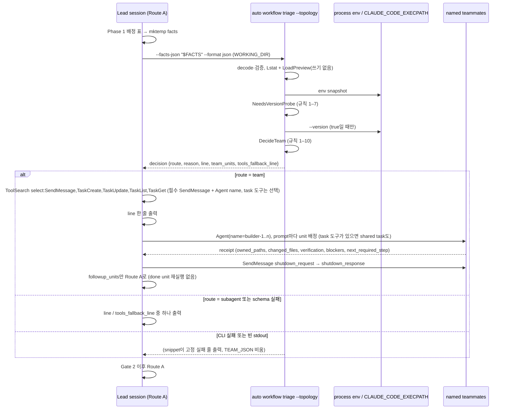

# SPEC-TEAMAUTO-001 구현 계획

## Tasks

기준은 origin/main `33b5bb55`이고 branch는 `feat/teamauto-001`이다. 순서: T1 → T2 → T3(같은 package라 차례로) · T4 · T6(서로 독립) → T5(T1–T4, T6 뒤) → T7 · T8(문구, T5의 출력 모양 확정 뒤) → T9(T7, T8 뒤) → T10(T5 뒤) → T11(마지막) → T12(T11 재-smoke가 찾은 도구 차이, 2026-10-17). 신규·변경 Go 소스는 300줄 이하다. 기존 `pkg/taskroute/decide.go`(195줄)는 바꾸지 않는다.

- [ ] T1: 판단 함수. 소유: `[NEW] pkg/taskroute/team.go`, `[NEW] pkg/taskroute/team_test.go`. `TeamInput`(flags, auto_team, units, capability snapshot, locale)·`TeamUnit`·`TopologyFlags`·`Capability`·`TeamDecision` 타입, 순수 함수 `NeedsVersionProbe`(규칙 1–7 통과 여부)와 `DecideTeam`(규칙 1–10), ready 집합, `followup_units`(team_units에도 done에도 없는 unit, facts 순서), `ownershipOverlap`과 같은 판정식의 `[NEW] firstOverlapPair`, 정수 버전 비교. callback·env·실행 없음. test는 flag × config × unit 모양 × snapshot 표 전체 (REQ-TA-04, 05, 10).
- [ ] T2: facts decode. 소유: `[NEW] pkg/taskroute/team_decode.go`(+test). 기존 `uniqueValue`와 `DisallowUnknownFields`로 decode하고, owned path 끝의 `/**` 하나를 뗀 뒤 `cleanPath`를 적용하며, Topology Facts Contract의 오류 code(`json`, `version`, `topology_conflict`, `unit_id`, `unit_count`, `execution`, `owned_paths`, `depends_on`)를 낸다 (REQ-TA-05, 08).
- [ ] T3: 이유 문구. 소유: `[NEW] pkg/taskroute/team_lines.go`(+test). Reason Line Contract의 ko·en 문자열, `{e}`·`{t}`·`{x}` 정규화, 언어 선택(`ko`만 한국어) (REQ-TA-12).
- [ ] T4: 능력 관측. 소유: `[NEW] internal/cli/workflow_triage_capability.go`(+test). env snapshot, EXECPATH guard(절대 경로, regular file, basename, 인자 하나, 5초, `processprobe.OutputLimited` 4096 bytes), PATH 미사용, env 조회·probe 실행 seam(package 변수). test는 POSIX에서 `<tmp>/probe` fake script, Windows에서는 guard 거부 경로만 (REQ-TA-06).
- [ ] T5: CLI mode. 소유: `internal/cli/workflow_triage.go`(`--topology` flag 등록, `readWorkflowTriageFacts`에서 guard만 하는 `[NEW] readWorkflowTriageFile`을 떼어 내는 refactor, 분기), `[NEW] internal/cli/workflow_triage_topology.go`(+test). 기존 오류 문구 세 개와 `invalid workflow triage facts JSON`은 그대로 둔다. `os.Lstat`로 autopus.yaml 존재를 보고 `config.LoadPreview`로 `workflow.auto_team`·`language.ai_responses`를 읽는다(`config.Load` 금지). snapshot → `NeedsVersionProbe` → 필요할 때만 probe → `DecideTeam`. 보고서 envelope, human 형식, 오류(`invalid topology facts: <code>`, `config load failed: <오류>`) (REQ-TA-06, 08, 09, 13).
- [ ] T6: 설정 key. 소유: `pkg/config/schema_workflow.go`, `[NEW] pkg/config/schema_workflow_auto_team.go`(raw node `!!bool` 검사), `pkg/config/loader_strict.go`(`decodeStrict`에서 호출 한 줄), `[NEW] pkg/config/schema_workflow_auto_team_test.go`. `AutoTeam *bool`(`omitempty`), `AutoTeamEnabled()`, evidence Y의 값 표 전체, init·update·Save 왕복, 빌드한 branch 바이너리와 v0.50.125로 A3 재실행(`true` 포함) (REQ-TA-09).
- [ ] T7: auto-go 문구. 소유: `templates/claude/commands/auto-workflows.md.tmpl`의 `## go` Route A 끝. `#### Route A Phase 2 Entry: Agent Team Auto-Selection` 절(Skill Surface Contract 규칙 1–5, `--continue` 건너뛰기, `sh` snippet 그대로, 한 줄 규칙, shutdown·ack → 남은 unit Route A → Gate 2 순서). Step 0, Route B, Route C, Workflow 절은 건드리지 않는다 (REQ-TA-01, 02, 03, 07, 13).
- [ ] T8: agent-teams 문구. 소유: `content/skills/agent-teams.md`. `## Automatic Entry from Route A`(같은 lifecycle, 준비된 wave 하나, tester·guardian 없음, schema 실패 시 fallback 줄, shutdown·ack 뒤 남은 unit은 Route A, 비용 공지). 명령 문자열은 넣지 않는다 (REQ-TA-02, 07, 14).
- [ ] T9: 생성 surface와 회귀 test. 소유: `[NEW] pkg/adapter/claude/claude_auto_team_surface_test.go`(S6·S7·S13의 절 bytes·순서, S14의 snippet 추출·실행), `[NEW] pkg/adapter/auto_team_platform_parity_test.go`(S9의 네 플랫폼 생성 문자열 부재), `make generate-templates`가 바꾸는 생성 root. 깨지는 Claude golden 목록을 `research.md`에 붙인다. 다른 플랫폼 adapter 파일은 소유하지 않는다 (REQ-TA-01, 10, 11, 13).
- [ ] T10: 문서. 소유: README 설정 표, CHANGELOG v0.50.126, `auto workflow triage` help 문구(T5 파일 안). EXECPATH 조건과 값 무관한 옛 바이너리 거부를 적는다 (REQ-TA-14).
- [ ] T11: 실제 터미널 확인. 소유: `[NEW] evidence/manual-smoke-teamauto.txt`. S15 (a)–(e). 결과로 A2를 PASS나 FAIL로 바꾸고 CD-1·CD-2·CD-3을 닫는다 (REQ-TA-01, 02, 03, 07, 15).
- [ ] T12: 현재 runtime의 팀 도구에 맞춤(2026-10-17 사용자 결정, T11 재-smoke에서 발견). 소유: `templates/claude/commands/auto-workflows.md.tmpl`(자동 진입 규칙 5, Route B preflight·배정·teardown), `content/skills/agent-teams.md`(Preflight, 배정, Result Handoff, Teardown, Automatic Entry, Failure Policy), `content/rules/deferred-tools.md`(preload 행), `pkg/taskroute/team_lines.go`(`team_tools_unavailable` 문구)와 그 test, surface test digest, TUIUX base golden. 필수 도구는 `SendMessage`와 `Agent`의 `name` 인자이고 공유 task-list 도구는 선택이다. 증거는 `evidence/probe-teamauto-teamtools.md` (REQ-TA-02, 07, 10).

## Implementation Strategy

- 판단은 Go 순수 함수 둘(`NeedsVersionProbe`, `DecideTeam`)이고 관측(env, 버전 probe)은 CLI의 일이다. 세션(LLM)은 facts를 옮기고 결과를 따르기만 한다. CLI가 실패하면 생성 `sh` snippet이 고정 줄을 직접 출력해 그 분기도 실행으로 판정된다. 그래서 flag × 설정 × slice × 능력 조합은 `go test`로 결정적으로 판정되고 문구는 생성 skill golden으로 판정된다.
- 새 subcommand 대신 기존 `auto workflow triage`에 mode flag를 붙인다. 파일 guard(`readWorkflowTriageFacts`에서 떼어 낸 `readWorkflowTriageFile`), 형식 flag(`singleTriageFlag`), JSON hardening(`uniqueValue`), 경로 규칙(`cleanPath`), 겹침 판정식(`ownershipOverlap`), 쓰지 않는 설정 load(`config.LoadPreview`)를 쓴다.
- 팀 lifecycle은 Route B를 다시 정의하지 않는다. 자동 진입은 Route B의 named teammate, receipt, shutdown 규칙과 (task-list 도구가 있을 때만) shared task를 Phase 2의 한 wave에 쓰고 나머지 run은 Route A다.
- 비 Claude 플랫폼은 공유 content(`agent-pipeline.md`, `references/agent-pipeline/*.md`)를 바꾸지 않아서 그대로다. 바뀌는 생성 원천은 Claude 전용 두 곳뿐이다.
- 설정 key는 바이너리가 스스로 쓰지 않는다. v0.50.125는 값과 무관하게 key가 있으면 파일을 거부하므로(A3) 호환 비용은 key를 직접 쓴 사용자(`true`든 `false`든)에게만 생기고 문서로 알린다.

## Visual Planning Brief

판단 흐름 Mermaid는 `spec.md` `## Visual Planning Brief`다. 아래는 Phase 2 진입의 command flow다.

## Feature Completion Scope

- 이 SPEC 하나가 Outcome Lock을 닫는다. T1–T6은 판단과 설정, T7–T9는 생성 문구와 무변경 증명, T10은 Should 문서, T11은 실제 터미널 증거다.
- 승인된 sibling 의존성은 없다. 규모는 task 11개, 소스 파일 test 포함 약 19개다. Completion Debt CD-1·CD-2·CD-3은 T11의 S15 기록으로만 닫힌다.

## Risk-First Integration Probe

| assumption_id | class | risk | boundary | input | oracle | isolation | status | reason | evidence |
|---------------|-------|------|----------|-------|--------|-----------|--------|--------|----------|
| A1 | verified_fact | high | 대화형 Claude Code 세션의 Bash tool child process가 팀 능력 신호와 실행 중인 바이너리 버전을 결정적으로 읽는가 | `env` 이름 목록과 지정 값, `"$CLAUDE_CODE_EXECPATH" --version`, `claude --version`, `[ -t 0 ]`·`[ -t 1 ]` | `CLAUDECODE=1`, `CLAUDE_CODE_EXPERIMENTAL_AGENT_TEAMS=1`, `CLAUDE_CODE_ENTRYPOINT=cli`, `CLAUDE_CODE_SESSION_ATTENDED=1`이 보이고 EXECPATH가 `X.Y.Z (Claude Code)`를 출력 | 이 세션의 Bash tool, 모델 호출 없음, 비밀 값 미출력 | PASS | 넷 다 보였다. EXECPATH는 `2.1.288 (Claude Code)`, PATH `claude`는 `2.1.299`라 PATH는 세션 버전이 아니다. stdin·stdout은 TTY가 아니라 TTY로는 대화형을 알 수 없다. 그래서 env + EXECPATH로 정했다 | `evidence/probe-teamauto-capability.md` C1–C5(2026-10-15) |
| A2 | implementation_assumption | high | 같은 신호가 headless·하위 세션·npm 설치를 가르는가: `claude -p`는 (`cli`, `1`)이 아니고, 최상위 대화형 세션에는 `CLAUDE_CODE_CHILD_SESSION`이 없고, npm 설치의 EXECPATH도 버전을 출력한다 | `claude -p`로 env 출력, 최상위 세션 Bash의 env, npm 설치 세션의 EXECPATH | print mode → `not_interactive`, 최상위 → (지운) 규칙 8 통과, npm → 버전 해석 또는 `claude_version_unknown` | scratch project, 실제 터미널 | FAIL | 2026-10-17 S15 smoke(Claude Code 2.1.301): 최상위 대화형 세션의 Bash 환경에도 `CLAUDE_CODE_CHILD_SESSION=1`이 있어 disjoint plan의 `/auto go`가 `not_top_level` 줄로 subagent에 남았다. 2.1.288·2.1.301 바이너리는 세션이 띄우는 모든 process에 이 값을 상수 `"1"`로 넣고, teammate·subagent 환경도 같다. 그래서 규칙 8을 지우고 subagent는 REQ-TA-07 schema fallback에 맡겼다(research D11). print mode가 (`cli`, `1`)이 아닌지와 npm EXECPATH는 아직 실행 전이라 T11이 S15(e)로 릴리스 전에 확인한다 | `evidence/probe-teamauto-childsession.md` H1–H3·T·S(2026-10-17) |
| A3 | verified_fact | high | v0.50.125 strict loader가 `workflow.auto_team`이 든 파일을 읽는가, key 없는 파일은 그대로인가 | scratch HOME·project, v0.50.125 `auto init --yes --platforms claude-code` 뒤 `workflow:` 아래 `auto_team: false` | 거부 오류 문구와 종료 코드, key 없는 update의 종료 0 | scratch HOME·project, 네트워크 없음 | PASS | `auto update --yes` 종료 1, `field auto_team not found in type config.WorkflowConf`, `auto doctor` `[ERROR]`. key 없는 파일은 종료 0이고 key가 생기지 않았다. `--topology`는 `unknown flag`다. 그래서 기본값은 key 없음이고 바이너리는 key를 쓰지 않는다 | `evidence/probe-teamauto-capability.md` F1–F4(2026-10-15) |

## Plan Statement Classification

| Statement | Class | Evidence |
|-----------|-------|----------|
| 판단은 같은 입력에 같은 route·reason·line을 낸다 | requirement_invariant | REQ-TA-04, S4 |
| 팀 wave 뒤 남은 Phase 2 unit을 구현한 다음에 Gate 2로 간다 | requirement_invariant | REQ-TA-02, S13, S15 |
| 팀은 준비된 worker unit 2개 이상이 서로 겹치지 않을 때만이다 | requirement_invariant | REQ-TA-05, S2–S4 |
| 매 Phase 2 진입은 이유 한 줄을 정확히 한 번 출력한다 | requirement_invariant | REQ-TA-01, 07, 13, S13 |
| 명시 flag와 비 Claude 플랫폼의 동작·생성 결과는 그대로다 | requirement_invariant | REQ-TA-10, 11, S6, S7, S9 |
| Bash tool child가 세션 env를 물려받고 EXECPATH가 실행 중인 바이너리다 | verified_fact | A1 |
| PATH의 `claude` 버전은 세션 버전과 다를 수 있다 | verified_fact | A1 C3 |
| v0.50.125는 `workflow.auto_team`이 든 파일을 거부하고 `--topology`를 모른다 | verified_fact | A3 F1–F4 |
| `config.LoadPreview`는 autopus.yaml을 쓰지 않고, `config.Load`는 platform 이름 정규화 때 쓴다 | verified_fact | evidence R2 |
| yaml.v3 `*bool` decode는 `yes`·`"off"`를 bool로, `null`을 nil로 받는다 | verified_fact | evidence Y |
| root는 오류를 `Error: <msg>\n`으로 쓰고 일반 종료 코드는 1이다 | verified_fact | evidence R1 |
| print mode는 (`cli`, `1`)을 보고하지 않는다 | implementation_assumption | A2, T11 |
| `--disallowedTools SendMessage` 세션에서는 SendMessage schema 로드가 실패한다 | implementation_assumption | S15(c), T11 |
| Claude Code 2.1.288·2.1.301의 기본 대화형 세션에는 `TaskCreate`·`TaskUpdate`·`TaskList`·`TaskGet`이 없고 ToolSearch는 있는 도구만 돌려준다 | verified_fact | `evidence/probe-teamauto-teamtools.md` R2·R4·S1 |
| `Agent`의 team 이름 인자는 무시되고 세션에는 implicit team 하나뿐이다 | verified_fact | `evidence/probe-teamauto-teamtools.md` S2 |
| 최상위 대화형 세션과 subagent의 Bash 환경에 모두 `CLAUDE_CODE_CHILD_SESSION=1`이 있어 그 값으로는 최상위를 가를 수 없다(처음 가정 "최상위에는 없다"는 반증됨) | verified_fact | A2 FAIL, `evidence/probe-teamauto-childsession.md` |
| 자동 진입한 팀도 Route B와 같이 shutdown·자동 정리된다 | implementation_assumption | CD-1, T11 |
| 생성 Claude golden 몇 개가 바뀔 수 있다 | implementation_assumption | T9 |

## Gate Applicability

- `{SPEC_DIR}/gate-applicability.json`은 아직 없다. 구현 handoff는 `auto spec gates`가 쓴 값만 쓴다. 새 CLI mode와 설정 key는 새 계약이라 `--new-contract`로 돌리고 `feature`로 볼 것으로 예상한다. 예상일 뿐 판정이 아니다.
- security, validation, data_loss, deterministic_oracle gate는 `not_applicable`이 될 수 없다. security는 env가 준 경로의 실행(EXECPATH guard)을, data_loss는 설정 저장 왕복을 본다. UI 경로가 없으므로 accessibility와 ux_verification은 classifier가 정한다.
- 요구사항보다 넓은 제약(예: 팀 크기 상한, 팀원 model 지정, 겹침 시 부분 팀, 비 Claude 플랫폼 문구)을 구현이 들여오면 scope expansion으로 표시하고 요구사항으로 올리지 않는다. 필요하면 fan-out 전에 이 표에 probe 행을 더해 기존 런타임에서 먼저 확인한다.
