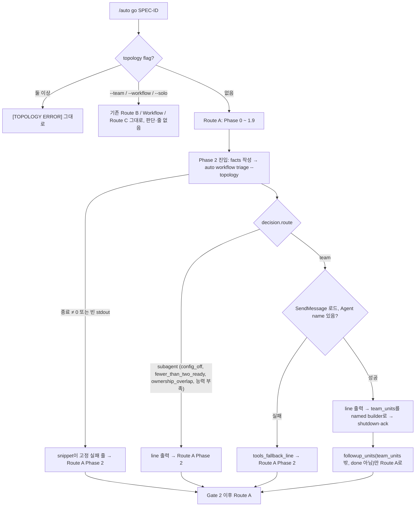

# SPEC-TEAMAUTO-001: /auto go가 조건이 맞을 때 Phase 2를 native Agent Team으로 자동 실행

**Status**: completed
**Created**: 2026-10-15
**Revised**: 2026-10-15 (review round 1: F-001–F-006, F-010–F-021, 미룬 F-007–F-009도 반영. round 2: F-022, F-019. `evidence/review-rounds.md`), 2026-10-17 (S15 실제 터미널 smoke가 A2의 `CLAUDE_CODE_CHILD_SESSION` 가정을 반증해 규칙 8 `not_top_level`을 뺐다. `evidence/probe-teamauto-childsession.md`. 재-smoke에서 Claude Code 2.1.301의 ToolSearch가 `SendMessage`만 돌려줘, 사용자 결정으로 자동 진입과 `--team`의 팀 도구 요구를 `SendMessage`와 `Agent`의 `name` 인자로 줄이고 공유 task-list 도구는 선택으로 바꿨다. `evidence/probe-teamauto-teamtools.md`)
**Domain**: TEAMAUTO
**Module**: autopus-adk
**Release**: v0.50.126(SPEC-MODELUX-003, SPEC-REA-001, PR #199와 함께). 작업 branch는 `feat/teamauto-001`이고 기준은 origin/main `33b5bb55`다. PATH의 기준 바이너리는 `auto 0.50.125`다.
**Source PRD**: `prd.md`. 근거와 probe는 `research.md`, `evidence/probe-teamauto-capability.md`에 있다.

## 목적

지금 `/auto go`는 `--team`을 줘야만 native Agent Team(Route B)을 쓴다. 기본 Route A는 서로 독립인 slice도 subagent로 돌린다. 사용자는 두 조건이 모두 맞을 때만 자동으로 팀을 쓰기를 원한다. (a) 세션이 native team을 실행할 수 있다. (b) plan에 owned paths가 겹치지 않고 함께 실행할 수 있는 준비된 slice가 2개 이상 있다. 전환할 때도 안 할 때도 이유 한 줄을 보이고, `--solo`(run마다)나 설정(계속)으로 끌 수 있어야 한다.

이 SPEC은 Route A가 Phase 2(Implementation)에 들어갈 때 한 번 판단한다. 판단은 `pkg/taskroute`의 순수 함수가 하고 기존 `auto workflow triage`에 붙인 `--topology` mode가 노출한다. 세션 능력은 CLI가 자기 process 환경(Bash tool이 물려받은 세션 환경)과 실행 중인 Claude Code 바이너리(`CLAUDE_CODE_EXECPATH`)에서 읽는다. 팀 lifecycle은 기존 Route B 계약을 그대로 쓴다.

## Outcome Boundary

- Outcome Lock 원문은 `research.md` `## Outcome Lock`이다.
- Mandatory requirements: REQ-TA-01 ~ REQ-TA-13, REQ-TA-15 (Must). REQ-TA-14는 Should.
- Explicit non-goals:
  - `/auto plan`, `/auto review`, `auto pipeline run`, Phase 1·1.5·Gate 2·3·4의 실행 방식 변경. 의존 관계가 있는 단계는 subagent 그대로다
  - 비 Claude 플랫폼(codex, antigravity-cli, opencode, omp)의 생성 결과 변경. 이유 한 줄도 더하지 않는다(`research.md` 가정 AS-1)
  - 새 topology flag(`--no-team` 등), topology flag 상호 배타 규칙, `--team`·`--workflow`·`--solo`의 의미와 진단 변경. 예외는 2026-10-17 사용자 결정 하나다: `--team` preflight와 agent-teams lifecycle의 도구 요구를 현재 runtime에 맞춰 공유 task-list 도구를 선택으로 바꿨다(REQ-TA-10)
  - Route B 계약 밖의 팀 기능: 팀 크기 정책, 팀원 model 지정, pane 시각화, 두 번째 wave 재판단, 겹치는 slice 자동 재분할
  - `--workflow` Workflow 기반층과의 결합, `workflow.team_default` 부활
- Completion evidence: Must S1–S15 PASS, `go test ./pkg/taskroute/... ./internal/cli/... ./pkg/config/... ./pkg/adapter/...`, 신규·변경 package coverage 85% 이상, 신규·변경 Go 소스 300줄 이하, `GOOS=windows GOARCH=amd64 go build ./...`, `make generate-templates` 뒤 drift 없음, `evidence/manual-smoke-teamauto.txt`(S15), `auto spec validate .autopus/specs/SPEC-TEAMAUTO-001 --strict`. `research.md` `## Completion Debt`의 CD-1·CD-2·CD-3이 남아 있으면 완료가 아니다.

## Trust Model

- facts의 unit 집합은 세션이 Phase 1 배정 표에서 옮긴 선언이다. CLI는 파일시스템 소유권을 확인하지 않는다(`pkg/taskroute/decide.go`의 `workerScopeContained` 주석과 같은 경계). 보고서는 `unit_source: caller_declared`로 이를 밝힌다.
- 세션 환경 변수는 판단에만 쓴다. 이유 한 줄에는 정규화한 값만 넣는다(Reason Line Contract). `CLAUDE_CODE_MESSAGING_TOKEN` 같은 비밀 값은 읽지 않는다.
- `CLAUDE_CODE_EXECPATH` 실행은 Capability Observation Contract의 guard를 모두 통과할 때만 한다. 하나라도 어긋나면 실행하지 않고 `claude_version_unknown`이다. PATH의 `claude`는 찾지 않는다.
- CLI는 파일을 쓰지 않는다. facts 파일은 세션이 `mktemp`로 만든 임시 파일이고 CLI는 기존 guard(regular file, 1 MiB, `os.SameFile`)로 읽기만 한다. 설정은 쓰지 않는 `config.LoadPreview`(`pkg/config/loader.go:22-25`)로 읽는다. `config.Load`는 platform 이름을 정규화하면 autopus.yaml을 다시 쓰므로 쓰지 않는다(evidence R2).
- CLI의 child process는 REQ-TA-06의 버전 probe 하나뿐이다. agent나 teammate를 띄우지 않는다.

## Requirements

### REQ-TA-01 판단 시점과 한 줄
Priority: Must · EARS: Event-driven

WHEN a Claude Code `/auto go` run with no topology flag enters Phase 2, THEN THE SYSTEM SHALL evaluate the Auto-Team Decision exactly once before any Phase 2 dispatch and SHALL print exactly one reason line from the Reason Line Contract, whether the route is `team` or `subagent`.

- Step 0의 `Mode:` 표시는 바꾸지 않는다. `--continue`로 Phase 2 뒤에서 이어지는 run은 판단하지 않고 줄도 없다.

### REQ-TA-02 팀 실행
Priority: Must · EARS: Event-driven

WHEN the decision route is `team`, the `SendMessage` schema loads, and the `Agent` tool exposes its `name` parameter, THEN THE SYSTEM SHALL run exactly the units in `team_units` as named teammates under the Route B lifecycle, SHALL send every teammate a shutdown request and wait for every acknowledgement, SHALL then implement exactly the units in `followup_units` (Phase 2 units that are neither in `team_units` nor done) under the Route A Phase 2 rules, re-running no done unit, and only after that SHALL enter Gate 2 under Route A.

- 팀원 이름은 `team_units` 순서로 `builder-1` … `builder-n`이다. 각 prompt는 자기 unit 배정과 Phase 2 prompt와 같은 항목(요구사항, owned·forbidden paths, acceptance, gate 결정, minimality ladder), Route B receipt 필드를 담는다. tester·guardian 팀원은 띄우지 않는다.
- 공유 task-list 도구(`TaskCreate`, `TaskUpdate`, `TaskList`, `TaskGet`)는 같은 ToolSearch로 요청해 돌아오면 unit마다 task를 기록한다. 돌아오지 않으면(Claude Code 2.1.288·2.1.301의 기본) lead가 unit을 직접 추적한다. 완료는 팀원 결과나 `SendMessage` 보고로 알고 receipt 다섯 필드는 lead가 기록한다. shutdown은 `SendMessage`의 `shutdown_request`와 `shutdown_response`다.

### REQ-TA-03 subagent 유지
Priority: Must · EARS: Event-driven

WHEN the decision route is `subagent`, THEN THE SYSTEM SHALL run Phase 2 exactly as Route A runs it today and SHALL launch no named teammate.

### REQ-TA-04 판단 함수
Priority: Must · EARS: Ubiquitous

THE SYSTEM SHALL compute the Auto-Team Decision with two pure functions over one input value (topology flags, config value, declared units, observed capability snapshot, locale): `NeedsVersionProbe` reports whether rules 1–7 all pass, and `DecideTeam` applies the rules of the Auto-Team Decision Contract in order and returns the first match, so identical inputs always yield the identical route, reason code, and line.

### REQ-TA-05 준비된 독립 slice
Priority: Must · EARS: Ubiquitous

THE SYSTEM SHALL treat a unit as ready only when its execution is `worker`, it is not done, and every unit it depends on is done, SHALL select `team` only when at least two units are ready and no two ready units own the same cleaned path or a path inside the other's owned path, and for route `team` SHALL report as `followup_units` exactly the units that are neither in `team_units` nor done, in facts order.

### REQ-TA-06 능력 관측
Priority: Must · EARS: Ubiquitous

THE SYSTEM SHALL build the capability snapshot in the CLI only from its process environment and from the version printed by `CLAUDE_CODE_EXECPATH --version` under the Capability Observation Contract, SHALL never consult a `claude` found on PATH, and SHALL run the version probe only when `NeedsVersionProbe` returns true.

### REQ-TA-07 도구 schema 실패
Priority: Must · EARS: Unwanted

IF the decision route is `team` and the `SendMessage` schema cannot be loaded or the `Agent` tool has no `name` parameter, THEN THE SYSTEM SHALL print `tools_fallback_line` instead of `line`, so the run still prints exactly one line, and SHALL run Phase 2 under Route A; missing shared task-list tools SHALL NOT trigger this fallback.

- 환경으로는 최상위 세션과 subagent를 가를 수 없다(Capability Observation Contract). `Agent`가 없는 subagent·teammate는 이 확인에서 subagent로 남는다.

### REQ-TA-08 CLI
Priority: Must · EARS: Event-driven

WHEN `auto workflow triage --topology --facts-json <file>` runs, THEN THE SYSTEM SHALL validate the file against the Topology Facts Contract, SHALL print the decision report as JSON (default) or only the reason line (`--format human`), SHALL launch no agent or teammate, write no file, and change no gate, and SHALL report facts that fail the contract as a `subagent` decision with reason `invalid_facts`, the failed code in `facts_error`, and a reason line that names the code.

- 잘못된 facts는 오류가 아니라 종료 0의 decision이다. 생성 snippet이 stderr를 버리므로 오류로 내면 원인이 사용자에게 보이지 않기 때문이다(review LOW 2). 파일 guard와 설정 오류는 root가 `Error: <msg>\n`으로 stderr에 쓰고 종료 1이다(`internal/cli/root.go:203-211`, `:173-179`, evidence R1). child process는 버전 probe 하나뿐이다.
- `--topology`가 없으면 기존 triage의 stdout·stderr·종료 코드가 기준 빌드와 같다(S11).

### REQ-TA-09 설정 key
Priority: Must · EARS: State-driven

WHERE `autopus.yaml` sets `workflow.auto_team: false`, THEN THE SYSTEM SHALL return route `subagent` with reason `config_off`, SHALL treat an absent key or `true` as enabled, SHALL reject at load every value whose YAML node is not tagged `!!bool` (including `null`, `~`, an empty value, quoted strings, `yes`/`no`/`on`/`off`/`y`/`n`, and numbers) with an error naming `workflow.auto_team` and its line, SHALL keep a set value across `auto update` and every config save, and SHALL never write the key when the user has not set it.

### REQ-TA-10 명시 flag
Priority: Must · EARS: Event-driven

WHEN `/auto go` receives `--team`, `--workflow`, or `--solo`, THEN THE SYSTEM SHALL keep the current topology semantics and diagnostics, SHALL require in the `--team` preflight only the `Agent` tool's `name` parameter and the `SendMessage` schema among tools, treating the shared task-list tools as optional, and SHALL neither run nor print the Auto-Team Decision; the decision function SHALL return the flag's route with reason `explicit_flag` without reading capability.

- `--team` preflight의 도구 줄은 2026-10-17 사용자 결정으로 바뀌었다. 전에는 `Agent`, `SendMessage`, 공유 task-list 도구 schema를 모두 요구해 Claude Code 2.1.288·2.1.301 기본 세션에서 늘 blocker였다. 나머지 preflight(버전, `CLAUDE_CODE_EXPERIMENTAL_AGENT_TEAMS=1`, 대화형)와 "If preflight fails, report the blocker and suggest Route A."는 그대로다.

### REQ-TA-11 비 Claude 플랫폼
Priority: Must · EARS: State-driven

WHERE the target platform is codex, antigravity-cli, opencode, or omp, THEN THE SYSTEM SHALL leave that platform's generation inputs, adapter code, and golden outputs unchanged from the base commit and SHALL emit none of the auto-team text into its generated files, so routing and output on those platforms do not change.

### REQ-TA-12 locale
Priority: Must · EARS: Ubiquitous

THE SYSTEM SHALL render the reason line in Korean when `language.ai_responses` is `ko` and in English otherwise, using exactly the strings of the Reason Line Contract.

### REQ-TA-13 판단 실패
Priority: Must · EARS: Unwanted

IF `auto workflow triage --topology` exits non-zero or writes an empty stdout, THEN THE SYSTEM SHALL print the fixed line `Agent Team: off — auto workflow triage --topology failed; running subagents` from the generated shell snippet of the Skill Surface Contract, SHALL print no other reason line, and SHALL run Phase 2 under Route A.

### REQ-TA-14 문서와 비용 공지
Priority: Should · EARS: Ubiquitous

THE SYSTEM SHALL document in README, CHANGELOG (v0.50.126), the agent-teams skill, and `auto workflow triage --help` that auto-selection is on by default for eligible Claude Code sessions, that each teammate is a separate Claude session with higher token use and the feature is experimental, how to turn it off (`workflow.auto_team: false`, or `--solo` for one run), that auto 0.50.113 through 0.50.125 refuse a file containing the key with any value while auto 0.50.112 and older ignore the key and delete it on `auto update`, and that auto-selection needs `CLAUDE_CODE_EXECPATH` to name the Claude Code binary (`claude` or `claude.exe`), so other installs stay on subagents with the `claude_version_unknown` line.

### REQ-TA-15 실제 터미널 확인
Priority: Must · EARS: Ubiquitous

THE SYSTEM SHALL count as complete only after real-terminal Claude Code runs show the auto switch to a team with the remaining dependent unit implemented before Gate 2, the stay-subagent line, the `tools_fallback_line` branch, and a `--continue` resume past Phase 2 that prints no reason line, together with the probe A2 environment values, all recorded in `evidence/manual-smoke-teamauto.txt`.

## Contracts

### Auto-Team Decision Contract

입력(`[NEW] taskroute.TeamInput` 한 값):

| Input | 출처 | 모양 |
|---|---|---|
| flags | facts `flags`. CLI 단독 호출용이다. 생성 skill은 `TOPOLOGY_FLAG_COUNT == 0`일 때만 부르므로 늘 false다 | boolean 셋. 둘 이상 true면 invalid facts `topology_conflict` |
| units | Phase 1 배정 표(Unit, Execution, Owned paths, Depends on) → facts `units` | `id`, `execution`, `owned_paths`, `depends_on`, `done` |
| auto_team | CLI가 `config.LoadPreview`로 읽은 `workflow.auto_team` | 없음 / true / false |
| capability | CLI가 만든 snapshot(Capability Observation Contract) | env 값 넷, EXECPATH basename, 버전 문자열(probe를 안 했거나 실패면 빈 값) |
| locale | CLI가 읽은 `language.ai_responses` | `ko`면 ko, 그 밖(파일 없음 포함)은 en |

규칙(위에서부터, 처음 맞는 규칙이 결과다). ready는 REQ-TA-05의 정의다. `NeedsVersionProbe`는 규칙 1–7이 모두 통과했는지만 돌려준다:

| # | 조건 | route | reason |
|---|---|---|---|
| 1 | flag 하나가 true | 그 flag의 route(`team`, `workflow`, `solo`) | `explicit_flag` |
| 2 | `auto_team == false` | subagent | `config_off` |
| 3 | ready unit 2개 미만 | subagent | `fewer_than_two_ready` |
| 4 | ready unit 두 개의 owned path가 겹침 | subagent | `ownership_overlap` |
| 5 | `CLAUDECODE` ≠ `1` | subagent | `not_claude_code` |
| 6 | `CLAUDE_CODE_EXPERIMENTAL_AGENT_TEAMS` ≠ `1` | subagent | `teams_env_missing` |
| 7 | `CLAUDE_CODE_ENTRYPOINT` ≠ `cli` 또는 `CLAUDE_CODE_SESSION_ATTENDED` ≠ `1` | subagent | `not_interactive` |
| 8 | 버전 문자열이 비었거나 해석 불가 | subagent | `claude_version_unknown` |
| 9 | 버전 < 2.1.246 | subagent | `claude_version_old` |
| 10 | 그 밖 | team | `independent_disjoint_slices` |

- 설정과 plan 사실을 능력보다 먼저 본다. 어차피 팀을 쓸 수 없는 run이 실험 환경 변수를 매번 권하지 않게 하고, 유일한 실행(버전 probe)은 나머지가 다 통과할 때만 일어난다.
- 최상위 세션인지는 규칙이 아니다. 환경으로는 최상위 세션과 subagent를 가를 수 없다(Capability Observation Contract). subagent에서 판단이 `team`을 내도 팀 도구가 없는 세션은 REQ-TA-07의 `tools_fallback_line`을 출력하고 subagent로 남는다. 2026-10-17까지 있던 규칙 8(`CLAUDE_CODE_CHILD_SESSION`이 비어 있지 않으면 `not_top_level`)은 실제 최상위 세션도 막아 지웠다.
- owned path는 literal path나 끝의 `/**` 하나만 받는다(`content/skills/references/agent-pipeline/delegation.md:111`과 같다). `/**`를 떼고 기존 `cleanPath`를 적용한다. `pkg/a/**`는 `pkg/a`다.
- 겹침 판정식은 기존 `ownershipOverlap`(`pkg/taskroute/decide.go`)과 같다. path가 같거나 한쪽이 다른 쪽 + `/`로 시작한다. `pkg/a`와 `pkg/ab`는 겹치지 않는다. 단 비교 값은 cleaned path를 NFC로 정규화하고 Unicode case folding(`golang.org/x/text/cases` `Fold`)한 뒤 다시 NFC로 정규화한 것이다. 기본 macOS·Windows 파일 시스템에서는 대소문자나 정규화만 다른 표기(`pkg/Foo.go`와 `pkg/foo.go`, NFC와 NFD, `ς`와 `σ`, `ß`와 `ss`)가 같은 파일이기 때문이다. 거짓 겹침은 subagent로 남을 뿐이고 `cleanPath`가 거부하는 path는 모두와 겹친다고 본다. 접기는 겹침 판정에만 쓰고 검증과 출력은 바꾸지 않는다. 첫 겹침 쌍(facts 순서의 unit 쌍)은 `[NEW] firstOverlapPair`가 낸다. 기존 `decide.go`는 바꾸지 않는다.
- 버전 비교는 (major, minor, patch) 정수 비교다. `2.10.0` > `2.1.246`이다.
- facts가 Topology Facts Contract를 어기면 규칙을 적용하지 않고 `route: subagent`, `reason: invalid_facts`, `facts_error: <code>`인 decision이다(`[NEW] taskroute.InvalidFactsDecision`). 능력을 읽지 않고 probe도 없다.

출력(decision):

| Field | 값 |
|---|---|
| `version` | 1 |
| `route` | `team` / `subagent` / `solo` / `workflow` |
| `reason` | 위 reason code 또는 `invalid_facts` |
| `facts_error` | reason `invalid_facts`일 때만. Topology Facts Contract 오류 code |
| `ready_units` | ready unit 수. 규칙 1과 `invalid_facts`면 없다 |
| `team_units` | route `team`일 때만. ready unit id, facts 순서 |
| `followup_units` | route `team`일 때만. `team_units`에도 없고 done도 아닌 unit id(의존 worker, inline), facts 순서. 빈 배열일 수 있다 |
| `line` | 이유 한 줄 |
| `tools_fallback_line` | route `team`일 때만. `team_tools_unavailable` 줄 |

### Capability Observation Contract

관측은 CLI(`[NEW] internal/cli/workflow_triage_capability.go`)의 일이고 판단 함수는 snapshot만 받는다. CLI는 env를 읽어 snapshot을 만들고, `NeedsVersionProbe`가 true일 때만 버전 probe를 돌려 snapshot에 넣은 뒤 `DecideTeam`을 부른다.

| 신호 | 출처 | 통과 값 | 2026-10-15 관측(A1) |
|---|---|---|---|
| Claude Code 세션 | `CLAUDECODE` | `1` | `1` |
| 팀 기능 | `CLAUDE_CODE_EXPERIMENTAL_AGENT_TEAMS` | `1` | `1` |
| 대화형 | `CLAUDE_CODE_ENTRYPOINT`, `CLAUDE_CODE_SESSION_ATTENDED` | `cli`, `1` | `cli`, `1` |
| 최상위 lead | 없음. CLI는 `CLAUDE_CODE_CHILD_SESSION`을 읽지 않는다 | — | `1`(probe가 subagent에서 돌았다). 2026-10-17 최상위 대화형 세션도 `1`이다(아래 "최상위 여부") |
| 버전 | `"$CLAUDE_CODE_EXECPATH" --version` 첫 줄 | `^(\d+)\.(\d+)\.(\d+) \(Claude Code\)$` 이고 ≥ 2.1.246 | `2.1.288 (Claude Code)`. PATH `claude`는 `2.1.299` |
| 팀 도구 | 세션의 ToolSearch `select:SendMessage,TaskCreate,TaskUpdate,TaskList,TaskGet`, `Agent`의 `name` 인자 | `SendMessage` 로드, `name` 있음. task-list 도구는 선택 | CLI 밖. REQ-TA-07. 2026-10-17 2.1.301 lead 세션은 `SendMessage`만 돌려받았다 |

- 버전 probe guard: 값이 절대 경로이고, `os.Stat`(symlink는 따라간 결과)이 regular file이며, basename이 `claude` 또는 `claude.exe`일 때만 shell 없이 인자 `--version` 하나로 실행한다. 5초 timeout, 출력은 기존 `processprobe.OutputLimited`로 4096 bytes까지다.
- Windows에서는 drive 문자 경로(`C:\…`, `C:/…`)이고 basename이 `claude.exe`일 때만 실행한다. 확장자 없는 `claude`는 os/exec가 PATHEXT로 옆의 `claude.cmd`·`claude.bat`을 찾아 cmd.exe로 돌릴 수 있기 때문이다. UNC(`\\server\share`), `\\?\`·`\\.\` device 경로, `:`가 든 대체 데이터 스트림은 거부한다. 판정은 `[NEW] claudeVersionProbePathAllowed(goos, path)`의 경로 문자열 규칙이라 모든 host의 test가 두 플랫폼 규칙을 판정한다.
- TTY는 신호가 아니다. Bash tool 안에서 stdin·stdout 모두 TTY가 아니었다(A1).
- 최상위 여부도 신호가 아니다. Claude Code(2.1.288, 2.1.301)는 세션이 띄우는 모든 process에 `CLAUDE_CODE_CHILD_SESSION=1`을 넣는다. 최상위 대화형 세션의 Bash tool, subagent, teammate의 환경이 이 값으로 갈리지 않고, 판단이 읽는 나머지 값도 같다(`evidence/probe-teamauto-childsession.md` H1·T·S). 그래서 snapshot은 env 값 넷만 담고, subagent는 세션 쪽 schema 확인(REQ-TA-07)으로 subagent에 남는다.
- test seam: CLI의 env 조회(`func(string) (string, bool)`)와 probe 실행(`func(path string) (string, error)`)은 package 변수로 바꿀 수 있다. 순수 함수 test는 snapshot 값만 쓴다.

### Reason Line Contract

모든 줄은 `Agent Team: `로 시작하고 한 run에 한 번만 나온다. lead는 `line`, `tools_fallback_line`(REQ-TA-07) 중 하나를 출력하거나, 판단 실패 때는 생성 snippet이 고정 실패 줄(REQ-TA-13)을 출력하고 lead는 아무 줄도 더하지 않는다.

| reason | ko | en |
|---|---|---|
| `independent_disjoint_slices` | `Agent Team: 전환 — 준비된 slice {n}개의 owned_paths가 겹치지 않아 native Agent Team으로 실행한다` | `Agent Team: on — {n} ready slices have disjoint owned_paths; running them as a native Agent Team` |
| `config_off` | `Agent Team: 유지 — autopus.yaml의 workflow.auto_team이 false라 subagent로 실행한다` | `Agent Team: off — workflow.auto_team is false in autopus.yaml; running subagents` |
| `fewer_than_two_ready` | `Agent Team: 유지 — 함께 실행할 준비된 slice가 {n}개라 subagent로 실행한다` | `Agent Team: off — {n} ready slice(s) can run together; running subagents` |
| `ownership_overlap` | `Agent Team: 유지 — {a}, {b}의 owned_paths가 겹쳐 subagent로 실행한다` | `Agent Team: off — {a} and {b} have overlapping owned_paths; running subagents` |
| `not_claude_code` | `Agent Team: 유지 — Claude Code 세션이 아니라 subagent로 실행한다` | `Agent Team: off — not a Claude Code session; running subagents` |
| `teams_env_missing` | `Agent Team: 유지 — 세션 환경에 CLAUDE_CODE_EXPERIMENTAL_AGENT_TEAMS=1이 없어 subagent로 실행한다` | `Agent Team: off — CLAUDE_CODE_EXPERIMENTAL_AGENT_TEAMS=1 is not in the session environment; running subagents` |
| `not_interactive` | `Agent Team: 유지 — 대화형 CLI 세션이 아니라(entrypoint={e}, attended={t}) subagent로 실행한다` | `Agent Team: off — not an interactive CLI session (entrypoint={e}, attended={t}); running subagents` |
| `claude_version_unknown` | `Agent Team: 유지 — 실행 중인 Claude Code 버전을 읽지 못해(execpath={x}) subagent로 실행한다` | `Agent Team: off — the running Claude Code version could not be read (execpath={x}); running subagents` |
| `claude_version_old` | `Agent Team: 유지 — Claude Code {v} 버전은 2.1.246보다 낮아 subagent로 실행한다` | `Agent Team: off — Claude Code {v} is older than 2.1.246; running subagents` |
| `team_tools_unavailable` | `Agent Team: 유지 — SendMessage 도구나 Agent의 name 인자를 쓸 수 없어 subagent로 실행한다` | `Agent Team: off — the SendMessage tool or the Agent name parameter is unavailable; running subagents` |
| `explicit_flag` | `Agent Team: 자동 선택 안 함 — {f} 지정됨` | `Agent Team: auto-selection skipped — {f} was given` |
| `invalid_facts` | `Agent Team: 유지 — topology facts가 잘못되어({c}) subagent로 실행한다` | `Agent Team: off — the topology facts are invalid ({c}); running subagents` |

- `{n}`은 10진 수, `{a}`·`{b}`는 첫 겹침 쌍의 unit id(이미 `[A-Za-z0-9_.-]{1,128}`로 검증됨), `{v}`는 해석한 `X.Y.Z`, `{f}`는 `--team`·`--workflow`·`--solo`다. `{c}`는 Topology Facts Contract 오류 code이고 그 밖의 값은 `unknown`이다. `{e}`·`{t}`는 값이 `[a-z0-9-]{1,32}`이면 그대로, 없으면 `unset`, 그 밖은 `unknown`이다. `{x}`는 EXECPATH의 basename이 `[A-Za-z0-9._-]{1,32}`이면 그대로, 없으면 `unset`, 그 밖은 `unknown`이다. 경로 전체는 넣지 않는다.
- `explicit_flag` 줄은 CLI 단독 호출용이다. 생성 skill은 이 줄을 출력할 일이 없다.
- 실패 줄 `Agent Team: off — auto workflow triage --topology failed; running subagents`는 생성 skill snippet에 고정된 영어다. CLI가 실패했을 때는 CLI가 줄을 만들 수 없기 때문이다. 잘못된 facts는 실패가 아니라 `invalid_facts` decision이라 그 줄이 원인 code를 보인다.

### Config Contract

- key: `workflow.auto_team`, `[NEW] config.WorkflowConf.AutoTeam *bool` (`yaml:"auto_team,omitempty"`)과 `[NEW] (WorkflowConf).AutoTeamEnabled() bool`(nil·true면 true). `removedConfigKeys`·`reservedConfigKeys`에는 넣지 않는다.
- 값: 없음 → on, `true` → on, `false` → off. yaml.v3 v3.0.1의 `*bool` decode는 `yes`·`"off"` 같은 YAML 1.1 문자열을 bool로 바꾸고 `null`·`~`·빈 값을 오류 없이 nil로 둔다(evidence Y). 그래서 `[NEW] pkg/config/schema_workflow_auto_team.go`의 raw node 검사를 `decodeStrict`(`pkg/config/loader_strict.go`, `Load`·`LoadPreview`가 함께 쓰는 strict decode)에서 decode 전에 돌린다. `workflow.auto_team` node가 있으면 ShortTag가 `!!bool`이어야 하고(`true`·`True`·`TRUE`·`false`·`False`·`FALSE`, `!!bool "false"`), 아니면 `workflow.auto_team: must be true or false (line <n>)`로 거부한다.
- 쓰기: `auto init`, `auto update`, 모든 typed Save는 값이 nil이면 key를 쓰지 않는다(nil marshal 결과 `workflow: {}`, evidence Y). 사용자가 둔 값은 `auto update --yes`와 config 저장을 지나도 같은 bool로 남는다.
- 옛 바이너리(A3, F5): strict decode가 들어간 v0.50.113부터 v0.50.125까지는 값과 상관없이 key가 든 파일을 거부한다(`true`도 같다. 원인은 모르는 key다. v0.50.125 `auto update --yes` 종료 1, `field auto_team not found in type config.WorkflowConf`). v0.50.112 이하는 key를 무시하고, 그 `auto update --yes`는 종료 0이며 typed Save가 그 줄을 지운다(F5). 그래서 끈 설정이 말없이 사라지고 새 바이너리에서 다시 on이 된다. 바이너리는 key를 스스로 쓰지 않으므로 사용자가 이 key를 쓰지 않은 프로젝트는 옛 바이너리에서도 그대로 읽힌다(F3). key를 쓴 프로젝트를 옛 auto로 열면 그 줄을 지우거나 올려야 한다(REQ-TA-14). 기본값이 on이라 `true`를 적을 이유는 없다.
- 버린 대안은 `research.md` `## 설계 결정` D3이다.

### Topology Facts Contract

명령: `auto workflow triage --topology --facts-json <file> [--format json|human]`. `--format` 처리는 기존 `singleTriageFlag`를 쓴다. 파일 guard는 기존 `readWorkflowTriageFacts`에서 `[NEW] readWorkflowTriageFile(path) ([]byte, error)`로 떼어 내고(오류 문구 `facts file must be a readable regular file at most 1 MiB`, `facts file unavailable`, `facts file changed or exceeds limit` 그대로), 기존 함수는 그 bytes를 `taskroute.Decode`에 넘기고 `invalid workflow triage facts JSON`을 그대로 낸다. topology mode는 같은 bytes를 `[NEW] taskroute.DecodeTeamFacts`에 넘긴다. 중복 key와 모르는 field는 거부한다(기존 `uniqueValue`, `DisallowUnknownFields`). 모든 object key는 `^[a-z_]+$`여야 한다. encoding/json은 field 이름을 대소문자와 Unicode folding으로 맞추고 뒤의 key가 이기므로 `OWNED_PATHS`나 `owned_pathſ`가 선언한 값을 말없이 바꿀 수 있기 때문이다.

```json
{"version": 1,
 "flags": {"team": false, "workflow": false, "solo": false},
 "units": [{"id": "T1", "execution": "worker", "owned_paths": ["pkg/a/**"], "depends_on": [], "done": false}]}
```

| 오류 code | 조건 |
|---|---|
| `json` | 해석할 수 없는 JSON, 중복 key, 모르는 field, `^[a-z_]+$` 밖의 key |
| `version` | `version` ≠ 1 |
| `topology_conflict` | flag 둘 이상이 true |
| `unit_id` | id가 비었거나 128자 초과, `[A-Za-z0-9_.-]` 밖 글자, 중복 |
| `unit_count` | unit 33개 이상 |
| `execution` | `worker`·`inline`이 아님 |
| `owned_paths` | worker의 owned path 0개, 끝 `/**` 하나를 뗀 뒤 기존 `cleanPath`가 거부하는 path(남은 `*` 등), `$` `` ` `` `\` `"` `'` `;` `&` `|` `<` `>` 줄바꿈이 든 path, 합계 256개 초과 |
| `depends_on` | 없는 id나 자기 id |

- facts가 위 code 중 하나에 걸리면 오류가 아니라 `invalid_facts` decision을 출력하고 종료 0이다(REQ-TA-08). 파일 guard 실패는 위 기존 문구 그대로 RunE가 돌려주고 root가 `Error: <msg>\n`으로 쓴다(종료 1).

출력(JSON, stdout):

```json
{"mode": "topology", "unit_source": "caller_declared", "capability_source": "observed_process_env",
 "config_source": "autopus.yaml", "execution_performed": false,
 "decision": {"version": 1, "route": "team", "reason": "independent_disjoint_slices", "ready_units": 2,
              "team_units": ["T1", "T2"], "followup_units": ["T3"], "line": "…", "tools_fallback_line": "…"}}
```

- CLI는 실행 디렉터리의 `autopus.yaml`을 `os.Lstat`로 확인한다. 없으면 `config_source: default`(on, en)이고 load하지 않는다. 있으면 `config.LoadPreview`로 읽고, 실패하면 `config load failed: <loader 오류>`를 돌려준다(종료 1). 설정은 facts decode 전에 읽는다. `invalid_facts` 줄의 언어를 정해야 하기 때문이다. `LoadPreview`는 파일이 없을 때도 기본값을 돌려주므로(evidence R2) 존재는 `Lstat`가 정한다.
- `--format human`은 `line` 한 줄과 개행만 출력한다.

### Skill Surface Contract

- 원천: `templates/claude/commands/auto-workflows.md.tmpl` `## go` → 생성 `.claude/skills/auto-go/SKILL.md`(`pkg/adapter/claude/claude_workflow_skills.go`). Route A 마지막 문단 뒤, `#### Route B` 앞에 `[NEW] #### Route A Phase 2 Entry: Agent Team Auto-Selection`을 둔다.
- 그 절의 규칙:
  1. `TOPOLOGY_FLAG_COUNT == 0`인 run이 Phase 2에 들어갈 때 한 번. `--continue`로 Phase 2가 이미 끝난 checkpoint에서 이어지면 이 절을 건너뛰고 줄도 없다.
  2. lead는 한 Bash tool 호출 안에서 한다. Bash tool 호출끼리는 shell 변수를 나누지 않기 때문이다. 그 호출은 `WORKING_DIR`에서 `FACTS="$(mktemp)"`, `TEAM_JSON="$(mktemp)"`를 만들고, Phase 1 배정 표를 quoted heredoc(`cat >"$FACTS" <<'JSON'` … `JSON`)으로 facts에 옮기고(echo나 unquoted heredoc 금지, done unit 포함, 표가 없으면, 예를 들어 compact route에서 unit을 나누지 않았으면 `units: []`이고 결과는 `fewer_than_two_ready`다), 아래 snippet을 그대로 실행한 뒤 `cat "$TEAM_JSON"`과 `rm -f "$TEAM_JSON"`을 한다.
  3. `TEAM_JSON`이 비어 있으면 snippet이 이미 고정 실패 줄을 출력했다. lead는 줄을 더 출력하지 않고 Route A Phase 2로 간다.
  4. route가 `subagent`면 `line`을 출력하고 Route A Phase 2를 그대로 돈다.
  5. route가 `team`이면 ToolSearch `select:SendMessage,TaskCreate,TaskUpdate,TaskList,TaskGet`. 필수는 `SendMessage`와 `Agent`의 `name` 인자이고 task-list 도구는 선택이다. 둘 중 하나가 없으면 `tools_fallback_line`을 출력하고 Route A Phase 2다. 둘 다 있으면 `line`을 출력하고 `team_units`를 Route B lifecycle(named `builder-1` … `builder-n`, 각 prompt의 unit 배정, receipt, task-list 도구가 있을 때만 shared task)로 실행한다. 모든 teammate에 shutdown을 보내 ack를 받은 뒤, decision의 `followup_units`(team_units에도 없고 done도 아닌 unit)만 Route A Phase 2 규칙으로 구현하고, done unit은 다시 돌리지 않으며, 그 다음에 Gate 2로 간다.

```sh
if ! auto workflow triage --topology --facts-json "$FACTS" --format json >"$TEAM_JSON" 2>/dev/null || [ ! -s "$TEAM_JSON" ]; then
  printf '%s\n' 'Agent Team: off — auto workflow triage --topology failed; running subagents'
  : >"$TEAM_JSON"
fi
rm -f "$FACTS"
```

- snippet은 stderr를 버린다. 진단 문구가 이유 한 줄 말고 다른 줄을 만들지 않게 하기 위해서다.
- 바꾸지 않는 곳: Step 0(flag 해석, `[TOPOLOGY ERROR]`, `Mode:` 표시), Route C, Deterministic Workflow 절, `content/skills/agent-pipeline.md`, `content/skills/references/agent-pipeline/*.md`. Route B는 2026-10-17 도구 요구만 바뀐다: preflight 4가 ``4. The `Agent` tool exposes its `name` parameter and the `SendMessage` schema is loaded.``이고, task-list 도구는 선택이며, 배정은 각 prompt에, teardown은 `shutdown_request`·`shutdown_response`다.
- `content/skills/agent-teams.md`(platform claude 전용)에 `[NEW] ## Automatic Entry from Route A`를 더한다: 같은 lifecycle, 범위는 Phase 2의 준비된 wave 하나, tester·guardian 없음, schema 실패(`SendMessage`나 `Agent`의 `name`이 없음)는 stop이 아니라 fallback 줄, shutdown·ack 뒤 남은 unit은 Route A, 비용 공지. 명령 문자열은 auto-go skill에만 둔다. 2026-10-17부터 그 skill의 Preflight·배정·teardown도 task-list 도구 없이 동작한다.
- `content/rules/deferred-tools.md`의 `/auto go --team` preload 행은 `SendMessage`와, 있으면 `TaskCreate`·`TaskUpdate`·`TaskList`·`TaskGet`이다. 이 원천은 Claude rule만 만든다(OMP·OpenCode·Antigravity는 자기 문구로 바꾼다).

## Migration Notes

- 이 branch로 `auto update`를 해도 `autopus.yaml`은 바뀌지 않는다. key는 쓰지 않는다.
- 이미 `CLAUDE_CODE_EXPERIMENTAL_AGENT_TEAMS=1`을 켠 대화형 Claude Code 사용자는 다음 `/auto go`부터 조건이 맞는 Phase 2를 팀으로 돌린다. teammate마다 별도 Claude 세션이라 토큰이 늘어난다. 이유 한 줄과 CHANGELOG가 이를 알린다. 끄려면 `workflow.auto_team: false`, 한 run만이면 `--solo`다.
- 팀 기능을 켜지 않은 사용자, 비 Claude 플랫폼, 명시 topology flag run은 이유 한 줄(Claude Code의 flag 없는 run만) 말고는 지금과 같다.
- `--team`은 공유 task-list 도구가 없는 세션(Claude Code 2.1.288·2.1.301의 기본)에서도 preflight를 통과한다. 전에는 그 세션에서 blocker였다.
- `workflow.auto_team`을 적은 프로젝트는 auto 0.50.113–0.50.125에서 load되지 않는다(값과 무관). 그 줄을 지우면 다시 읽힌다. auto 0.50.112 이하는 key를 무시하고 그 `auto update`가 그 줄을 지운다.

## Existing Test Changes

- `pkg/adapter/claude/claude_topology_flags_test.go`의 `TestAutoGoTopologyFlags_FailClosedBeforeRouteSelection`은 바꾸지 않고 통과해야 한다.
- `internal/cli/workflow_triage_test.go`의 기존 test는 바꾸지 않고 통과해야 한다. reader 분리(T5) 뒤에도 기존 경로의 stdout·stderr·종료 코드가 같아야 하기 때문이다(S11).
- 생성 Claude skill을 snapshot하는 golden이 있으면 갱신한다. 실제 목록은 T9가 `go test ./pkg/adapter/claude/...` 실패 목록으로 정해 `research.md`에 붙인다. codex·antigravity·opencode·omp adapter의 test·golden은 바꾸지 않는다(REQ-TA-11).
- 2026-10-17 팀 도구 조정(T12)으로 바뀐 test와 golden, 이유는 `research.md` `## 생성 surface 영향`의 T12 목록이다.

## 생성 파일 상세

- `pkg/taskroute`: `[NEW] team.go`(`TeamInput`, `NeedsVersionProbe`, `DecideTeam`, ready 집합, `firstOverlapPair`, 버전 비교), `[NEW] team_decode.go`(`DecodeTeamFacts`, `/**` 처리, 검증), `[NEW] team_lines.go`(ko·en 문구, 정규화), 각 `_test.go`. 기존 `cleanPath`, `uniqueValue`, `ownershipOverlap`의 판정식을 쓴다.
- `internal/cli`: `workflow_triage.go`(`--topology` flag, `readWorkflowTriageFile` 분리, 분기), `[NEW] workflow_triage_topology.go`(보고서, `Lstat`·`LoadPreview`), `[NEW] workflow_triage_capability.go`(env snapshot, 버전 probe), 각 `_test.go`.
- `pkg/config`: `schema_workflow.go`(+field, accessor), `[NEW] schema_workflow_auto_team.go`(raw node `!!bool` 검사), `loader_strict.go`(`decodeStrict`에서 호출 한 줄), `[NEW] schema_workflow_auto_team_test.go`.
- 생성 원천: `templates/claude/commands/auto-workflows.md.tmpl`, `content/skills/agent-teams.md`, `content/rules/deferred-tools.md`(2026-10-17 preload 행). 생성 surface는 `make generate-templates`와 adapter `Generate`가 만든다.
- 문서: README, CHANGELOG(v0.50.126). 증거: `evidence/probe-teamauto-capability.md`, `evidence/probe-teamauto-childsession.md`, `evidence/probe-teamauto-teamtools.md`, `[NEW] evidence/manual-smoke-teamauto.txt`.

## Related SPECs

- SPEC-HARNESS-WORKFLOW-TEAM-001(implemented): `--team` → Workflow 대체와 `workflow.team_default`는 그 뒤 cutover로 빠졌다. 지금 Route B는 "never dispatches a Workflow"이고 `workflow.team_default`는 `removedConfigKeys`다(`pkg/config/loader_strict.go:37-41`). 이 SPEC은 둘 다 되살리지 않는다.
- SPEC-TEAMPANE-001(completed): `--team` pane 시각화. 자동 팀은 pane을 더하지 않는다(non-goal).
- SPEC-REA-001(`feat/rea-001`, 진행 중): router 행과 auto-* 목록을 바꿀 예정이다. 이 SPEC은 router 행을 건드리지 않고 `## go` Route A 안만 바꾼다. 먼저 들어가는 쪽이 없고, 나중에 들어가는 쪽이 `make generate-templates`와 golden을 다시 돌린다.
- SPEC-MODELUX-003: 같은 릴리스. `pkg/config/schema.go`는 건드리지 않고 `schema_workflow.go`만 바꾼다.

### Sibling SPEC Decision

| Decision | Reason | Sibling SPEC IDs |
|----------|--------|------------------|
| none | 판단 함수, CLI mode, 설정 key, skill 문구는 한 결과(자동 팀 전환)를 닫는다. task 11개, 소스 파일 test 포함 약 19개로 예외 기준(25개 초과 task이면서 40개 초과 파일)에 못 미친다 | None |

## Visual Planning Brief



## Completion Debt

| ID | Item | Blocks | Required resolution |
|----|------|--------|---------------------|
| CD-1 | 실제 터미널 자동 전환 run 미확인 | REQ-TA-02, 15, S15(a) | 대화형 `claude` 세션에서 disjoint ready unit 2개와 의존 unit 1개 plan으로 `/auto go`를 돌려 전환 줄, named teammate, shutdown·ack, 의존 unit 구현, Gate 2 진입 순서를 기록 |
| CD-2 | 실제 터미널 subagent 유지 run과 A2 환경 값 미확인 | REQ-TA-03, 06, 15, S15(b), S15(e) | 준비된 unit 1개 plan의 유지 줄, 최상위 세션 env, `claude -p` env, npm 설치가 있으면 그 EXECPATH basename과 결과를 기록 |
| CD-3 | 실제 터미널 fallback·resume 분기 미확인 | REQ-TA-01, 07, 15, S15(c), S15(d) | `--disallowedTools SendMessage` 세션의 `tools_fallback_line` 한 줄과 teammate 없음, Phase 2 뒤 `--continue` run의 줄 없음을 기록 |

## Evolution Ideas

These are optional improvements and do not block sync completion.

| Idea | Why not required now | Promotion trigger |
|------|----------------------|-------------------|
| 두 번째 이후 wave도 다시 판단 | 사용자 결정은 함께 실행할 수 있는 준비된 slice이고 첫 wave로 닫힌다 | 사용자가 wave별 팀을 요청 |
| 겹치는 slice가 있을 때 disjoint 부분집합만 팀으로 | 재분할은 planner 책임이고 보수적으로 subagent가 현재 동작이다 | 겹침 때문에 팀을 놓친 사례가 반복 |
| run 단위 `--no-team` flag | topology flag를 늘리지 않는다는 결정. `--solo`와 설정이 있다 | 사용자가 명시 요청 |
| 비 Claude 플랫폼의 이유 한 줄 | AS-1 가정. 그 플랫폼에는 native team이 없다 | 사용자가 그 줄을 원한다고 확인 |

## Open Issues

- 없음. 가정 AS-1(비 Claude 플랫폼 무변경)은 `research.md`에 있다. A2는 2026-10-17 FAIL이다. 최상위 세션에도 `CLAUDE_CODE_CHILD_SESSION=1`이 있어 규칙 8을 뺐다. print mode·npm 부분은 S15(e)로 남는다(`plan.md`).

## Traceability Matrix

| Requirement | Plan Task | Acceptance Scenario | Semantic Invariant |
|-------------|-----------|---------------------|--------------------|
| REQ-TA-01 | T7, T9, T11 | S12, S14, S15 | INV-TA-01 |
| REQ-TA-02 | T1, T7, T8, T11, T12 | S4, S13, S15 | INV-TA-02, INV-TA-07 |
| REQ-TA-03 | T7, T11 | S1, S2, S3, S15 | INV-TA-01 |
| REQ-TA-04 | T1 | S1, S2, S3, S4, S5 | INV-TA-01 |
| REQ-TA-05 | T1, T2 | S2, S3, S4 | INV-TA-02 |
| REQ-TA-06 | T1, T4, T5 | S4, S5 | INV-TA-03 |
| REQ-TA-07 | T7, T8, T11, T12 | S4, S13, S15 | INV-TA-01 |
| REQ-TA-08 | T2, T5 | S11, S12 | INV-TA-01 |
| REQ-TA-09 | T6 | S8 | INV-TA-04 |
| REQ-TA-10 | T1, T7, T9, T12 | S6, S7 | INV-TA-05 |
| REQ-TA-11 | T9 | S9 | INV-TA-05 |
| REQ-TA-12 | T3 | S10 | INV-TA-06 |
| REQ-TA-13 | T7, T9 | S14 | INV-TA-01 |
| REQ-TA-14 | T8, T10 | S16 | INV-TA-04 |
| REQ-TA-15 | T11 | S15 | INV-TA-02, INV-TA-03, INV-TA-07 |
