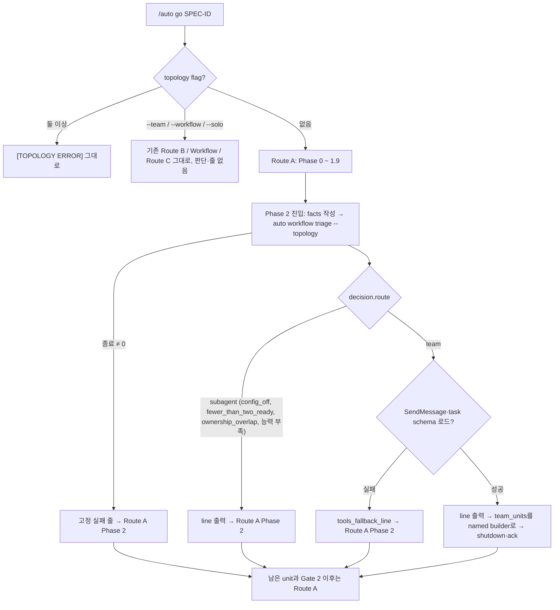

# SPEC-TEAMAUTO-001: /auto go가 조건이 맞을 때 Phase 2를 native Agent Team으로 자동 실행

**Status**: draft
**Created**: 2026-10-15
**Domain**: TEAMAUTO
**Module**: autopus-adk
**Release**: v0.50.126(SPEC-MODELUX-003, SPEC-REA-001, PR #199와 함께). 작업 branch는 `feat/teamauto-001`이고 기준은 origin/main `33b5bb55`다. PATH의 기준 바이너리는 `auto 0.50.125`다.
**Source PRD**: `prd.md`. 근거와 probe는 `research.md`, `evidence/probe-teamauto-capability.md`에 있다.

## 목적

지금 `/auto go`는 `--team`을 줘야만 native Agent Team(Route B)을 쓴다. 기본 Route A는 서로 독립인 slice도 subagent로 돌린다. 사용자는 두 조건이 모두 맞을 때만 자동으로 팀을 쓰기를 원한다. (a) 세션이 native team을 실행할 수 있다. (b) plan에 owned paths가 겹치지 않고 함께 실행할 수 있는 준비된 slice가 2개 이상 있다. 전환할 때도 안 할 때도 이유 한 줄을 보이고, `--solo`(run마다)나 설정(계속)으로 끌 수 있어야 한다.

이 SPEC은 Route A가 Phase 2(Implementation)에 들어갈 때 한 번 판단한다. 판단은 `pkg/taskroute`의 순수 함수가 하고 기존 `auto workflow triage`에 붙인 `--topology` mode가 노출한다. 세션 능력은 CLI가 자기 process 환경(Bash tool이 물려받은 세션 환경)과 실행 중인 Claude Code 바이너리(`CLAUDE_CODE_EXECPATH`)에서 읽는다. 팀 lifecycle은 기존 Route B 계약을 그대로 쓴다.

## Outcome Boundary

- Outcome Lock 원문은 `research.md` `## Outcome Lock`이다.
- Mandatory requirements: REQ-TA-01 ~ REQ-TA-13, REQ-TA-15 (Must). REQ-TA-14는 Should.
- Explicit non-goals:
  - `/auto plan`, `/auto review`, `auto pipeline run`, Phase 1·1.5·Gate 2·3·4의 실행 방식 변경. 의존 관계가 있는 단계는 subagent 그대로다
  - 비 Claude 플랫폼(codex, antigravity-cli, opencode, omp)의 생성 결과 변경. 이유 한 줄도 더하지 않는다(`research.md` 가정 AS-1)
  - 새 topology flag(`--no-team` 등), topology flag 상호 배타 규칙, `--team`·`--workflow`·`--solo`의 의미와 진단 변경
  - Route B 계약 밖의 팀 기능: 팀 크기 정책, 팀원 model 지정, pane 시각화, 두 번째 wave 재판단, 겹치는 slice 자동 재분할
  - `--workflow` Workflow 기반층과의 결합, `workflow.team_default` 부활
- Completion evidence: Must S1–S15 PASS, `go test ./pkg/taskroute/... ./internal/cli/... ./pkg/config/... ./pkg/adapter/...`, 신규·변경 package coverage 85% 이상, 신규·변경 Go 소스 300줄 이하, `GOOS=windows GOARCH=amd64 go build ./...`, `make generate-templates` 뒤 drift 없음, `evidence/manual-smoke-teamauto.txt`(S15), `auto spec validate --strict`. `research.md` `## Completion Debt`의 CD-1·CD-2가 남아 있으면 완료가 아니다.

## Trust Model

- facts의 unit 집합은 세션이 Phase 1 배정 표에서 옮긴 선언이다. CLI는 파일시스템 소유권을 확인하지 않는다(`pkg/taskroute/decide.go`의 `workerScopeContained` 주석과 같은 경계). 보고서는 `unit_source: caller_declared`로 이를 밝힌다.
- 세션 환경 변수는 판단에만 쓴다. 이유 한 줄에는 정규화한 값만 넣는다(Reason Line Contract). `CLAUDE_CODE_MESSAGING_TOKEN` 같은 비밀 값은 읽지 않는다.
- `CLAUDE_CODE_EXECPATH` 실행은 Capability Observation Contract의 guard를 모두 통과할 때만 한다. 하나라도 어긋나면 실행하지 않고 `claude_version_unknown`이다. PATH의 `claude`는 찾지 않는다.
- 새 파일 쓰기는 없다. facts 파일은 세션이 `mktemp`로 만든 임시 파일이고 CLI는 기존 guard(regular file, 1 MiB, `os.SameFile`)로 읽기만 한다.

## Requirements

### REQ-TA-01 판단 시점과 한 줄
Priority: Must · EARS: Event-driven

WHEN a Claude Code `/auto go` run with no topology flag enters Phase 2, THEN THE SYSTEM SHALL evaluate the Auto-Team Decision exactly once before any Phase 2 dispatch and SHALL print exactly one reason line from the Reason Line Contract, whether the route is `team` or `subagent`.

- Step 0의 `Mode:` 표시는 바꾸지 않는다. `--continue`로 Phase 2 뒤에서 이어지는 run은 판단하지 않고 줄도 없다.

### REQ-TA-02 팀 실행
Priority: Must · EARS: Event-driven

WHEN the decision route is `team` and the `SendMessage` and shared task-list schemas load, THEN THE SYSTEM SHALL run exactly the units in `team_units` as named teammates under the Route B lifecycle, SHALL send every teammate a shutdown request and wait for acknowledgements before Gate 2, and SHALL run the remaining Phase 2 units and every later phase under Route A.

- 팀원 이름은 `team_units` 순서로 `builder-1` … `builder-n`이다. 각 prompt는 Phase 2 prompt와 같은 항목(요구사항, owned·forbidden paths, acceptance, gate 결정, minimality ladder)과 Route B receipt 필드를 담는다. tester·guardian 팀원은 띄우지 않는다.

### REQ-TA-03 subagent 유지
Priority: Must · EARS: Event-driven

WHEN the decision route is `subagent`, THEN THE SYSTEM SHALL run Phase 2 exactly as Route A runs it today and SHALL launch no named teammate.

### REQ-TA-04 판단 함수
Priority: Must · EARS: Ubiquitous

THE SYSTEM SHALL compute the Auto-Team Decision as a pure function of the topology flags, the config value, the declared units, and the observed capability, applying the rules of the Auto-Team Decision Contract in order and returning the first match, so identical inputs always yield the identical route, reason code, and line.

### REQ-TA-05 준비된 독립 slice
Priority: Must · EARS: Ubiquitous

THE SYSTEM SHALL treat a unit as ready only when its execution is `worker`, it is not done, and every unit it depends on is done, and SHALL select `team` only when at least two units are ready and no two ready units own the same cleaned path or a path inside the other's owned path.

### REQ-TA-06 능력 관측
Priority: Must · EARS: Ubiquitous

THE SYSTEM SHALL determine team capability only from the CLI process environment and from the version printed by `CLAUDE_CODE_EXECPATH --version` under the Capability Observation Contract, SHALL never consult a `claude` found on PATH, and SHALL run the version probe only after every earlier rule has passed.

### REQ-TA-07 도구 schema 실패
Priority: Must · EARS: Unwanted

IF the decision route is `team` and the `SendMessage` or shared task-list schemas cannot be loaded, THEN THE SYSTEM SHALL print `tools_fallback_line` instead of `line`, so the run still prints exactly one line, and SHALL run Phase 2 under Route A.

### REQ-TA-08 CLI
Priority: Must · EARS: Event-driven

WHEN `auto workflow triage --topology --facts-json <file>` runs, THEN THE SYSTEM SHALL validate the file against the Topology Facts Contract, SHALL print the decision report as JSON (default) or only the reason line (`--format human`), SHALL perform no spawn, file write, or gate change, and SHALL exit 1 with `invalid topology facts: <code>` for invalid facts.

- `--topology`가 없으면 기존 triage와 bytes가 같다(S11).

### REQ-TA-09 설정 key
Priority: Must · EARS: State-driven

WHERE `autopus.yaml` sets `workflow.auto_team: false`, THEN THE SYSTEM SHALL return route `subagent` with reason `config_off`, SHALL treat an absent key or `true` as enabled, SHALL reject a non-boolean value at load, SHALL keep a set value across `auto update` and every config save, and SHALL never write the key when the user has not set it.

### REQ-TA-10 명시 flag
Priority: Must · EARS: Event-driven

WHEN `/auto go` receives `--team`, `--workflow`, or `--solo`, THEN THE SYSTEM SHALL keep the current topology semantics, preflight, and diagnostics unchanged and SHALL neither run nor print the Auto-Team Decision; the decision function SHALL return the flag's route with reason `explicit_flag` without reading capability.

### REQ-TA-11 비 Claude 플랫폼
Priority: Must · EARS: State-driven

WHERE the target platform is codex, antigravity-cli, opencode, or omp, THEN THE SYSTEM SHALL generate files byte-identical to the base commit, so routing and output on those platforms do not change.

### REQ-TA-12 locale
Priority: Must · EARS: Ubiquitous

THE SYSTEM SHALL render the reason line in Korean when `language.ai_responses` is `ko` and in English otherwise, using exactly the strings of the Reason Line Contract.

### REQ-TA-13 판단 실패
Priority: Must · EARS: Unwanted

IF `auto workflow triage --topology` exits non-zero or prints no parsable decision, THEN THE SYSTEM SHALL print the fixed line `Agent Team: off — auto workflow triage --topology failed; running subagents` and SHALL run Phase 2 under Route A.

### REQ-TA-14 문서와 비용 공지
Priority: Should · EARS: Ubiquitous

THE SYSTEM SHALL document in README, CHANGELOG (v0.50.126), the agent-teams skill, and `auto workflow triage --help` that auto-selection is on by default for eligible Claude Code sessions, that each teammate is a separate Claude session with higher token use and the feature is experimental, how to turn it off (`workflow.auto_team: false`, or `--solo` for one run), and that auto 0.50.125 or older refuses a file containing the key.

### REQ-TA-15 실제 터미널 확인
Priority: Must · EARS: Ubiquitous

THE SYSTEM SHALL count as complete only after one real-terminal Claude Code run shows the auto switch to a team and one shows the stay-subagent line, with the probe A2 environment values, all recorded in `evidence/manual-smoke-teamauto.txt`.

## Contracts

### Auto-Team Decision Contract

입력:

| Input | 출처 | 모양 |
|---|---|---|
| flags | Step 0의 `TEAMS_MODE`, `WORKFLOW_MODE`, `SOLO_MODE` → facts `flags` | boolean 셋. 둘 이상 true면 invalid facts `topology_conflict` |
| units | Phase 1 배정 표(Unit, Execution, Owned paths, Depends on) → facts `units` | `id`, `execution`, `owned_paths`, `depends_on`, `done` |
| auto_team | `autopus.yaml` `workflow.auto_team`, CLI가 `config.Load`로 읽음 | 없음 / true / false |
| capability | CLI process 환경과 EXECPATH 버전 | Capability Observation Contract |

규칙(위에서부터, 처음 맞는 규칙이 결과다). ready는 REQ-TA-05의 정의다:

| # | 조건 | route | reason |
|---|---|---|---|
| 1 | flag 하나가 true | 그 flag의 route(`team`, `workflow`, `solo`) | `explicit_flag` |
| 2 | `auto_team == false` | subagent | `config_off` |
| 3 | ready unit 2개 미만 | subagent | `fewer_than_two_ready` |
| 4 | ready unit 두 개의 owned path가 겹침 | subagent | `ownership_overlap` |
| 5 | `CLAUDECODE` ≠ `1` | subagent | `not_claude_code` |
| 6 | `CLAUDE_CODE_EXPERIMENTAL_AGENT_TEAMS` ≠ `1` | subagent | `teams_env_missing` |
| 7 | `CLAUDE_CODE_ENTRYPOINT` ≠ `cli` 또는 `CLAUDE_CODE_SESSION_ATTENDED` ≠ `1` | subagent | `not_interactive` |
| 8 | `CLAUDE_CODE_CHILD_SESSION`이 비어 있지 않음 | subagent | `not_top_level` |
| 9 | 버전 probe 실패나 해석 불가 | subagent | `claude_version_unknown` |
| 10 | 버전 < 2.1.246 | subagent | `claude_version_old` |
| 11 | 그 밖 | team | `independent_disjoint_slices` |

- 설정과 plan 사실을 능력보다 먼저 본다. 어차피 팀을 쓸 수 없는 run이 실험 환경 변수를 매번 권하지 않게 하고, 유일한 실행(버전 probe)은 나머지가 다 통과할 때만 일어난다.
- 겹침은 기존 `ownershipOverlap`(`pkg/taskroute/decide.go`)과 같다. cleaned path가 같거나 한쪽이 다른 쪽 + `/`로 시작한다. `pkg/a`와 `pkg/ab`는 겹치지 않는다. 첫 겹침 쌍은 facts 순서로 고른다.
- 버전 비교는 (major, minor, patch) 정수 비교다. `2.10.0` > `2.1.246`이다.

출력(decision):

| Field | 값 |
|---|---|
| `version` | 1 |
| `route` | `team` / `subagent` / `solo` / `workflow` |
| `reason` | 위 reason code |
| `ready_units` | ready unit 수. 규칙 1이면 없다 |
| `team_units` | route `team`일 때만. ready unit id, facts 순서 |
| `line` | 이유 한 줄 |
| `tools_fallback_line` | route `team`일 때만. `team_tools_unavailable` 줄 |

### Capability Observation Contract

| 신호 | 출처 | 통과 값 | 2026-10-15 관측(A1) |
|---|---|---|---|
| Claude Code 세션 | `CLAUDECODE` | `1` | `1` |
| 팀 기능 | `CLAUDE_CODE_EXPERIMENTAL_AGENT_TEAMS` | `1` | `1` |
| 대화형 | `CLAUDE_CODE_ENTRYPOINT`, `CLAUDE_CODE_SESSION_ATTENDED` | `cli`, `1` | `cli`, `1` |
| 최상위 lead | `CLAUDE_CODE_CHILD_SESSION` | 없음 | `1`(probe가 subagent에서 돌았다) |
| 버전 | `"$CLAUDE_CODE_EXECPATH" --version` 첫 줄 | `^(\d+)\.(\d+)\.(\d+) \(Claude Code\)$` 이고 ≥ 2.1.246 | `2.1.288 (Claude Code)`. PATH `claude`는 `2.1.299` |
| 도구 schema | 세션의 ToolSearch `select:SendMessage,TaskCreate,TaskUpdate,TaskList,TaskGet` | 로드됨 | CLI 밖. REQ-TA-07 |

- 버전 probe guard: 값이 절대 경로이고, `os.Stat`(symlink는 따라간 결과)이 regular file이며, basename이 `claude` 또는 `claude.exe`일 때만 shell 없이 인자 `--version` 하나로 실행한다. 5초 timeout, 출력은 기존 `processprobe.OutputLimited`로 4096 bytes까지다.
- TTY는 신호가 아니다. Bash tool 안에서 stdin·stdout 모두 TTY가 아니었다(A1).
- 환경 조회(`func(string) (string, bool)`)와 버전 probe(`func() (string, error)`)는 주입한다. test는 host 환경에 기대지 않는다.

### Reason Line Contract

모든 줄은 `Agent Team: `로 시작하고 한 run에 한 번만 나온다. 세션은 `line`, `tools_fallback_line`(REQ-TA-07), 고정 실패 줄(REQ-TA-13) 중 하나만 출력한다.

| reason | ko | en |
|---|---|---|
| `independent_disjoint_slices` | `Agent Team: 전환 — 준비된 slice {n}개의 owned_paths가 겹치지 않아 native Agent Team으로 실행한다` | `Agent Team: on — {n} ready slices have disjoint owned_paths; running them as a native Agent Team` |
| `config_off` | `Agent Team: 유지 — autopus.yaml의 workflow.auto_team이 false라 subagent로 실행한다` | `Agent Team: off — workflow.auto_team is false in autopus.yaml; running subagents` |
| `fewer_than_two_ready` | `Agent Team: 유지 — 함께 실행할 준비된 slice가 {n}개라 subagent로 실행한다` | `Agent Team: off — {n} ready slice(s) can run together; running subagents` |
| `ownership_overlap` | `Agent Team: 유지 — {a}, {b}의 owned_paths가 겹쳐 subagent로 실행한다` | `Agent Team: off — {a} and {b} have overlapping owned_paths; running subagents` |
| `not_claude_code` | `Agent Team: 유지 — Claude Code 세션이 아니라 subagent로 실행한다` | `Agent Team: off — not a Claude Code session; running subagents` |
| `teams_env_missing` | `Agent Team: 유지 — 세션 환경에 CLAUDE_CODE_EXPERIMENTAL_AGENT_TEAMS=1이 없어 subagent로 실행한다` | `Agent Team: off — CLAUDE_CODE_EXPERIMENTAL_AGENT_TEAMS=1 is not in the session environment; running subagents` |
| `not_interactive` | `Agent Team: 유지 — 대화형 CLI 세션이 아니라(entrypoint={e}, attended={t}) subagent로 실행한다` | `Agent Team: off — not an interactive CLI session (entrypoint={e}, attended={t}); running subagents` |
| `not_top_level` | `Agent Team: 유지 — 하위 세션은 팀 lead가 될 수 없어 subagent로 실행한다` | `Agent Team: off — a child session cannot lead a team; running subagents` |
| `claude_version_unknown` | `Agent Team: 유지 — 실행 중인 Claude Code 버전을 읽지 못해 subagent로 실행한다` | `Agent Team: off — the running Claude Code version could not be read; running subagents` |
| `claude_version_old` | `Agent Team: 유지 — Claude Code {v} 버전은 2.1.246보다 낮아 subagent로 실행한다` | `Agent Team: off — Claude Code {v} is older than 2.1.246; running subagents` |
| `team_tools_unavailable` | `Agent Team: 유지 — SendMessage·task 도구 schema를 불러오지 못해 subagent로 실행한다` | `Agent Team: off — SendMessage/task tool schemas could not be loaded; running subagents` |
| `explicit_flag` | `Agent Team: 자동 선택 안 함 — {f} 지정됨` | `Agent Team: auto-selection skipped — {f} was given` |

- `{n}`은 10진 수, `{a}`·`{b}`는 첫 겹침 쌍의 unit id(이미 `[A-Za-z0-9_.-]{1,128}`로 검증됨), `{v}`는 해석한 `X.Y.Z`, `{f}`는 `--team`·`--workflow`·`--solo`다. `{e}`·`{t}`는 값이 `[a-z0-9-]{1,32}`이면 그대로, 없으면 `unset`, 그 밖은 `unknown`이다.
- 실패 줄 `Agent Team: off — auto workflow triage --topology failed; running subagents`는 생성 skill에 고정된 영어다. CLI가 실패했을 때는 CLI가 줄을 만들 수 없기 때문이다.

### Config Contract

- key: `workflow.auto_team`, `[NEW] config.WorkflowConf.AutoTeam *bool` (`yaml:"auto_team,omitempty"`)과 `[NEW] (WorkflowConf).AutoTeamEnabled() bool`(nil·true면 true). `removedConfigKeys`·`reservedConfigKeys`에는 넣지 않는다.
- 값: 없음 → on, `true` → on, `false` → off. bool이 아닌 값(`"false"`, `1`)은 기존 strict decode가 줄 번호와 함께 거부한다.
- 쓰기: `auto init`, `auto update`, 모든 typed Save는 값이 nil이면 key를 쓰지 않는다. 사용자가 둔 `false`는 `auto update --yes`와 config 저장을 지나도 남는다.
- 옛 바이너리(A3): v0.50.125는 key가 든 파일을 거부한다(`auto update --yes` 종료 1, `field auto_team not found in type config.WorkflowConf`). 바이너리가 key를 스스로 쓰지 않으므로 이 branch가 만들거나 갱신한 프로젝트는 끄지 않는 한 v0.50.125에서 그대로 읽힌다(F3). 끈 프로젝트를 옛 auto로 열면 그 줄을 지우거나 올려야 한다(REQ-TA-14).
- 버린 대안은 `research.md` `## 설계 결정` D3이다.

### Topology Facts Contract

명령: `auto workflow triage --topology --facts-json <file> [--format json|human]`. 파일 guard와 `--format` 처리는 기존 `readWorkflowTriageFacts`·`singleTriageFlag`를 쓴다. 중복 key와 모르는 field는 거부한다(기존 `uniqueValue`, `DisallowUnknownFields`).

```json
{"version": 1,
 "flags": {"team": false, "workflow": false, "solo": false},
 "units": [{"id": "T1", "execution": "worker", "owned_paths": ["pkg/a"], "depends_on": [], "done": false}]}
```

| 오류 code | 조건 |
|---|---|
| `json` | 해석할 수 없는 JSON, 중복 key, 모르는 field, 1 MiB 초과, regular file 아님 |
| `version` | `version` ≠ 1 |
| `topology_conflict` | flag 둘 이상이 true |
| `unit_id` | id가 비었거나 128자 초과, `[A-Za-z0-9_.-]` 밖 글자, 중복 |
| `unit_count` | unit 33개 이상 |
| `execution` | `worker`·`inline`이 아님 |
| `owned_paths` | worker의 owned path 0개, 기존 `cleanPath`가 거부하는 path, 합계 256개 초과 |
| `depends_on` | 없는 id나 자기 id |

출력(JSON, stdout):

```json
{"mode": "topology", "unit_source": "caller_declared", "capability_source": "observed_process_env",
 "config_source": "autopus.yaml", "execution_performed": false,
 "decision": {"version": 1, "route": "team", "reason": "independent_disjoint_slices", "ready_units": 2,
              "team_units": ["T1", "T2"], "line": "…", "tools_fallback_line": "…"}}
```

- CLI는 실행 디렉터리의 `autopus.yaml`을 `config.Load`로 읽는다. 파일이 없으면 `config_source: default`(on, en)다. 파일이 있는데 읽히지 않으면 종료 1(`config load failed`)이고 세션은 REQ-TA-13 줄을 쓴다.
- `--format human`은 `line` 한 줄과 개행만 출력한다.

### Skill Surface Contract

- 원천: `templates/claude/commands/auto-workflows.md.tmpl` `## go` → 생성 `.claude/skills/auto-go/SKILL.md`(`pkg/adapter/claude/claude_workflow_skills.go`). Route A 마지막 문단 뒤, `#### Route B` 앞에 `[NEW] #### Route A Phase 2 Entry: Agent Team Auto-Selection`을 둔다.
- 그 절의 규칙: (1) `TOPOLOGY_FLAG_COUNT == 0`인 run의 Phase 2 진입에서 한 번. (2) Phase 1 배정 표를 `mktemp` facts 파일로 옮기고(표가 없으면, 예를 들어 compact route에서 unit을 따로 나누지 않았으면 `units: []`이고 결과는 `fewer_than_two_ready`다) `WORKING_DIR`에서 `auto workflow triage --topology --facts-json "$FACTS" --format json`을 돌린 뒤 파일을 지운다. (3) `team`이면 ToolSearch `select:SendMessage,TaskCreate,TaskUpdate,TaskList,TaskGet`. 성공하면 `line`을 출력하고 `team_units`를 Route B lifecycle로 실행하고, teardown 뒤 Gate 2부터 Route A다. 실패하면 `tools_fallback_line`을 출력하고 Route A다. (4) `subagent`면 `line`을 출력하고 Route A Phase 2 그대로다. (5) 종료 코드가 0이 아니거나 JSON이 해석되지 않으면 고정 실패 줄과 Route A다.
- 바꾸지 않는 곳: Step 0(flag 해석, `[TOPOLOGY ERROR]`, `Mode:` 표시), Route B, Route C, Deterministic Workflow 절, `content/skills/agent-pipeline.md`, `content/skills/references/agent-pipeline/*.md`.
- `content/skills/agent-teams.md`(platform claude 전용)에 `[NEW] ## Automatic Entry from Route A`를 더한다: 같은 lifecycle, 범위는 Phase 2의 준비된 wave 하나, tester·guardian 없음, schema 실패는 stop이 아니라 fallback 줄, Gate 2 전 teardown, 비용 공지. 명령 문자열은 auto-go skill에만 둔다.

## Existing Test Changes

- `pkg/adapter/claude/claude_topology_flags_test.go`의 `TestAutoGoTopologyFlags_FailClosedBeforeRouteSelection`은 바꾸지 않고 통과해야 한다.
- 생성 Claude skill을 snapshot하는 golden이 있으면 갱신한다. 실제 목록은 T9가 `go test ./pkg/adapter/claude/...` 실패 목록으로 정해 `research.md`에 붙인다. 그 밖의 test 변경은 예상하지 않는다.

## 생성 파일 상세

- `pkg/taskroute`: `[NEW] team.go`(판단, ready 집합, 버전 비교), `[NEW] team_decode.go`(facts decode·검증), `[NEW] team_lines.go`(ko·en 문구, 정규화), 각 `_test.go`. 기존 `decide.go`·`decode.go`·`validate.go`의 `cleanPath`, `ownershipOverlap`, `uniqueValue`를 쓴다.
- `internal/cli`: `workflow_triage.go`(`--topology` flag와 분기 몇 줄), `[NEW] workflow_triage_topology.go`(보고서, config 읽기), `[NEW] workflow_triage_capability.go`(환경·버전 관측), 각 `_test.go`.
- `pkg/config`: `schema_workflow.go`(+field, accessor), `[NEW] schema_workflow_auto_team_test.go`.
- 생성 원천: `templates/claude/commands/auto-workflows.md.tmpl`, `content/skills/agent-teams.md`. 생성 surface는 `make generate-templates`와 adapter `Generate`가 만든다.
- 문서: README, CHANGELOG(v0.50.126). 증거: `evidence/probe-teamauto-capability.md`, `[NEW] evidence/manual-smoke-teamauto.txt`.

## Related SPECs

- SPEC-HARNESS-WORKFLOW-TEAM-001(implemented): `--team` → Workflow 대체와 `workflow.team_default`는 그 뒤 cutover로 빠졌다. 지금 Route B는 "never dispatches a Workflow"이고 `workflow.team_default`는 `removedConfigKeys`다(`pkg/config/loader_strict.go:37-41`). 이 SPEC은 둘 다 되살리지 않는다.
- SPEC-TEAMPANE-001(completed): `--team` pane 시각화. 자동 팀은 pane을 더하지 않는다(non-goal).
- SPEC-REA-001(`feat/rea-001`, 진행 중): router 행과 auto-* 목록을 바꿀 예정이다. 이 SPEC은 router 행을 건드리지 않고 `## go` Route A 안만 바꾼다. 먼저 들어가는 쪽이 없고, 나중에 들어가는 쪽이 `make generate-templates`와 golden을 다시 돌린다.
- SPEC-MODELUX-003: 같은 릴리스. `pkg/config/schema.go`는 건드리지 않고 `schema_workflow.go`만 바꾼다.

### Sibling SPEC Decision

| Decision | Reason | Sibling SPEC IDs |
|----------|--------|------------------|
| none | 판단 함수, CLI mode, 설정 key, skill 문구는 한 결과(자동 팀 전환)를 닫는다. task 11개, 소스 파일 test 포함 약 16개로 예외 기준(25개 초과 task이면서 40개 초과 파일)에 못 미친다 | None |

## Visual Planning Brief



## Completion Debt

| ID | Item | Blocks | Required resolution |
|----|------|--------|---------------------|
| CD-1 | 실제 터미널 자동 전환 run 미확인 | REQ-TA-02, 15, S15(a) | 대화형 `claude` 세션에서 준비된 disjoint unit 2개 plan으로 `/auto go`를 돌려 전환 줄, named teammate, shutdown, Gate 2 진입을 기록 |
| CD-2 | 실제 터미널 subagent 유지 run과 A2 환경 값 미확인 | REQ-TA-03, 06, 15, S15(b) | 같은 세션에서 준비된 unit 1개 plan의 유지 줄, 최상위 세션 env, `claude -p` env를 기록 |

## Evolution Ideas

These are optional improvements and do not block sync completion.

| Idea | Why not required now | Promotion trigger |
|------|----------------------|-------------------|
| 두 번째 이후 wave도 다시 판단 | 사용자 결정은 함께 실행할 수 있는 준비된 slice이고 첫 wave로 닫힌다 | 사용자가 wave별 팀을 요청 |
| 겹치는 slice가 있을 때 disjoint 부분집합만 팀으로 | 재분할은 planner 책임이고 보수적으로 subagent가 현재 동작이다 | 겹침 때문에 팀을 놓친 사례가 반복 |
| run 단위 `--no-team` flag | topology flag를 늘리지 않는다는 결정. `--solo`와 설정이 있다 | 사용자가 명시 요청 |
| 비 Claude 플랫폼의 이유 한 줄 | AS-1 가정. 그 플랫폼에는 native team이 없다 | 사용자가 그 줄을 원한다고 확인 |

## Open Issues

- 없음. 가정 AS-1(비 Claude 플랫폼 무변경)과 A2(not-run)는 `research.md`와 `plan.md`에 있다.

## Traceability Matrix

| Requirement | Plan Task | Acceptance Scenario | Semantic Invariant |
|-------------|-----------|---------------------|--------------------|
| REQ-TA-01 | T7, T9 | S12, S13 | INV-TA-01 |
| REQ-TA-02 | T7, T8, T11 | S4, S13, S15 | INV-TA-02 |
| REQ-TA-03 | T7 | S1, S2, S3, S13 | INV-TA-01 |
| REQ-TA-04 | T1 | S1, S2, S3, S4, S5 | INV-TA-01 |
| REQ-TA-05 | T1 | S2, S3, S4 | INV-TA-02 |
| REQ-TA-06 | T1, T4 | S4, S5 | INV-TA-03 |
| REQ-TA-07 | T7, T8 | S4, S13 | INV-TA-01 |
| REQ-TA-08 | T2, T5 | S11, S12 | INV-TA-01 |
| REQ-TA-09 | T6 | S8 | INV-TA-04 |
| REQ-TA-10 | T1, T7, T9 | S6, S7 | INV-TA-05 |
| REQ-TA-11 | T9 | S9 | INV-TA-05 |
| REQ-TA-12 | T3 | S10 | INV-TA-06 |
| REQ-TA-13 | T7 | S13, S14 | INV-TA-01 |
| REQ-TA-14 | T8, T10 | S16 | INV-TA-04 |
| REQ-TA-15 | T11 | S15 | INV-TA-02, INV-TA-03 |
