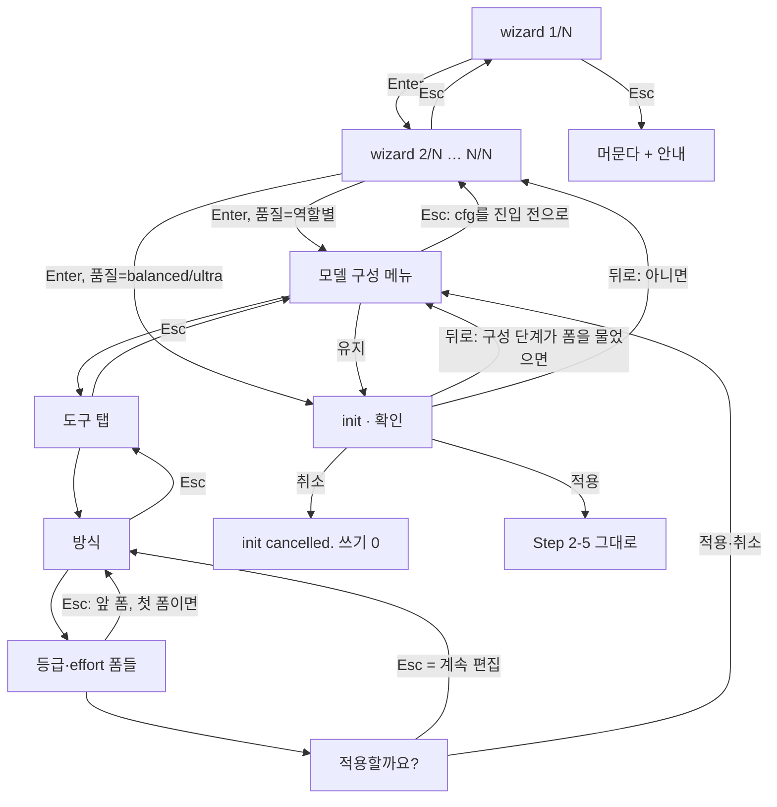

# SPEC-TUIUX-001 구현 계획

## Tasks

기준은 8ec13935(`feat/tuiux-001`, `feat/revmodel-001` 위)다. 순서: T1 → (T2, T3, T4) → T5(T2–T4 뒤), T6(T2, T3 뒤) → T7(T6 뒤) → T8(T4, T7 뒤) → T9(T5, T7 뒤, 첫 작업은 probe A3) → T10 → T11 → T12. 296·295·275줄 파일(`quality_compose_form_driver.go`, `quality_compose_omp.go`, `wizard_steps.go`)에는 호출 몇 줄만 더하거나 코드를 새 파일로 옮긴다.

- [ ] T1: 기준과 분류. 8ec13935에서 `[NEW] evidence/base-goldens/`를 만든다: `auto init --yes --dir <DIR> --platforms claude-code,codex`와 그 project의 `auto update --yes`의 stdout(경로는 `<DIR>`, HOME·XDG는 temp), 두 run 뒤 project 파일 전부의 SHA-256 목록, `acceptance.md` IN 흐름(wizard seam W, 폼 helper)의 파일 SHA-256 목록, `cmd.SetIn`으로 `b\n`을 준 D `auto quality` 줄 driver의 stdout. 이 golden을 읽는 `[NEW] internal/cli/tuiux_noninteractive_golden_test.go`를 기준에서 먼저 통과시킨다. `spec.md` `## Existing Test Changes` 분류를 파일·줄 단위로 `research.md` `### 기존 test 분류`에 붙이고 `runInitComposeStepCancellable`을 부르는 test가 있는지 적는다. 소스 변경 없음 (REQ-TUX-07, 16).
- [ ] T2: TUI navigation. 소유: `[NEW] internal/cli/tui/nav.go`(+test). `NavFrame`, `ErrNavBack`, `RunNav`: wrapper model이 header·요약·footer를 그리고, Esc(filter 중이 아니면) → `ErrNavBack`, 첫 폼은 안내 줄을 보이고 계속, Ctrl+C·`tea.ErrInterrupted` → `huh.ErrUserAborted`, 완료 → nil, huh help 숨김. frame 문구 ko·en(footer, 안내, 요약 머리 줄) (REQ-TUX-01, 02, 04, 05, 09, 17).
- [ ] T3: accessible navigation. 소유: `[NEW] internal/cli/tui/nav_accessible.go`(+test). `RunNavAccessible`: frame을 ANSI 없이 쓰고, 1 byte씩 읽는 줄 reader가 `b`·`back`·`뒤로`를 받으면 첫 폼은 안내 한 줄 뒤 다음 줄을 같은 질문에 주고, 아니면 form이 끝날 때까지 EOF를 준 뒤 `ErrNavBack`을 돌려준다. token 뒤 줄은 다음 폼에 남는다 (REQ-TUX-04, 06, 09).
- [ ] T4: 폼 기록. 소유: `[NEW] internal/cli/tui/nav_history.go`(+test). `NavHistory[S]`: 폼마다 보이기 직전 state 사본과 답 라벨을 쌓고, 뒤로는 지금 폼의 저장 state를 돌려주며 앞 폼으로 간다. 첫 폼에서는 ok=false다. 요약 줄은 지금 폼 앞의 라벨이다 (REQ-TUX-02, 10).
- [ ] T5: wizard. 소유: `[NEW] internal/cli/tui/wizard_nav.go`(+test), `wizard_steps.go`(loop를 옮기고 `InitWizardOpts.Runner`·`Resume` 두 줄), `export_test.go`. 단계 loop는 `NavHistory[InitWizardResult]`(Rea pointer는 값 사본), 단계 이름과 요약 값, `init · <n>/<N> <이름>` header, 첫 단계 경계, `Resume`이면 마지막 단계에서 시작. 단계 제목은 그대로 (REQ-TUX-02, 03, 04, 08, 10, 16, 17).
- [ ] T6: 구성 단계 seam과 위치 상태. 소유: `quality_compose_form.go`(`composeRunForm` 시그니처, `runComposeForm`이 frame을 만든다), `[NEW] internal/cli/quality_compose_nav.go`(+test: 경로 push·pop, 첫 폼, 요약, command context 싣기·읽기, header), 기존 test 4곳의 stub 시그니처(분류 1), `quality_compose_form_helpers_test.go`에 `[NEW] useNavComposeForms` (REQ-TUX-01, 08, 16, 17).
- [ ] T7: 구성 단계의 뒤로. 소유: `quality_compose_form_driver.go`(menu·edit·chooseTab·compose·review), `[NEW] quality_compose_form_preset.go`(`choosePreset` 이동, 동작 불변), `quality_compose_omp.go`(`ompFailed` 조건 한 줄). Navigation Contract의 구성 단계 행 전부: 메뉴의 첫 폼 경계(`BackOut`이 없을 때), 도구 탭 → 메뉴, 방식 → 도구 탭(또는 메뉴), override 질문·`적용할까요?` = 계속 편집, 기본 프리셋 → 메뉴, OMP·리뷰 탭 → 도구 탭, 뒤로로 다시 보이는 도구 탭·방식의 마지막 선택 미리 선택 (REQ-TUX-02, 04, 14, 15).
- [ ] T8: 편집 pass의 기록과 요약. 소유: `quality_compose_form_edit.go`, `quality_compose_form_effort.go`. `groups`·`agents`를 `NavHistory`로 돌린다(state = 편집 map과 effort working 사본). 묻지 않은 effort 폼은 기록하지 않는다. pass의 첫 폼에서 뒤로면 방식으로 `ErrNavBack`. 요약 줄 `<주제>: <답>` (REQ-TUX-02, 03, 10, 15).
- [ ] T9: init 흐름. 먼저 probe A3을 돈다. 소유: `[NEW] internal/cli/init_interactive.go`(+test), `[NEW] internal/cli/init_review.go`(+test), `init_compose.go`(`[NEW] runInitComposeStage`: done·back·cancelled, `[NEW] composeFormOptions.BackOut`, 새로 시작과 이어 하기), `init.go`(L106-147을 호출로). 기준 cfg 사본(`cloneHarnessConfig`), wizard → 구성 단계 → 확인 화면 loop, 취소·Ctrl+C는 쓰기 0, 뒤로 경로 두 개 (REQ-TUX-05, 11, 12, 13, 15, 17).
- [ ] T10: 회귀. T1 golden 비교, `go test ./internal/cli/... ./pkg/...` 필터 없이, `git diff --stat 8ec13935 -- '*_test.go'`가 분류 안인지, 신규·변경 package coverage 85% 이상, `GOOS=windows GOARCH=amd64 go build ./...`, 신규·변경 소스 300줄 이하(`wc -l`) (REQ-TUX-07, 15, 16).
- [ ] T11: 문서(Should). 소유: `init_help.go`, `update_help.go`, `quality_help.go`, `README.md`, `CHANGELOG.md`(v0.50.126). 도움말 문장은 더하기만 하고 `quality_compose_docs_test.go`가 고정한 문장은 지우지 않는다. 생성 루트는 `make generate-templates`로만 바꾼다 (REQ-TUX-18).
- [ ] T12: 실제 터미널 smoke. `acceptance.md` S18 순서로 init과 update를 실제 터미널에서 돌리고 `[NEW] evidence/manual-smoke-tuiux.txt`에 경로를 바꿔 남긴다. 빠지면 Completion Debt CD-1이다 (REQ-TUX-19).

## Implementation Strategy

- helper 하나: 키 처리, frame 그리기, 폼 기록은 `internal/cli/tui`의 nav 파일 셋에만 있다. wizard와 구성 단계는 `RunNav`(또는 test의 `RunNavAccessible`)와 `NavHistory`만 부른다.
- TUI는 huh `Form`을 감싼 tea model 하나다. huh `Form`은 tea.Model이라 감싸도 field 동작(화살표, filter, shift+tab, Confirm 토글)은 그대로다. 기본 KeyMap의 `Quit`(ctrl+c)도 그대로다. `WithKeyMap`·`WithProgramOptions`는 쓰지 않는다(`WithProgramOptions`는 기존 option을 덮어 `WithInput`·`WithOutput` 순서 문제를 만든다, huh `form.go:353-356`).
- 구성 단계의 위치 상태는 `runForms`가 시작할 때 command context에 싣고 끝날 때 원래 context로 돌린다. `runComposeForm`이 거기서 header·요약·첫 폼을 읽어 frame을 만든다. 그래서 OMP·리뷰 탭의 폼도 코드 변경 없이 header와 footer를 받는다.
- 뒤로는 오류 값 `ErrNavBack`으로 올라간다. 각 자리는 Navigation Contract의 행만큼만 받는다. 받지 않는 자리(OMP·리뷰 탭 안)는 `edit`이 받아 도구 탭으로 돌린다. 경고로 바꾸는 wrapper는 `ompFailed` 하나를 확인했다.
- init은 기준 cfg 사본 위에 wizard 답을 적용하고 구성 단계를 돈다. 구성 단계에서 뒤로 나가면 사본으로 되돌린다. 확인 화면의 뒤로는 구성 단계를 이어 하거나 wizard 마지막 단계로 간다. 적용 뒤의 흐름(Step 2–5)은 그대로다.

## Visual Planning Brief

모든 그림은 `wireframe intent: assumed`다. 사용자가 확인하기 전이므로 배치와 문구는 Reviewer focus이고, 요구사항으로 묶는 것은 Navigation·Summary·Stage Indicator Contract의 문자열과 순서뿐이다.



wizard 단계(TUI, ko, 6단계 run의 4단계):

```text
init · 4/6 리뷰 게이트
지금까지 고른 값
  사용 프로필: Fullstack
  언어 설정: 주석 ko · 커밋 en · AI 응답 ja
  품질 모드: Ultra
┃ [4/6] Review Gate
┃ Providers detected: 2 — enable review gate?
┃   Yes     No
방향키 이동 · Enter 선택 · Esc 뒤로 · Ctrl+C 취소
```

구성 단계 탭(TUI, ko, `auto quality`의 Claude Code 탭, 역할 그룹 두 번째 그룹):

```text
(메뉴 앞에서 이미 출력한 구성 표)
quality · 모델 구성 › 구성 편집 › Claude Code › 역할 그룹
지금까지 고른 값
  설계·판단: fable
  설계·판단 effort: 그대로
┃ 구현 — executor, debugger, deep-worker, devops, frontend-specialist, perf-engineer
┃ > 그대로 — …
┃   fable …
┃   opus …
방향키 이동 · Enter 선택 · Esc 뒤로 · Ctrl+C 취소
```

init 확인(TUI, ko):

```text
init · 확인
적용할 설정
  프로필: fullstack
  언어: comments=ko, commits=en, ai=ja
  품질: ultra
  리뷰 게이트: false (0 providers)
  REA: true
  방법론: none
  플랫폼: claude-code, codex
┃ 이대로 적용할까요?
┃ > 적용
┃   뒤로
┃   취소
방향키 이동 · Enter 선택 · Esc 뒤로 · Ctrl+C 취소
```

accessible(test runner, en, 3단계에서 뒤로):

```text
init · 3/6 Quality Mode
Chosen so far
  Usage Profile: Fullstack
  Language Settings: comments ko · commits en · AI responses ja
Type an answer and press Enter · back: b
[3/6] Quality Mode
1. Ultra — strict review, high coverage
…
Enter a number between 1 and 3: b
init · 2/6 Language Settings
Chosen so far
  Usage Profile: Fullstack
Type an answer and press Enter · back: b
```

## Feature Completion Scope

- 이 SPEC 하나가 Outcome Lock을 닫는다. T2–T4는 helper, T5는 wizard와 REA 단계, T6–T8은 구성 단계와 탭, T9는 init 흐름과 확인 화면, T1·T10은 비대화형 불변과 회귀, T12는 실제 터미널이다. T11은 Should다.
- 승인된 sibling 의존성은 없다. task 12개, 소스 파일 test 포함 약 26개다. Completion Debt CD-1은 T12의 S18 기록으로만 닫힌다.

## Risk-First Integration Probe

| assumption_id | class | risk | boundary | input | oracle | isolation | status | reason | evidence |
|---------------|-------|------|----------|-------|--------|-----------|--------|--------|----------|
| A1 | verified_fact | high | huh v1.0.0 Form을 감싼 tea model이 실제 `tea.Program`에서 폼마다 Esc와 Ctrl+C를 구별하는가, 첫 폼에서 머물 수 있는가 | `io.Pipe`로 `\x1b`, `\x03`, `\r`, 첫 폼 `\x1b\r`, 한 번에 쓴 `\x1b[B` 뒤 `\r` | Esc만 back flag, Ctrl+C는 StateAborted → `huh.ErrUserAborted`, Enter는 StateCompleted, 첫 폼은 안내 뒤 Enter로 완료, 한 번에 온 화살표는 Down | package tui의 throwaway test, 터미널 없음, 실행 뒤 지움 | PASS | 2026-10-16 실행. 기본 KeyMap의 Esc는 아무것도 하지 않는다(P1, `Quit`=`[ctrl+c]`). byte마다 나눠 쓴 화살표는 Esc로 읽혔다(R1) | `evidence/probe-nav-a1.md` P1, P2, P2b |
| A2 | verified_fact | high | accessible huh 폼이 뒤로를 표현할 수 있는가 | 줄 reader 위 Select에 `b\n`, `뒤로\n3\n`, `3\n`, Select 두 개 group에 `2\nb\n` | token이면 값 그대로이고 다음 줄(`3\n`)이 남는다, `3`은 c, group은 token 앞 답이 들어간다 | 위와 같다 | PASS | 2026-10-16 실행. accessible huh 자체에는 뒤로가 없고(오류를 버린다) reader가 표현한다. group 결과 때문에 호출자가 저장 state로 되돌린다(REQ-TUX-06) | `evidence/probe-nav-a1.md` P3, P3b |
| A3 | implementation_assumption | high | init loop에서 기준 cfg 사본, wizard resume, 구성 단계 새로 시작·이어 하기가 우회 없는 run과 같은 파일을 쓰는가 | S7의 두 흐름과 우회 없는 대조 run | autopus.yaml과 생성 파일 bytes가 대조 run과 같다. 생성은 마지막 진입의 snapshot을 쓴다 | temp project, `useNavComposeForms`, wizard seam | not-run | T9 코드가 있어야 돈다. T9의 첫 작업으로 S7 대조 test를 먼저 쓰고 돌린다 | - |

## Plan Statement Classification

| Statement | Class | Evidence |
|-----------|-------|----------|
| 쓰는 값, 기본값, 비대화형·줄 driver 출력은 8ec13935와 같다 | requirement_invariant | REQ-TUX-07, 15, S15 |
| 뒤로는 지금 폼이 보이기 직전 state로 되돌리고 앞 답은 남는다 | requirement_invariant | REQ-TUX-02, 03, S1, S2 |
| 취소와 Ctrl+C는 init에서 아무 파일도 쓰지 않는다 | requirement_invariant | REQ-TUX-05, 12, S8, S16 |
| 기본 KeyMap에서 Esc는 abort가 아니고 `Quit`은 ctrl+c뿐이다 | verified_fact | probe P1, huh `keymap.go:109` Read |
| 감싼 model로 Esc와 Ctrl+C를 폼마다 구별한다 | verified_fact | probe P2 |
| accessible 폼은 줄 reader로 뒤로를 표현하고 token 뒤 줄은 남는다 | verified_fact | probe P3 |
| accessible huh는 field 오류를 버리고 EOF에서 기본값을 둔다 | verified_fact | huh `form.go:703-721`, `internal/accessibility` PromptString Read, probe P3 |
| wizard는 단계마다 form 하나이고 오류는 wizard 전체 취소다 | verified_fact | `wizard_steps.go:60-69` Read |
| 구성 단계 폼은 모두 `runComposeForm`을 지난다(호출 27곳) | verified_fact | `quality_compose_form.go:68-111` Read, grep |
| parent rule 검사는 충돌이 있으면 `config.Save`를 부른다 | verified_fact | `prompts.go:99-140` Read |
| `ompFailed`는 `errComposeInterrupted` 밖의 오류를 경고로 바꾼다 | verified_fact | `quality_compose_omp.go:130-138` Read |
| 리뷰 탭 안에 뒤로를 경고로 바꾸는 wrapper가 없다 | implementation_assumption | S13, 나오면 scope expansion 행 |
| init 재진입은 대조 run과 같은 파일을 쓴다 | implementation_assumption | A3, S7 |
| 분류 2(a)(b)처럼 init form test 대부분은 입력을 바꾸지 않아도 된다 | implementation_assumption | T1 분류, S17 |
| production에는 accessible mode를 켜는 경로가 없다 | verified_fact | 비test 코드 `WithAccessible(` grep 0건 |

## Scope Expansion Rule

요구사항보다 넓은 제약이나 변경은 scope expansion이다. 요구사항으로 올리지 않고 아래 표에 행을 더한 뒤 fan-out 전에 기존 runtime에서 probe한다.

| 후보 | 왜 확장인가 | 처리 |
|---|---|---|
| 줄 driver에 뒤로나 header 추가 | REQ-TUX-07과 non-goal | 하지 않는다 |
| OMP·리뷰 탭 안의 폼 단위 뒤로 | 리뷰 탭 의미 변경 금지, OMP 파일 295줄 | Evolution Idea |
| 리뷰 탭 코드의 `ErrNavBack` 통과 줄 | 리뷰 탭 코드에 닿는다 | 경고로 바뀌는 경로가 test로 확인될 때만 그 한 줄, 이 표에 행 추가, SPEC-REVMODEL-001과 맞춘다 |
| 기본 프리셋 고르기 확인 폼, update 생성 앞 확인 | 흐름과 기존 test가 바뀐다 | 하지 않는다 |
| Esc debounce, KeyMap 재정의 | 새 동작, huh 기본과 달라진다 | R1이 실제로 재현되면 probe 뒤 결정 |

## Existing Test Changes

규칙은 `spec.md` `## Existing Test Changes`다. scripted keystroke test에 적용하는 방법:

- 기존 test는 지금 runner(`useComposeFormRunner`)로 돈다. frame을 쓰지 않으므로 출력 단언은 그대로다. 새 test만 `useNavComposeForms`와 `RunNavAccessible`을 쓴다.
- accessible 입력에서 `b`·`back`·`뒤로` 줄은 새 test만 쓴다. 기존 test 입력에 이 줄이 있으면 T1이 적고 review를 받는다(grep으로 0건 기대).
- init 확인 화면의 기본값이 적용이라 옛 흐름 끝에서 끝나는 입력은 그대로다. 입력을 고치는 것은 분류 2(c)뿐이고 단언은 고치지 않는다.
- 폼 번호로 중단하는 test(`abortComposeFormAt`)는 중단 번호가 확인 화면 앞이면 그대로다.

## Gate Applicability

- `{SPEC_DIR}/gate-applicability.json`은 아직 없다. 구현 handoff에서는 `auto spec gates`가 쓴 값만 쓴다. 터미널 UI 경로와 사용자 설정 쓰기(init의 쓰기 전 확인)가 있으므로 accessibility와 ux_verification은 classifier가 required로 볼 것으로 예상한다. 예상일 뿐 판정이 아니다.
- security, validation, data_loss, deterministic_oracle gate는 `not_applicable`이 될 수 없다. data_loss는 S8(취소 bytes 불변)과 S15(비대화형 bytes 불변)로, deterministic_oracle은 S1–S17의 문자열·bytes 단언으로 닫는다.
